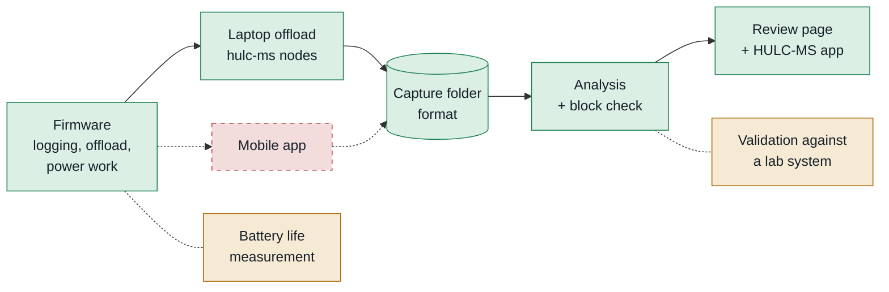

# Handoff — where the project stands and what to do next

For the person taking over the HULC Motion Shirt, both the wearable and the
software. Read this first, then follow the [reading order](#reading-order).
Lines marked **`TODO(handoff)`** are facts that are not in the repository;
whoever is handing over fills them in.

1. [The project in one paragraph](#the-project-in-one-paragraph)
2. [State of things](#state-of-things)
3. [Open work](#open-work)
4. [Your first week](#your-first-week)
5. [Where things live](#where-things-live)
6. [Reading order](#reading-order)

---

## The project in one paragraph

IMU nodes record orientation on the body with nothing connected, and are
offloaded over BLE once they are idle, one **capture folder** per block. The
analysis turns each folder into joint angles, range of motion, a block check
(OK / UNUSABLE) and a review page. Today a laptop does the offload; the plan is a
**mobile app**. The full picture is in the [README](README.md) and
[Technical reference chapter 1](docs/TECHNICAL_REFERENCE.md#1-the-system-and-the-pipeline).

## State of things

Green: built and in use · amber: built, not yet validated · red, dashed: not started.

**Built, and in use**

- Firmware: autonomous logging (~10 Hz moving, ~1 Hz still, nothing in IDLE),
  segment stored on the node, framed and recoverable offload, power work
  (~8.8 mA idle, ~21 mA recording).
- Analysis: clock alignment from motion, automatic freeze / session-end
  detection, calibration, joint angles and ROM, block check, optional OpenSim
  solves.
- Review: the review page with Timeline corrections; the HULC-MS app.
- Delivery: the standalone app for Windows, macOS and Linux (built by CI,
  published on GitHub Releases), pinned requirements for the Python install,
  one `hulc-ms` command.
- Safety net: selftests in CI, and a regression library of real recordings
  (5 cases so far, in `tools/regress_cases/`).
- The hand-over format between acquisition and analysis: the capture folder
  ([Technical reference chapter 2](docs/TECHNICAL_REFERENCE.md#2-the-capture-folder-data-format)),
  checked by `hulc-ms validate`, and the BLE protocol written out for a phone
  ([Technical reference §4.3](docs/TECHNICAL_REFERENCE.md#43-ble-protocol--talking-to-a-node)).

**Built, not yet validated.** See V1–V6 below. In particular, the joint angles
have not been compared against a lab motion-capture system, and battery life
on the current firmware has not been measured.

**Not started.** The mobile app.

## Open work

### The mobile app (replaces `hulc-ms nodes`)

What it must do is in
[Technical reference §9.6](docs/TECHNICAL_REFERENCE.md#96-integrating-the-mobile-app).

| # | Item | Notes |
|---|---|---|
| M1 | Choose the platform (iOS / Android / cross-platform) and its BLE library | needs BLE notifications, reads and writes; iOS and Android centrals are both fast enough for offload |
| M2 | Enroll: assign each board a segment (`0x07`) and show what each node stores | one node powered at a time, as the laptop does today |
| M3 | Offload with framing and range re-requests until complete | port `measure_offload()` / `_missing_ranges()` from `tools/multinode_test.py`; IDLE only |
| M4 | Store each block as a capture folder (`.bin` + `.seg.json`, `montage.json` with subject / session) | keep zero-filled holes at their offsets |
| M5 | Erase a node only after its transfer is verified | the node keeps its log until `0x03` |
| M6 | Subject / session entry, block list, charge reminders | a block lasts until the flash fills: ~2.3 h of continuous movement, longer with rests |
| M7 | Export to the computer at the end of the collection period | a folder tree of capture folders; check with `hulc-ms validate --recursive` |
| M8 | Data protection on the phone (encryption at rest, who can export) | recordings are research data |
| M9 | Test against the regression library | export the library's recordings through the app path and confirm `hulc-ms regress run` still passes |

### Computer side, for the mobile workflow

| # | Item | Notes |
|---|---|---|
| C1 | Import a whole export in one step | works today: drop the top folder on the HULC-MS app (one session per block); a dedicated "import export" view would help at scale |
| C2 | A summary across blocks and subjects (one table: verdict, ROM per joint) | today each block has its own `metrics.json` and review page |
| C3 | Offload / erase buttons in the HULC-MS app | interim convenience until the mobile app exists; today `hulc-ms nodes` in a terminal |

### Validation and open decisions

| # | Item |
|---|---|
| V1 | Motion-capture validation: per-DOF RMSE and Bland–Altman against a lab system |
| V2 | Grow the regression library to 20–30 recordings across people, montages and rooms |
| V3 | Bench-measure battery life on the current firmware (also the write energy of the ~1 Hz STATIC logging and the exact-rate ACTIVE gate: [Technical reference §4.7.1](docs/TECHNICAL_REFERENCE.md#471-landed) items 9–10) |
| V4 | Decide the plane-of-elevation cutoff (10° now, or 20–30°) |
| V5 | Choose the left-arm body model (mirrored shoulder model or Rajagopal), [Technical reference §8.5](docs/TECHNICAL_REFERENCE.md#85-recommendations) |
| V6 | Check offload writing `montage.json` on hardware, and the standalone app on a Mac |

### Firmware

| # | Item |
|---|---|
| F1 | Confirm the clock-offset read latency from a phone central (~tens of ms expected) |
| F2 | Confirm 10 Hz is enough for the movements of interest; if not, raise `activeHz` and re-check alignment |
| F3 | Faster offload if ever needed: ~30% of the measured offload time is the fixed 3 ms `OFFLOAD_PACING_MS`; backpressure already paces it, so it could be reduced |
| F4 | Ground-truth alignment on hardware with a shared physical event (tap all nodes together) |
| F5 | Check the simultaneous-connection ceiling before going past 2–3 nodes |
| F6 | Production build: drop USB/serial; cut the LED jumpers on every node. The rest of the power backlog is in [Technical reference §4.7.2](docs/TECHNICAL_REFERENCE.md#472-backlog--worth-exploring) |

## Your first week

1. **Install.** Download the standalone app from Releases, or clone and
   `pip install -r requirements.txt` (Python 3.11–3.13). Run
   `hulc-ms selftest`: every tool should pass.
2. **Read** [SOP §6](docs/SOP.md#6-recording-a-block) and
   [§7](docs/SOP.md#7-after-the-block) (recording a block and the routine
   after it). Together they are the whole workflow.
3. **Flash a node** ([SOP §3.2](docs/SOP.md#32-flashing-a-node))
   and watch it on the serial monitor: `Advertising as HULC-IMU-XXXX`, then
   state changes as you move it.
4. **Enroll two nodes** (`hulc-ms nodes enroll --segments upper_arm_r,forearm_r`),
   record a short block on yourself following the card, offload it, and drop
   the folder on the HULC-MS app. Read the block check and look at the review
   page.
5. **Run the regression library** against the lab recordings:
   `hulc-ms regress run --data <regression data folder>`. Every case should
   pass. Do this before and after any change to the analysis.
6. **Make a small change end to end:** a branch, a pull request, CI green,
   then a release tag ([Technical reference chapter 9](docs/TECHNICAL_REFERENCE.md#9-changing-the-software-safely)).

## Where things live

| What | Where |
|---|---|
| Code and docs | this repository, `Jamie215/HULC_motionshirt` on GitHub |
| Standalone app builds | GitHub **Releases** (tagged versions); untagged builds on each **app** workflow run's Artifacts |
| CI | `.github/workflows/selftest.yml` (selftests on every push), `app.yml` (standalone builds; a tag publishes a release) |
| Regression cases (expectations) | `tools/regress_cases/*.json`, in git |
| Regression recordings (`.bin`) | **`TODO(handoff)`**: lab drive path. Not in git; point `--data` or `$HULC_REGRESS_DATA` at it |
| Raw recordings from studies | **`TODO(handoff)`**: where they are stored, and who may access them |
| Analyses made with the app | `~/HULC_sessions` on each lab computer |
| Case design (3-D print) | `hardware/HULC_MS_Wearable_Case.stl`, in git ([SOP §2.3](docs/SOP.md#23-case)) |
| Hardware: nodes, chargers, spare boards | **`TODO(handoff)`**: location, how many nodes, which are enrolled to which segment (`nodes_registry.json` on the enrolling laptop) |
| GitHub repository admin / release rights | **`TODO(handoff)`** |
| People: PIs, previous developer, clinical contacts | **`TODO(handoff)`** |

## Reading order

1. This page.
2. [`README.md`](README.md): install and the `hulc-ms` commands.
3. [`docs/SOP.md`](docs/SOP.md): chapters 1–7 now (building, setup, recording,
   the routine after a block); the rest when you review data or something goes wrong.
4. [`docs/TECHNICAL_REFERENCE.md`](docs/TECHNICAL_REFERENCE.md) chapters 1–4 (the
   system, the data format, the montage, the nodes' firmware) and chapter 9
   (changing the software). That is enough to work on either half.
5. The rest of the technical reference (design decisions, clock alignment,
   metrics, the solver comparison) when you change something it covers.
