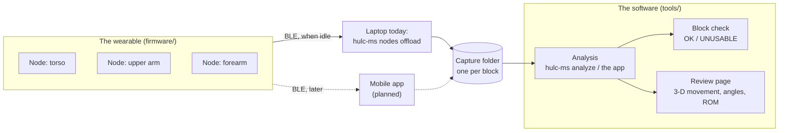
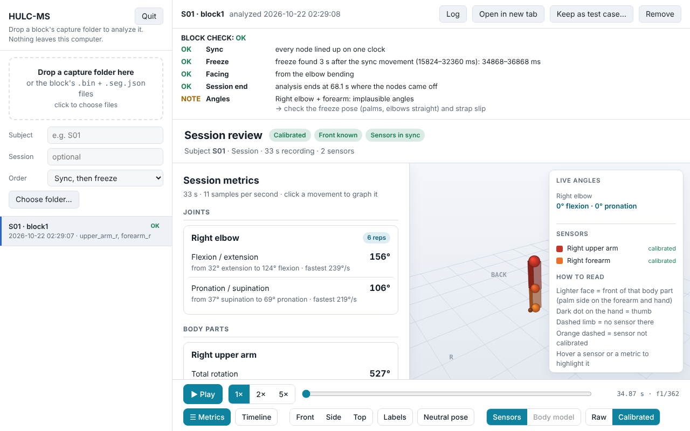

# HULC Motion Shirt

Wearable motion capture for upper-extremity rehab. Small IMU nodes are worn on
the body, one per segment. Each logs its orientation to on-board flash while
the subject moves, then hands the data to a laptop over Bluetooth. An offline
Python pipeline time-aligns the nodes, calibrates them to the body, and turns
the raw quaternions into clinical **joint angles and range of motion**, plus a
self-contained HTML review page of the movement.

The project has two halves that meet at one documented hand-over format, the
**capture folder**:



**Where it is heading:** the nodes will hand their logs to a **mobile app**
that stores every block during a collection period; afterwards the whole
export moves to a computer for analysis. The analysis side is built, and the
mobile app can replace today's laptop offload without changing it.

## Start here

| You want to… | Read |
|---|---|
| use the software: install it, analyze a block, the `hulc-ms` commands | this page, below |
| understand or change how it works: the pipeline and data format, the nodes' firmware and Bluetooth protocol, the math behind every number, the solver comparison, running and fixing an analysis by hand, releasing a build | [`docs/TECHNICAL_REFERENCE.md`](docs/TECHNICAL_REFERENCE.md) |

---

## Analyzing sessions

A session is recorded in **blocks** (mount, collect, offload). Each block is
offloaded into its own capture folder. Analyzing that folder gives a **block
check** (OK / UNUSABLE, and what to change for the next block) and a **review page** (3-D movement,
joint angles, range of motion). There are two ways to do it, and both run the
same analysis.

| | **1. The HULC-MS app** | **2. `hulc-ms` commands** |
|---|---|---|
| For | analyzing and reviewing blocks without a terminal | offloading the nodes, scripting, batches |
| How | drop a block's folder on a page in the browser | `hulc-ms analyze --capture-dir …` in a terminal |
| Get it | the standalone app (no Python), or the repository + Python | the same two installs |

### Getting hulc-ms

**Standalone app, no Python needed.** One program that bundles Python and every
tool, built for each system by CI. Download it from the latest release's
assets on the
**[Releases](https://github.com/Jamie215/HULC_motionshirt/releases/latest)**
page (no GitHub sign-in needed):

- **Windows:** `hulc-ms-windows.zip`. Unzip it into a normal folder (do not run
  it from inside the zip) and double-click `hulc-ms\hulc-ms.exe`. On first
  launch, "Windows protected your PC" appears: choose **More info → Run
  anyway** (the app is not code-signed).
- **macOS:** `hulc-ms-macos.zip`. Unzip it, then the first time open
  `hulc-ms.app` with right-click → **Open**.
- **Linux:** `hulc-ms-linux.tar.gz`. Run `tar xzf hulc-ms-linux.tar.gz`, then
  `hulc-ms/hulc-ms`.

Builds of work not yet released are attached to each CI run of the **app**
workflow (Actions → app → the run → Artifacts; you must be signed in, and they
are kept 30 days). Body-model solves (OpenSim) are not in the standalone app.

**From the repository, with Python 3.11–3.13.** From the repository folder:

```bash
pip install -r requirements.txt              # numpy + bleak (the node commands)
pip install -r requirements-opensense.txt    # optional: + OpenSim body-model solves
```

(`hulc-ms.bat` / `hulc-ms.command` offer to do this the first time they run.)

### The HULC-MS app

To start it, double-click **hulc-ms**: `hulc-ms.exe` / `hulc-ms.app` from the
standalone download, or `hulc-ms.bat` / `hulc-ms.command` in the repository
folder. A browser tab opens at `http://127.0.0.1:8765/`.

1. Type the subject id, then **drop a block's capture folder** on the page (or
   its `.bin` + `.seg.json` files). If you drop several block folders, each
   becomes its own session.
2. Read the **block check** at the top, then the **review page** below it.
3. If the freeze or the end was found in the wrong place, open **Timeline**,
   drag it, and press **Apply**. The block is re-analyzed in place.
4. **Keep as test case…** adds the block to the regression library.
   **Quit** stops the app.



The app runs only on this computer (127.0.0.1). It keeps copies of the dropped
files and every analysis in `~/HULC_sessions` (`--workspace` changes this). The
original files are never modified, and **Remove** deletes a session's copies.

### `hulc-ms` commands

This is the same program, with a command after it. What to type for `hulc-ms`:

| You have | Type `hulc-ms` as |
|---|---|
| Standalone app, Windows | `hulc-ms` in a Command Prompt opened in the hulc-ms folder (it runs `hulc-ms.exe`) |
| Standalone app, macOS / Linux | `hulc-ms.app/Contents/MacOS/hulc-ms` / `hulc-ms/hulc-ms` |
| Repository, Windows | `hulc-ms` in a Command Prompt in the repository folder (it runs `hulc-ms.bat`) |
| Repository, macOS / Linux | `python3 hulc-ms.py` (or `./hulc-ms.command`) |

(In PowerShell, type `.\hulc-ms`.)

| Command | What it does |
|---|---|
| `hulc-ms` (no command) | the HULC-MS app |
| `hulc-ms nodes enroll --segments torso,upper_arm_r` | once per rig: power one node at a time; each node stores its body part |
| `hulc-ms nodes offload --count 2 --out-dir ./capture/block1 --subject S01` | after a block (nodes idle): each node's log + the block's `montage.json` into the folder |
| `hulc-ms analyze --capture-dir ./capture/block1 --outdir ./out/block1` | the analysis: block check printed at the end, review page `out/block1/session.html` |
| `hulc-ms validate --capture-dir ./capture/block1` | check a capture folder against the data format (`--recursive`: a whole export of many blocks) |
| `hulc-ms nodes erase --count 2` | wipe the nodes for the next block |
| `hulc-ms nodes check --count 2` | link check: sync and cross-node clock offset |
| `hulc-ms regress run --data D:/regress_data` | the regression library (before and after any analysis change) |
| `hulc-ms opensense fetch-models` | once, for body-model solves (Python install with OpenSim) |
| `hulc-ms selftest` | every tool's selftest: checks an install or a build |

`hulc-ms <command> --help` lists the options. The `analyze` options you may need:

- `--window t0,t1` / `--end t_ms`: set the freeze / end by hand (the review
  page's Timeline writes these for you)
- `--protocol hold-first`: recordings made before 2026-10
- `--montage FILE`: override the folder's montage
- `--facing-deg`: no torso node and too little elbow bending
- `--no-opensense`

---

## Repository layout

```
README.md                    start here
docs/                        TECHNICAL_REFERENCE.md (how it works, and why)
  img/                       photos, screenshots and figures (make_screenshots.cjs remakes the screenshots)
hardware/                    the 3-D printed case (HULC_MS_Wearable_Case.stl)
hulc-ms.py                   the hulc-ms command (and the standalone app's entry point)
hulc-ms.bat / .command       start the HULC-MS app from the repository; `hulc-ms …` commands
requirements*.txt            pinned dependencies: analysis + nodes, OpenSim, build
firmware/
  firmware.ino               node firmware (state machine + BLE + QSPI log)
  state_machine_test/        stripped-down harness used for the IDLE-reset investigation
tools/                       the analysis code (module by module: docs/TECHNICAL_REFERENCE.md §1.2)
  app.py                     the HULC-MS app (local web page)
  analyze_session.py         hulc-ms analyze: stages 3-7 + the block check
  multinode_test.py          hulc-ms nodes: enroll / offload / erase / check (BLE)
  reconcile_nodes.py         stage 3 - motion-based time alignment
  motion_capabilities.py     stage 4 - montage schema + capability resolver
  calibrate_segments.py      stage 5 - freeze, facing, session end, mounting solve
  metrics.py                 stage 6 - joint angles, ROM, metric tiers
  skeleton_viewer.py         stage 7 - the review page
  opensense_ik.py            optional OpenSense solve (TSM / Rajagopal)
  regress.py                 hulc-ms regress; cases in regress_cases/
  validate_capture.py        hulc-ms validate: check a capture folder
  hulc_paths.py              where the tools write (repository vs standalone app)
  montage.example.json       a filled-in montage to copy
  evaluation/                synthetic-truth studies behind the design
packaging/                   building the standalone app (build_app.py, README.txt)
.github/workflows/           CI: selftest.yml (selftests + library), app.yml (standalone builds)
```

## Data & privacy

Real recordings and per-session generated files (capture folders, `.bin`
logs, `aligned.csv`, every per-session `.json`, generated review pages) are
**git-ignored** by design (see `.gitignore`). Only source, docs, the example
montage and the regression case files (expectations, no recordings) are
tracked. Never commit real recording data. The HULC-MS app keeps its copies
outside the repository (`~/HULC_sessions` by default).
