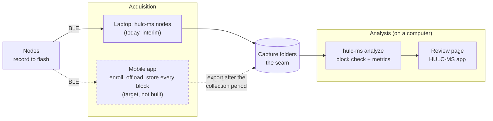
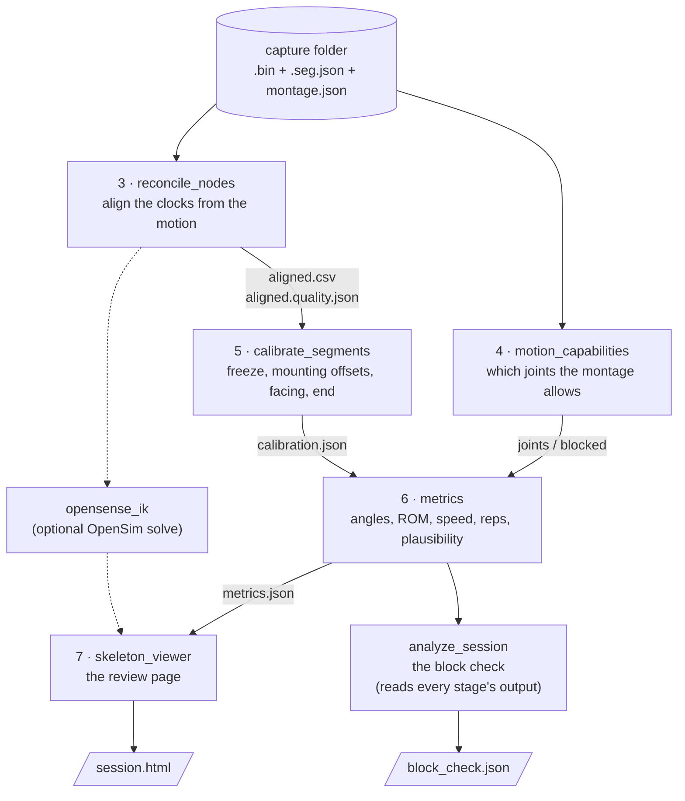
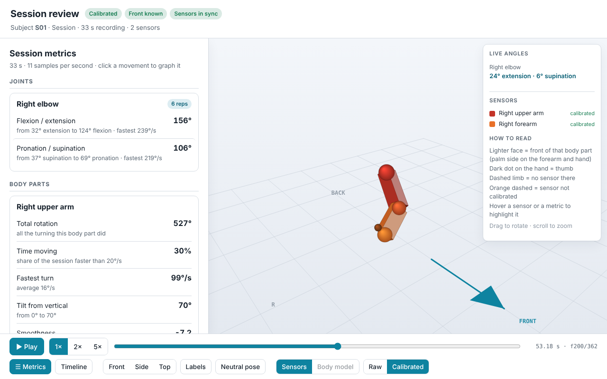
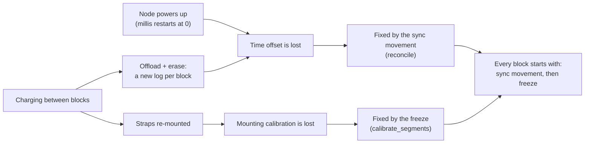
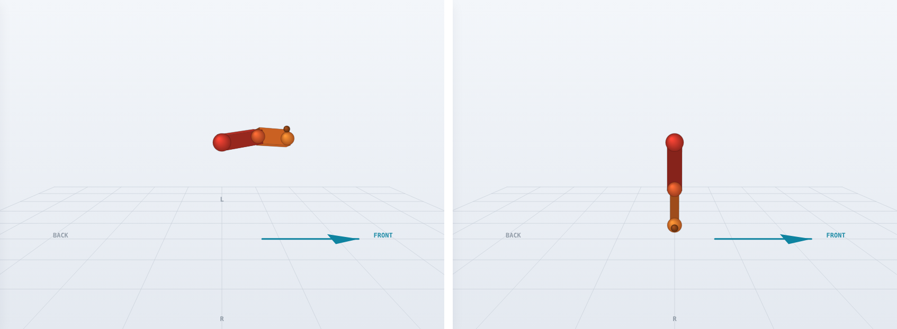
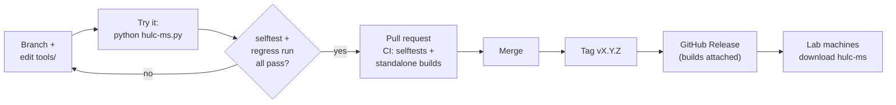

# Analysis — how the software is built and how to change it

The software half of the project: how the parts fit, the capture folder that
hands data from the nodes to the analysis, the montage that says what can be
computed, the design decisions behind calibration, and how to change the code
safely and ship a new build. The math behind each stage (clock alignment,
every metric, the solver comparison) is in [`METHODS.md`](METHODS.md).

1. [The system: today and the target](#1-the-system-today-and-the-target)
2. [The pipeline](#2-the-pipeline)
3. [The capture folder (data format)](#3-the-capture-folder-data-format)
4. [The montage and what it lets you compute](#4-the-montage-and-what-it-lets-you-compute)
5. [Design decisions: identity, time, calibration](#5-design-decisions-identity-time-calibration)
6. [Changing the analysis safely](#6-changing-the-analysis-safely)
7. [Integrating the mobile app](#7-integrating-the-mobile-app)

---

## 1. The system: today and the target



Solid lines exist today; dashed lines are the target.

The **capture folder** (§3) is the seam. Left of it is acquisition, right of
it analysis, and neither side knows the other: the mobile app replaces
`hulc-ms nodes` by writing the same folders, and the analysis, the HULC-MS app
and the regression library work unchanged. A whole export (many blocks, many
subjects) is just a tree of capture folders: `hulc-ms validate --recursive`
checks it, and dropping its top folder on the HULC-MS app analyzes every block.

| Layer | Status | Code | Talks to the next layer through |
|---|---|---|---|
| Firmware | built | `firmware/firmware.ino` | BLE GATT ([`WEARABLE.md` §4](WEARABLE.md#4-ble-protocol--talking-to-a-node)) |
| Acquisition | interim: laptop | `tools/multinode_test.py` (`hulc-ms nodes`) | capture folders |
| Acquisition | **TODO: mobile app** | — | capture folders, exported to the computer |
| Analysis | built | `tools/analyze_session.py` (`hulc-ms analyze`) and the stage modules | the output files (§3.5) |
| Review | built | `tools/skeleton_viewer.py` (review page), `tools/app.py` (HULC-MS app) | — |

---

## 2. The pipeline

Each node records the ORIENTATION of the SEGMENT it is strapped to. A clinical
**joint angle** is the *relative* orientation of two adjacent segments, so what
can be computed depends entirely on where the nodes are placed — the
**montage** (§4). The pipeline makes that dependency explicit and never
fabricates a number a placement can't support.

`hulc-ms analyze` (`tools/analyze_session.py`) runs stages 3–7 in order; the app
runs it for each dropped block. Each stage is a separate module that reads
files and writes files, so it can be run, tested or replaced on its own
(running them by hand: [`RECORDING.md` §5](RECORDING.md#5-blocks-the-charging-checkpoint-and-where-the-analysis-ends)):



| Stage | Module | What it does |
|-------|------|--------------|
| 1–2 Capture & offload | `firmware.ino`, `multinode_test.py` (`hulc-ms nodes`) | Nodes log autonomously; the laptop offloads each node's `.bin` |
| 3 Reconcile | `reconcile_nodes.py` | Decodes the `.bin` logs and time-aligns them onto one timeline **from the motion itself** (cross-correlating world-frame angular-velocity vectors; angular speed as fallback) → `aligned.csv`, plus `aligned.quality.json` (sync confidence, data gaps, clock restarts). Math: [`METHODS.md` Part A](METHODS.md#part-a--clock-alignment) |
| 4 Capability | `motion_capabilities.py` | Segments, joints and the montage schema; reads a capture folder (`capture_logs`, `montage_from_capture`); given the montage, resolves which joints/metrics are valid and which are blocked (and why) |
| 5 Calibrate | `calibrate_segments.py` | Finds the sync movement, the freeze after it and the session end; solves each node's **sensor→segment mounting offset**; estimates the subject's facing (torso node, elbow hinge, or `--facing-deg`) → `calibration.json` |
| 6 Metrics | `metrics.py` | Per-DOF joint angles over the analysis window → range of motion, angular velocity, rep bouts, plausibility flags, plus segment and derived tiers → `metrics.json`. Every metric: [`METHODS.md` Part B](METHODS.md#part-b--metrics) |
| 7 Visualize | `skeleton_viewer.py` | The review page (one self-contained HTML file): the segments as a stickman, Front / Side / Top views, the metrics panel, the Timeline, and a switch to each OpenSense solve |
| (optional) OpenSense | `opensense_ik.py` | The same session solved on a published OpenSim model (Thoracoscapular Shoulder Model, right arm; or Rajagopal 2016), through the same metrics and page; fit-lost frames excluded. Why: [`METHODS.md` Part C](METHODS.md#part-c--choosing-the-pose-solver) |
| Block check | `analyze_session.py` | Runs the stages; OK / REDO per check (sync, freeze, facing, end, trunk, joint limits, …) → `block_check.json` |



Around the stages:

| Module | Role |
|---|---|
| `app.py` | the HULC-MS app: a local web page around `analyze_session.py` |
| `validate_capture.py` | `hulc-ms validate`: checks a capture folder against §3 |
| `regress.py` | `hulc-ms regress`: the regression library of real recordings (§6) |
| `hulc_paths.py` | where the tools write; how one tool starts another (`tool_cmd`) |
| `hulc-ms.py` (repo root) | the `hulc-ms` command; the standalone build's entry point |
| `tools/evaluation/` | synthetic-truth studies behind the design (`timing_bench`, `compare_paths`, `opensense_feasibility`) |

---

## 3. The capture folder (data format)

The **capture folder** is where acquisition hands over to analysis. Whatever
gets the logs off the nodes — today the laptop (`hulc-ms nodes offload`),
later the mobile app — writes one folder per block in this format, and
everything after it (`hulc-ms analyze`, the HULC-MS app, the regression
library) reads only this. Keep to it and the analysis needs no change when the
acquisition side does.

Check a folder, or a whole export of many blocks, before analyzing:

```bash
hulc-ms validate --capture-dir ./capture/block1
hulc-ms validate --capture-dir ./phone_export --recursive
```

### 3.1 One folder per block

A **block** is one mounting of the nodes, from strapping on to taking off
(the [recording card](RECORDING.md#part-1--the-recording-card)). Its folder
holds, for every node:

| File | Required | Content |
|---|---|---|
| `<name>.bin` | yes | the node's log: its 20-byte records, back to back (§3.2) |
| `<name>.seg.json` | yes | the header naming the node and its segment (§3.3) |
| `montage.json` | no | which node is on which segment, plus subject / session ids (§3.4) |

- `<name>` is free (`HULC-IMU-485C`, `export_1`, …), but each `.bin` and its
  `.seg.json` share it. The node is identified by `node_id` in the
  `.seg.json`, not by the file name.
- One file pair per node, at most one node per segment.
- Nothing else in the folder is read. Keep the folder whole: without the
  `.seg.json` files a log does not say what it measured.

**Many blocks** (a collection period's export): any folder tree whose leaf
folders are block folders. `hulc-ms validate --recursive` checks every folder
that holds `.bin` logs; dropping the top folder on the HULC-MS app makes one
session per block folder. A suggested layout:
`<export>/<subject>/<date>_<block>/…`.

### 3.2 The log: `.bin`

Exactly the bytes the node stores after its 4 KB flash header — the log data
region, as offload delivers it — with no header, framing or padding added.

Each record is 20 bytes, little-endian:

| Bytes | Type | Field |
|---|---|---|
| 0–3 | `uint32` | `t_ms`: the node's own `millis()` clock |
| 4–7 | `float32` | quaternion w (real) |
| 8–11 | `float32` | quaternion x |
| 12–15 | `float32` | quaternion y |
| 16–19 | `float32` | quaternion z |

- The quaternion is the BNO086 Rotation Vector: the sensor's orientation in a
  world frame of gravity and magnetic north, the same frame for every node.
- **Clocks are per node.** Each node counts from its own boot; the analysis
  aligns them from the motion itself (the sync movement), so no time sync or
  wall-clock time is needed in the file.
- **Rate:** ~10 records/s while moving, ~1/s while still, none in IDLE.
- **What the loader tolerates** (and `validate` reports): records with
  `t_ms = 0xFFFFFFFF` (erased flash) or a zero / non-finite quaternion are
  dropped, so a transfer hole may be **zero-filled** (keep the offsets, never
  close the gap); trailing bytes that are not a whole record; a constant
  framing shift; a clock restart (a reboot mid-block: only the longest part is
  analyzed).

### 3.3 The header: `.seg.json`

```json
{
  "node_id": "HULC-IMU-485C",
  "segment": "torso",
  "code": 0
}
```

| Field | Required | Meaning |
|---|---|---|
| `node_id` | yes | the node's advertised name, `HULC-IMU-` + the last 4 hex digits of its BLE MAC; stable per board |
| `segment` | yes | one of the segment names below |
| `code` | no | the segment code the node stores (read from the status characteristic, bytes 4–5: [`WEARABLE.md` §4](WEARABLE.md#4-ble-protocol--talking-to-a-node)) |

| Code | Segment | Code | Segment |
|---|---|---|---|
| 0 | `torso` | 4 | `forearm_r` |
| 1 | `upper_arm_l` | 5 | `hand_l` |
| 2 | `upper_arm_r` | 6 | `hand_r` |
| 3 | `forearm_l` | 0xFF | unassigned (not allowed in a capture) |

The table is `motion_capabilities.SEGMENT_CODES`, shared with the firmware;
new segments are only ever appended.

### 3.4 The montage: `montage.json` (optional)

If present it is used as is (`--montage` overrides it; without either, the
analysis builds one from the `.seg.json` files). Write it when there is more to
record than the headers carry — the subject id, the session id, strap
positions. The full format is in §4.2; the minimum:

```json
{
  "schema_version": "1.0",
  "subject": {"id": "S01"},
  "session": {"id": "2026-10-21_block1"},
  "calibration": {"neutral_pose": "N-pose", "captured": true, "protocol": "sync-first"},
  "nodes": [
    {"node_id": "HULC-IMU-485C", "column": "n0", "segment": "torso"},
    {"node_id": "HULC-IMU-B059", "column": "n1", "segment": "upper_arm_r"}
  ]
}
```

### 3.5 What the analysis writes

`hulc-ms analyze --capture-dir … --outdir OUT` (the app writes the same into
`~/HULC_sessions/<session>/out/`):

| File | Content |
|---|---|
| `block_check.json` | the verdict (OK / REDO) and one line per check |
| `session.html` | the review page, self-contained |
| `metrics.json` | per-joint, per-DOF angles: range of motion, speed, reps, plausibility; segment and derived metrics ([`METHODS.md` Part B](METHODS.md#part-b--metrics)) |
| `calibration.json` | the freeze window, mounting offsets, facing, session end |
| `aligned.csv` | all nodes on one timeline: `t_common_ms`, then `n<i>_qw, n<i>_qx, n<i>_qy, n<i>_qz` per node (column order from the montage) |
| `aligned.quality.json` | per node: clock offset, sync confidence, data gaps, clock restarts |
| `montage.json` | only when the montage was built from the headers |
| `opensense/<model>/` | per body-model solve, when OpenSim is installed |

---

## 4. The montage and what it lets you compute

The **montage** is the record of where each node is placed for a session; the
**capability resolver** (`motion_capabilities.py`) maps a montage to the
joints and metrics that can actually be computed from it. Reconcile puts the
nodes on one timeline; the montage says *what body part each aligned stream
is*; the resolver says *what that placement lets you compute*. Every metric
builds against it.

### 4.1 Why a montage is required

A node measures the **orientation of the segment** it is strapped to, not a
joint. A joint angle is the **relative orientation of two adjacent segments'
nodes**:

| Joint | Proximal segment | Distal segment |
|---|---|---|
| shoulder | `torso` | `upper_arm` |
| elbow | `upper_arm` | `forearm` |
| wrist | `forearm` | `hand` |


Each rounded box is a node on a segment; each labelled link is a joint, and
it can be computed only when the nodes at **both** of its ends are worn. The
same chain exists on the left and right sides (`_l` / `_r`); the torso is
shared.

- **A joint needs both of its nodes.** Drop the torso node and you can still
  report how the upper arm moved in space, but you **cannot** separate shoulder
  motion from trunk motion — shoulder ROM becomes non-computable, not
  approximate. The resolver returns it as blocked, naming the missing node.
- **The computable metric set is a function of placement.** Bilateral symmetry
  needs both sides; inter-joint coordination needs ≥2 joints on a limb; trunk
  compensation needs the torso node.
- **Orientation ≠ anatomical angle without calibration** (§5.4).

### 4.2 Schema

`python tools/motion_capabilities.py --example` prints a fillable montage
(`tools/montage.example.json` is a filled-in one).

```json
{
  "schema_version": "1.0",
  "subject":  { "id": "S01", "notes": "" },
  "session":  { "id": "2026-09-04-A", "aligned_csv": "aligned.csv" },
  "calibration": {
    "neutral_pose": "N-pose",
    "captured": true,
    "protocol": "sync-first",
    "functional": []
  },
  "nodes": [
    { "node_id": "HULC-IMU-D067", "column": "n0", "segment": "torso",       "landmark": "sternum",       "calibrated": true },
    { "node_id": "HULC-IMU-A1B2", "column": "n1", "segment": "upper_arm_r", "landmark": "right humerus", "calibrated": true },
    { "node_id": "HULC-IMU-C3D4", "column": "n2", "segment": "forearm_r",   "landmark": "right forearm", "calibrated": false }
  ]
}
```

| Field | Meaning |
|---|---|
| `subject.id` | Person identity. |
| `session.aligned_csv` | The reconcile output this montage annotates. |
| `calibration.neutral_pose` | The static zeroing pose (e.g. `N-pose`). |
| `calibration.captured` | Whether that pose was actually recorded this session. |
| `calibration.protocol` | *Optional.* `sync-first` (default — sync movement, then the freeze) or `hold-first` (recordings made before 2026-10). `--protocol` overrides. |
| `calibration.t_window_ms` | *Optional, normally absent.* A known neutral window `[t0, t1]`; used only if the data there is actually still. Calibration finds the freeze itself, and `--window` overrides both. `[1000, 4000]` — the placeholder `enroll` used to write — is ignored. |
| `calibration.functional` | Optional functional-calibration movements captured (e.g. a known elbow flexion to fix a joint axis). |
| `nodes[].node_id` | The board's advertised id (`HULC-IMU-XXXX`). |
| `nodes[].column` | **The bridge to reconcile output** — the per-node prefix in `aligned.csv` (`n0`, `n1`, …). |
| `nodes[].segment` | One of the canonical segments: `torso`, `upper_arm_l/r`, `forearm_l/r`, `hand_l/r`. One node per segment. **Authoritative** for what the node represents. |
| `nodes[].landmark` | *Optional.* Human label of where the node sits. Descriptive only; checked against `segment` (§4.3). |
| `nodes[].calibrated` | Whether this node has a valid anatomical calibration this session. |

**Hard errors:** an unknown `segment`; two nodes on the same `segment` or the
same `column`; a missing `segment` or `column`.

### 4.3 Landmark vs segment, and node header vs montage

**Landmarks are advisory.** A landmark that *names a segment* (`humerus`,
`forearm`) is checked, and one that disagrees with its `segment` is flagged
as a likely mislabel. A landmark that *names a joint* (`shoulder`, `elbow`,
`wrist`) is ambiguous — a joint spans two segments but a node sits on one
bone — so the resolver keeps `segment` authoritative and emits a note. This is
why **two nodes labelled "wrist" and "elbow" on one arm yield one joint, not
two**: `elbow_l` and `wrist_l` together need three left segments.

**Which source wins.** Each node stores its own segment in its log header
(§5.2). The node header is the **default**: offload writes a
`<node_id>.seg.json` next to each `.bin`, and the block's `montage.json` from
them. `analyze_session` uses, in order: `--montage` if given; else the capture
folder's `montage.json`; else one built from the `.seg.json` files (saved to
the output folder). A montage that is used **is authoritative**; on a mismatch
with a node's header the analysis **warns**, so a swapped node surfaces
instead of silently binding wrong. Labels never change an angle: where on the
segment the strap sat is measured by the freeze calibration.

### 4.4 Joints, DOFs and conventions

The resolver declares capability and the decomposition convention; the angle
math is in `metrics.py` ([`METHODS.md` B2](METHODS.md#b2-the-shared-chain-quaternion--joint-angle)).
Conventions follow the ISB recommendations (Wu et al., 2005).

| Joint | DOFs | Decomposition | Note |
|---|---|---|---|
| shoulder | plane of elevation, elevation, axial rotation | `YXY` | Ball joint, large ROM; gimbal lock near poles. Trunk contaminates without a calibrated torso node. |
| elbow | flex/ext, pronation/supination | `ZXY` | Pro/sup is sensitive to forearm-node roll — calibrate axial zero explicitly. |
| wrist | flex/ext, radial/ulnar deviation | `ZXY` | |

### 4.5 Capability tiers

| Tier | Needs | Examples |
|---|---|---|
| **segment** | 1 node | elevation, angular speed, smoothness, posture dwell |
| **joint** | 2 adjacent nodes | angle series, ROM, joint velocity, rep count |
| **derived** | a set of joints/segments | L/R activity asymmetry (segment pair), L/R ROM symmetry (joint pair), inter-joint coordination, trunk compensation |

**Bilateral activity asymmetry** fires on any L/R segment pair — one node each
side, no joint or torso needed — and answers "which arm is used more". Its
metrics are session aggregates, so they **do not need the two sides
time-aligned**, which matters because two independently moving arms are
exactly what reconcile aligns with low confidence.

Every metric also declares its **quality inputs**, which a UI must show beside
the value: `dropout` (gaps in the aligned stream), `sensor_cal` (the BNO's own
calibration status) and `sync_confidence` (from reconcile).

```bash
python tools/motion_capabilities.py montage.json          # human-readable capability report
python tools/motion_capabilities.py montage.json --json   # machine-readable
python tools/motion_capabilities.py --selftest            # the model + resolver, no montage
```

**Deliberately not done:** no position / endpoint trajectory (orientation-only
sensors; double-integrating acceleration drifts — hand position would need
per-person segment lengths, a modelled estimate).

---

## 5. Design decisions: identity, time, calibration

The reasoning behind stages 3–5, kept so the next change does not undo it.

### 5.1 Anchor facts (from the firmware)

- Nodes log the **full Rotation Vector** (report `0x05`), which is
  **magnetometer-referenced**: every node's orientation is already in a
  **shared world frame** (gravity + magnetic north), not the arbitrary
  per-node heading a Game Rotation Vector would give.
- Each sample is timestamped with the node's free-running **`millis()`**,
  which starts at zero on **power-up**. There is no real-time clock.
- Nodes advertise a unique identity `HULC-IMU-XXXX` (from the BLE MAC).

### 5.2 Node identity: the segment is stored on the node

"Which node is where" (configuration) is kept separate from "how the sensor
sits on the bone" (calibration): they have different lifetimes.

- The segment is a **1-byte code in the log header** (reserved header bytes,
  plus a config-valid tag), not per record and not a string. It survives power
  cycles and erases, is set over BLE with control `0x07` at enroll, and is
  reported on the status characteristic. The enum is
  `motion_capabilities.SEGMENT_CODES`, the one source of truth.
- This makes every **offloaded log self-describing** and removes the
  mislabel-after-offload risk. Offload writes the montage from the headers,
  so the user only confirms it (§4.3).
- *Not built, worth trying:* **auto-assignment** — a scripted "raise your
  right arm" detects which node moved and assigns it.

### 5.3 Time offset vs mounting calibration (the key distinction)

Two quantities are refreshed at the start of a block. They are
**independent** and must not be conflated:

| | Aligns | Invalidated by | Cacheable? | Refreshed how |
|---|---|---|---|---|
| **Time offset** | the nodes' clocks (temporal) | every **power-up** | **No** | the sync movement (cross-correlation in reconcile) |
| **Mounting calibration** | sensor→segment (spatial) | every **re-mount** | **Yes** | the freeze, or reuse-if-verified |

- **Time offset cannot be cached:** `millis()` restarts at zero on boot. Within
  a block it holds (drift is negligible over minutes; long sessions:
  [`METHODS.md` A11](METHODS.md#a11-long-session-drift-tracking-textoffsett-as-a-fitted-curve)).
- **Mounting calibration survives a power cycle** (it is physical) and is
  broken only by re-mounting — so it *can* be cached and verified.
- Charging between blocks trips **both**: the straps come off, and each charge
  is also the offload-and-erase point, so every block starts a fresh log that
  is reconciled and calibrated on its own. That is why the sync movement and
  the freeze are one block-start routine. A node that reboots mid-log is
  caught by reconcile's clock-restart check.



### 5.4 Calibration: the sensor→segment solve

**In plain terms.** A sensor is like a compass strapped to the arm at some
unknown angle: it reports honestly in a fixed world frame, but a crooked strap
means its reading is not yet *about the bone*. The one unknown is that
crookedness — the fixed rotation between sensor and bone. To find it, the
subject holds a pose whose answer we already know (the N-pose: arms down,
palms to the thighs); whatever the sensor reads there *is* the correction.
Subtract it from every later reading and the numbers become anatomical. A
joint angle is then one corrected sensor relative to its neighbour
(upper arm vs torso = shoulder), which reads zero in the freeze pose.

The freeze does three jobs: it **solves the mounting offset**, **sets the
anatomical zero**, and is a **heading co-registration fallback** where the
magnetometer degrades near metal. The pose zeroes each segment, but its axes
stay on the world compass; to tie joint axes to the body (X anterior,
Y superior, Z right) calibration also needs the subject's **facing** — from
the torso node › the elbow hinge axis (needs ≥ 30° of flexion) ›
`--facing-deg` › none — stored as `anatomical_frame` in `calibration.json`.
Joint angles are clinical only when it is present.



What `calibrate_segments.py` implements:

- **Freeze window:** `--window` › the montage's `t_window_ms` *only if the data
  there is still* › auto-detect (the first hold ≥ 3 s, ≤ 0.04 rad/s at its
  quietest, after the sync movement; `hold-first` recordings take the first
  hold of the log).
- **Session end:** no closing pose; the log's final rest in a pose no body
  holds (nodes on the charger) marks the nodes coming off (`find_session_end`;
  `--end` by hand). An earlier version required a closing hold; it could not
  be guaranteed in practice.
- **Gating:** every calibration-dependent metric is gated on
  `calibration.captured` **and** each node's `calibrated` flag; when either is
  false it is still listed but marked **relative-only**, never as a clinical
  number. Uncalibrated segments propagate (an uncalibrated `forearm_r` flags
  both `elbow_r` and `wrist_r`).
- **Cache-and-verify:** `calibration.json` stores the offsets and a
  consistency baseline; `calibrate_segments.py verify` checks a later still
  pose against it — small residual → reuse, over threshold → re-pose. The same
  check catches strap slippage within a session.

**Placement:** the node need not be aligned to anatomy, only placed **the same
way each time** (a fixed tilt *is* the mounting offset and is removed). The
fragile axis is roll *around* the limb, which corrupts pro/supination and
axial rotation — pin it to a consistent flat spot by a bony landmark
([`RECORDING.md`, Where on each segment](RECORDING.md#where-on-each-segment)).

**Cheaper calibration, in order of effort** (1–2 built): (1) fold the pose into
the block-start routine; (2) cache + verify; (3) functional calibration from
ordinary motion (gravity gives vertical, a joint's gyro axis gives the hinge),
removing the deliberate pose; (4) rigid, anatomically shaped pockets in the
garment, so (2) can reuse more often.

---

## 6. Changing the analysis safely

Changes are made in the repository and reach the lab machines as a new
standalone build. The standalone `hulc-ms` app is a frozen copy of this code:
editing files inside it does nothing useful.

### 6.1 Rules that keep it easy to change

- **Files between stages.** Every stage's input and output is a file in a
  documented format, never shared memory, so each is testable and replaceable.
- **One way to start a tool.** A tool that runs another goes through
  `hulc_paths.tool_cmd()`, which works from the repository and inside the
  standalone build alike.
- **The capture folder is the only input.** New acquisition writes capture
  folders; the analysis never talks to hardware.
- **Every change is checked twice:** `hulc-ms selftest` (synthetic data, in
  CI) and `hulc-ms regress run` (real recordings, before and after).

### 6.2 Each change

One-time setup: Python 3.11–3.13, then from the repository folder
`pip install -r requirements.txt` (+ `requirements-opensense.txt` for OpenSim).



1. **Branch**, then edit `tools/`:

   | To change | Edit |
   |---|---|
   | sync / freeze / session-end detection, facing (thresholds are named constants at the top) | `calibrate_segments.py` |
   | joint angles, ROM, reps, plausibility | `metrics.py`; joint definitions and limits in `motion_capabilities.py` |
   | the block check | `analyze_session.py` |
   | the review page | `skeleton_viewer.py` |
   | the HULC-MS app | `app.py` |
   | reading capture folders | `motion_capabilities.py` (`capture_logs`), `reconcile_nodes.py` (`load_log`) |

2. **Try it** without building anything: `python hulc-ms.py` (the app) or
   `python hulc-ms.py analyze --capture-dir … --outdir …`.
3. **Check nothing broke:**
   ```bash
   python hulc-ms.py selftest                                    # synthetic checks, every tool
   python hulc-ms.py regress run --data <lab drive>/regress_data # real recordings: all must pass
   ```
4. **Push the branch and open a pull request.** CI (`.github/workflows/selftest.yml`)
   runs the selftests; `app.yml` builds the standalone app for Windows, macOS
   and Linux (downloadable from the run's Artifacts) so it can be tried before
   merging.
5. **Merge, then tag a version** (`v0.2.0`, …): the builds are attached to a
   GitHub release, and the lab machines download the new `hulc-ms` there.
   (Building locally: `packaging/build_app.py`, with `requirements-build.txt`.)

**When the app or the review page changes,** refresh the screenshots in
`docs/img/`: `node docs/img/make_screenshots.cjs <capture folder>` (needs
Node with Playwright). Any capture folder works; a regression-library case
is a good choice. Check the images for anything identifying before
committing them.

### 6.3 The regression library

Synthetic selftests check the math; they cannot tell whether a change still
handles **real** recordings. `hulc-ms regress` runs the whole pipeline on a
library of real captures and checks each against what a person confirmed once:
where the freeze is, where the session ends, the block-check verdict, the
facing, and plausible ranges.

```bash
# before AND after any change to the analysis — every case must still pass:
hulc-ms regress run --data /path/to/regress_data

# grow the library (or "Keep as test case…" in the app): expectations are
# pre-filled from today's analysis; CHECK them against what really happened,
# edit, and commit tools/regress_cases/<name>.json
hulc-ms regress add 2026-10-07_torso_upper-arm --capture-dir ./capture/block1 --description "..."
```

The case files are in git (`tools/regress_cases/`); the recordings are
**not** — keep them on the lab drive (`<data>/<case name>/*.bin`) and point
`--data` or `$HULC_REGRESS_DATA` at it. Cases without recordings are skipped,
which is also why the library cannot run in CI. When a recording breaks the
analysis, add it as a case first, then fix the code until every case passes.

### 6.4 Changing what the analysis reads or writes

The capture folder (§3) is the contract with the acquisition side. Keep
changes to it backward compatible (the analysis must still read older
folders), update §3 and `validate_capture.py` with the code, and never
renumber segment codes: they are stored on the nodes.

### 6.5 Dependencies

Edit the pin in `requirements.txt` (or `requirements-opensense.txt` /
`requirements-build.txt`) and re-run the selftests and the regression library
on Python 3.11 and 3.13.

---

## 7. Integrating the mobile app

What it has to do to replace `hulc-ms nodes` (protocol:
[`WEARABLE.md` §4](WEARABLE.md#4-ble-protocol--talking-to-a-node); format: §3):

1. Enroll each board once (`0x07` segment code), or read the stored segment.
2. At each charging checkpoint: offload every node (framed notifications,
   range re-requests until complete), and store each block as a capture folder:
   `<node>.bin` (the bytes as received) + `<node>.seg.json`; a `montage.json`
   with the subject id if the app knows it.
3. Erase a node only after its transfer is verified.
4. Export the stored folders to the computer as a tree; check it with
   `hulc-ms validate --recursive`, then analyze (HULC-MS app or
   `hulc-ms analyze`).

The open items (M1–M9) are in [`HANDOFF.md`](../HANDOFF.md#open-work).
