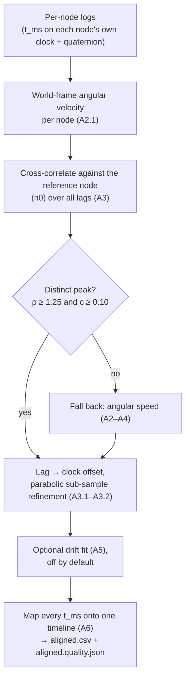

# Methods — the math and the evidence behind the analysis

This is the technical reference for the analysis. It explains how the nodes'
clocks are lined up, how every reported number is computed, and why the joint
angles come from the method they do. Each section starts with the idea in
ordinary words and then gives the precise version, with the equations, so it
can be read for understanding or used to review, reproduce and improve a
method. For how the software is organized and how to change it, see
[`ANALYSIS.md`](ANALYSIS.md).

- **[Part A — Clock alignment](#part-a--clock-alignment):** putting every node
  on one timeline (`tools/reconcile_nodes.py`).
- **[Part B — Metrics](#part-b--metrics):** turning orientations into joint
  angles, range of motion and the other numbers (`tools/metrics.py`).
- **[Part C — Choosing the pose solver](#part-c--choosing-the-pose-solver):**
  our own angle calculation compared with OpenSim's body-model fitting
  (`tools/opensense_ik.py`).

Equations are written in LaTeX (`$…$` inline, ` ```math ` blocks), which
GitHub and most Markdown viewers display as formatted math. Function and
constant names from the code are given in brackets, so you can find the exact
implementation.

**Key terms**

| **Term** | **Meaning** |
|---|---|
| Quaternion | Four numbers $(w, x, y, z)$ that describe an orientation (which way a node points) without the gaps or jumps of three angles. $q$ and $-q$ describe the same orientation |
| World frame | The shared reference every node reports in: "up" from gravity and "north" from the magnetometer |
| Angular velocity / speed | How fast something is turning, and about which axis (velocity); or just how fast, ignoring the axis (speed) |
| Cross-correlation | Sliding one signal along another and scoring how well they match at each shift; the best shift is the delay between them |
| Lag / offset | How far apart two clocks are (ms). Drift is how fast that offset changes, in parts per million (ppm) |
| DOF | Degree of freedom: one direction a joint can move in (e.g. elbow flexion) |
| Euler sequence | A recipe for splitting a 3-D rotation into three angles about named axes in a fixed order. The ISB (International Society of Biomechanics) recommends one per joint |
| ROM | Range of motion: the span between the smallest and largest angle reached |
| RMS | Root-mean-square: a typical size of an error or signal, weighting large values more |
| Neutral pose / freeze | The 5-second still pose at the start of each block (arms down, palms to the thighs) that defines zero |
| IK | Inverse kinematics: finding the body-model pose that best matches the sensors |

---

## Part A — Clock alignment

Each node keeps its own clock, so their timestamps do not agree. Part A
explains how `tools/reconcile_nodes.py` finds the differences between the
clocks from the motion itself, and maps every node onto one shared timeline.
The hardware side of the decision (why this is done afterwards, from the
motion, rather than over Bluetooth) is in
[`WEARABLE.md`](WEARABLE.md#6-multi-node-time-alignment).



### A1. The problem

Every node stamps its samples with its own millisecond counter (`millis()`),
which starts at zero when the node is switched on and ticks on the node's own
crystal. If a real event happens at time $\tau$, node $X$ records it at

```math
t_X(\tau) = \bigl(\tau - \text{boot}_X\bigr)\cdot 1000 \quad[\text{ms since node } X \text{ booted}]
```

where $\text{boot}_X$ is when node $X$ was switched on. Two nodes therefore
disagree in two ways:

1. **Offset.** They were switched on at different times
   ($\text{boot}_A \neq \text{boot}_B$), so their clocks start from different
   points.
2. **Drift (skew).** Their crystals tick at slightly different rates (tens of
   ppm), so the offset slowly changes over time.

"Reconciling" means finding, for each node $B$, how to convert its timestamps
onto the clock of the reference node $A$ (the first node):

```math
t_{\text{on }A} = t_B + \text{offset} + \text{drift}\cdot\bigl(t_B - t_{B,0}\bigr) \quad (1)
```

The offset (ms) and the drift (a rate, reported in ppm) are the two numbers to
estimate. This two-number clock model is the standard one used by network
time protocols such as NTP and PTP.

Because the nodes are wireless and analysis happens afterwards, both numbers
are recovered **from the recorded motion itself**, which makes them
independent of Bluetooth delays ([`WEARABLE.md` §6](WEARABLE.md#6-multi-node-time-alignment)).

---

> **The default method is the one in §A2.1.** Sections A2–A4 first describe
> the original method, which matches the nodes' angular *speed*; it is still
> the fallback (`--sync speed`). The default (`--sync vector`) matches the
> full angular-velocity *vector* instead. Both share the offset and drift
> steps (§A3.1, §A3.2, §A5, §A6).

### A2. The motion feature: angular speed (mounting-invariant)

To compare two nodes' motion, we need a signal that looks the same on both
even though each node is strapped on at a different, unknown angle. Raw
orientations fail this test. **How fast a segment is turning** passes it: a
rigid body turns at one rate, wherever on it a sensor sits and however it is
tilted.

Each node logs unit quaternions $q_i$. The rotation between two consecutive
orientations $q_i$ and $q_{i+1}$ has the angle

```math
\theta_i = 2\,\arccos\!\bigl(\lvert\, q_i \cdot q_{i+1}\,\rvert\bigr) \quad (2)
```

Here $q_i \cdot q_{i+1}$ is the quaternion dot product, and the absolute value
picks the shorter way round (since $q$ and $-q$ are the same orientation).
Dividing by the time between the samples gives the angular speed:

```math
\omega_i = \frac{\theta_i}{\Delta t_i}, \qquad \Delta t_i = \frac{t_{i+1}-t_i}{1000} \quad (3)
```

Angular velocity is a property of the whole rigid body, so its size
$\lvert\omega\rvert$ is the same whichever way each sensor is mounted. Two
sensors that move together therefore produce matching angular-speed signals,
even though their raw quaternions differ [`angular_speed()`].

#### A2.1 The default feature: world-frame angular-velocity vectors

Speed throws away the axis of rotation. Because every node reports in the
**same** world frame (gravity and magnetic north), we can keep the axis too:
two nodes that move together then show the same angular-velocity *vector*,
direction included, which makes the match much sharper.

The rotation from one sample to the next is $\Delta q_i$, defined by
$q_{i+1} = \Delta q_i \otimes q_i$ ($\otimes$ is quaternion multiplication and
$q^{*}$ the inverse rotation). Its axis $\hat{\mathbf u}$ and angle give the
angular velocity in the world frame:

```math
\Delta q_i = q_{i+1} \otimes q_i^{*}, \qquad
\boldsymbol\omega_i = \hat{\mathbf u}(\Delta q_i)\,\frac{2\arccos\lvert\Delta q_{i,w}\rvert}{\Delta t_i} \quad (3')
```

[`world_angular_velocity`]. Each of the three components is resampled to a
regular time grid, and the three cross-correlations (§A3) are added up, which
is the same as correlating the vectors with a dot product,
$\sum_k \boldsymbol\omega_A(k)\cdot\boldsymbol\omega_B(k+\ell)$. The best lag
is found as in §A3, with the same refinement (§A3.2).

**When is the match trusted?** Nodes on different segments (say torso and
arm) mostly move on their own, so the overall match score $c$ (the
normalized correlation: the summed dot products divided by the size of both
signals) stays low, even when one shared sync movement pins down the lag
exactly. What matters is whether the best peak **stands out**. The result is
accepted when the best peak is at least 1.25 times the highest peak more
than 0.5 s away, and $c$ is at least 0.10:

```math
\rho = \frac{C(\hat\ell)}{\max_{\lvert \ell - \hat\ell\rvert > 0.5\,\text{s}} C(\ell)} \ \ge\ 1.25
\quad\text{and}\quad c \ge 0.10 \quad (9')
```

[`VECTOR_PEAK_RATIO_MIN`, `VECTOR_PEAK_EXCLUDE_S`, `VECTOR_CONFIDENCE_MIN`]. If
either test fails, the aligner falls back to the speed method of §§A2–A4. The
method used and the peak ratio $\rho$ are saved in `aligned.quality.json` as
`sync_method` and `sync_peak_ratio`. On synthetic torso + upper-arm sessions
(`timing_bench.py`), the vector method matched the accuracy of perfectly
synchronized clocks, where the speed method failed.

---

### A3. Estimating the offset by cross-correlation

To find how far apart two clocks are, slide one node's motion signal along the
other's and find the shift where they line up best. That shift is the delay
between the clocks.

The two signals are sampled at slightly different, uneven times, so each is
first resampled onto a regular grid at $f_s$ (100 Hz by default), in time
measured from each node's own first sample ($t - t_0$). This gives the
sequences $a[n]$ (node $A$) and $b[n]$ (node $B$), plus each node's first
timestamp, $A_0$ and $B_0$ [`resample_uniform()`].

The match at each shift $k$ is the **cross-correlation**, the standard way to
estimate a time delay: subtract each signal's mean, multiply them sample by
sample at that shift, and add up.

```math
C[k] = \sum_n \bigl(a[n]-\bar a\bigr)\,\bigl(b[n-k]-\bar b\bigr) \quad (4)
```

The best shift $\hat k$ is the one with the largest score, and converting it
to seconds gives the lag $L$:

```math
\hat k = \arg\max_k C[k], \qquad L = \frac{\hat k}{f_s}\ \ [\text{s}] \quad (5)
```

A positive $L$ means $a$ lags behind $b$. The correlation is computed with the
FFT, which keeps it fast on long recordings [`_xcorr_full()`,
`best_lag_seconds()`, `lag_and_confidence()`].

#### A3.1 From relative-time lag to an absolute clock offset

The lag $L$ was measured on signals that each start at their own node's first
sample, so it is not yet the clock offset: the difference between the two
start times has to be added back. The two signals match when they sample the
same real motion, that is, for every $s$:

```math
\text{boot}_A + \frac{A_0 + s}{1000} \;=\; \text{boot}_B + \frac{B_0 + s - 1000L}{1000}
\quad \forall s
```

The $s$ terms cancel (the offset is constant when there is no drift), which
leaves

```math
\bigl(\text{boot}_B - \text{boot}_A\bigr)\cdot 1000 \;=\; (A_0 - B_0) + 1000L
```

The left side is exactly the offset that converts $B$'s timestamps onto $A$'s
clock ($t_A = t_B + \text{offset}$). So:

```math
\boxed{\ \text{offset} = (A_0 - B_0) + 1000L \quad[\text{ms}]\ } \quad (6)
```

The first term is bookkeeping (it puts back the different start times); the
second, $L$, is what was actually measured from the shared motion. Working
directly in absolute timestamps would give the same answer; the code uses
relative time only for numerical convenience [`estimate_offset_drift()`].

#### A3.2 Sub-sample refinement (parabolic interpolation)

The scores $C[k]$ exist only at whole-sample shifts, 10 ms apart at 100 Hz,
but the true best shift usually falls between two of them. Near its top, any
smooth peak is shaped like a parabola, so we fit one through the best score
and its two neighbours, $y_{-1}, y_0, y_{+1}$
($= C[\hat k -1], C[\hat k], C[\hat k +1]$), and take its highest point:

```math
\delta = \tfrac{1}{2}\,\frac{y_{-1}-y_{+1}}{\,y_{-1}-2y_0+y_{+1}\,}, \qquad \delta\in[-\tfrac12,\tfrac12] \quad (7)
```

```math
L = \frac{\hat k + \delta}{f_s}
```

This standard signal-processing step (also used to find spectral peaks and
pitch) improves the lag resolution from about 10 ms to about 1 ms.

---

### A4. Confidence — was there real shared motion?

Taking the largest score always produces *some* answer, even for two signals
that have nothing in common. So the result also gets a confidence: how well
the two signals agree once they are lined up at the best shift. This is the
**Pearson correlation** of the overlapping parts:

```math
r = \mathrm{corr}\bigl(a_{\text{overlap}},\, b_{\text{overlap}}\bigr)\ \text{at lag }\hat k, \qquad r\in[-1,1] \quad (8)
```

Pearson correlation divides out each signal's size, so it scores whether the
two signals have the same *shape*: a node that swings more or less than the
other still scores high if they moved *together*. The offset is accepted
only when

```math
r \ge r_{\min} \quad (r_{\min} = 0.40) \quad (9)
```

Below that, the offset is reported as unreliable: reconcile prints a
low-confidence warning, `aligned.quality.json` records it, and the block check
says REDO with a bigger sync movement [`_pearson_at_lag()`, `CONFIDENCE_MIN`].

This is the method's main limitation. Cross-correlation needs **shared
motion**: two nodes on limbs that move independently (one arm swinging, the
other still) have nothing to lock onto, and $r$ correctly drops towards 0.
That is why every block starts with a sync movement that moves every node
([`WEARABLE.md` §6](WEARABLE.md#6-multi-node-time-alignment)).

---

### A5. Drift (clock skew) estimation

Over a recording of a few minutes, two crystals drift apart by only a few
milliseconds. That is smaller than the measurement noise and well inside the
25–50 ms target, so estimating it would add noise rather than remove error.
Drift is therefore **off by default** and can be switched on for long
recordings.

When it is on, the lag is measured separately in $K$ windows spread over the
recording, giving pairs $(t_j, L_j)$, and a straight line $L = m\,t + c$ is
fitted through them by least squares. The slope $m$ is the drift. It is used
only if it is both statistically real (more than three times its standard
error) and big enough to matter (it moves the offset by more than
$\varepsilon_{\min}$ = 15 ms across the recording, [`DRIFT_RESOLVE_MS`]):

```math
\lvert m\rvert > 3\,\mathrm{SE}(m) \quad\text{AND}\quad \lvert m\rvert\cdot\bigl(t_{\text{last}}-t_{\text{first}}\bigr) > \varepsilon_{\min}\ (=15\text{ ms}) \quad (10)
```

Otherwise the drift is set to 0. It is reported as `drift_ppm` $= m\times 10^6$
[`_windowed_lags()`, `_lsq_slope()`].

Two safeguards keep the window measurements honest [`_aligned_overlap`,
`_windowed_lags`]:

- The windows are placed over the time **both** nodes cover, after applying
  the overall offset, so window $j$ of $A$ and of $B$ cover the same real
  time.
- A window is used only if the two nodes share motion in it (correlation of at
  least $r_{\min}$). In a window where one node sits still, the "best" lag is
  meaningless. Without this check, a line fitted through such windows once
  reported a false drift of $+15.9$ s on a real recording.

Fewer than 3 usable windows means no drift is estimated.

---

### A6. Applying the mapping and emitting aligned streams

With the offset (and the drift, if used), each node's timestamps are converted
onto the reference clock with Eq. (1) [`to_A_clock()`]. A common, regular time
grid is then laid over the stretch that every node covers, and each node's
orientation is estimated at each grid time by blending the two nearest samples
(normalized linear interpolation, "nlerp"):

```math
q(t) = \mathrm{normalize}\!\bigl((1-f)\,q_0 + f\,q_1\bigr), \qquad f = \frac{t - t_0}{t_1 - t_0} \quad (11)
```

If $q_0\cdot q_1 < 0$, one of them is flipped first so the blend takes the
shorter way round. For human movement at 10 Hz this is accurate enough; true
spherical interpolation (SLERP) could be substituted. The result is a CSV with
one `t_common_ms` column and each node's $q_w,q_x,q_y,q_z$, ready for the
next stage [`nlerp()`, `align_and_emit()`].

---

### A7. Validation

`reconcile_nodes.py --selftest` builds two synthetic nodes from the same
random motion, with a **known** offset and drift added, different mounting
angles, sensor noise and timing jitter, and checks that:

- the recovered offset is close to the true one (target: within about
  25–50 ms), and
- a **negative control** works: a second node given *independent* motion
  comes back with low confidence and is flagged.

Current result: the offset is recovered to about 15–18 ms; confidence is
$r\approx 0.93$ with shared motion and $r\approx 0.07$ with independent
motion. This shows the *math* works on synthetic data; it is **not** a check
against real hardware timing (§A9).

---

### A8. Known limitations

- **Shared motion is required** (§A4). Without it, the sync movement at the
  start of the block is what makes alignment possible.
- **The clock model is a straight line** (Eq. 1). That holds over minutes. A
  long session in which temperature changes the crystals could need the offset
  to be re-estimated piece by piece; §A11 describes how a full-day recording
  would be handled.
- **Gaps in the logs** weaken the correlation and enlarge the leftover error
  (seen on real recordings with intermittent logging).
- **Clock restarts.** A node that reboots mid-log (a flat battery) starts its
  counter again at 0, so one log holds two unrelated clocks. The loader splits
  the log at any backward jump of more than 1 s [`CLOCK_RESET_MS`], keeps the
  longest piece, warns, and records `clock_restarts` in the quality file; the
  other pieces are not analyzed. Offloading at every charge (one block per
  log) avoids this.
- **The speed fallback ignores direction.** Two movements with the same speed
  over time but different axes look identical to it. The default vector
  method (§A2.1) keeps the axis.

---

### A9. Algorithm / Technique Justification

The method combines **standard techniques**:

- **Cross-correlation to estimate a time delay**, the core of the method. The
  classic reference is Knapp & Carter, *"The Generalized Correlation Method
  for Estimation of Time Delay,"* IEEE Trans. ASSP, 1976 (the basis of GCC and
  GCC-PHAT).
- **Aligning unsynchronized sensors through a shared signal**, as is standard
  for synchronizing multiple cameras, motion-capture systems, audio tracks and
  multiple IMUs (by cross-correlating a common motion feature such as rotation
  rate).
- **An offset plus a linear drift** as the clock model, as in NTP, PTP and
  sensor networks.
- **Parabolic peak interpolation**, a textbook way to estimate a peak between
  samples.

**Status:** the implementation has **not** yet been benchmarked against
hardware ground truth.

---

### A10. Upgrades for a rigorous / publishable result

1. **Measure the real error.** Wire a shared electrical sync pulse to an
   input pin on every node, timestamp it with `millis()`, and report the
   actual alignment error in milliseconds instead of a confidence score.
2. **GCC-PHAT.** Whiten the cross-spectrum before the inverse FFT. This gives
   a much sharper and more robust delay peak when there is noise or there are
   gaps.
3. **Robust fitting.** Use RANSAC or weighted least squares for the offset and
   drift, so that dropouts cannot pull the estimate off.
4. **Richer feature.** Correlating the full angular-velocity vector rather
   than only its size, to remove the direction ambiguity of §A8. This is now
   the default (§A2.1).

---

### A11. Long-session drift tracking: $\text{offset}(t)$ as a fitted curve

The single straight line of §A5 (one offset and one drift for the whole
recording) assumes the clocks drift apart at a **constant** rate. That holds
for a recording of minutes at a stable temperature. It does **not** hold for a
full day of wear, when body and room temperature change the crystals' rates
during the day (§A8). This section describes the model for that long case,
and clears up two ways the names "offset" and "drift" can mislead.

#### A11.1 The model: one curve, sampled by events

There is one underlying curve: the true clock difference between nodes $B$ and
$A$ at every moment, and its slope.

```math
\text{offset}(t) \quad [\text{ms}], \qquad \text{drift}(t) = \frac{d\,\text{offset}}{dt}
```

Every moment of shared motion (the sync movement at the start of a block, or
everyday movement during the day, §A11.2) gives one **noisy measurement** of
this curve. Cross-correlating the two nodes' motion around the event (vector,
or speed as the fallback) gives one point $\bigl(t_j,\
\widehat{\text{offset}}_j\bigr)$ through Eq. (6), with a confidence $r_j$
(Eq. 8). Reconciliation **rebuilds the curve** by fitting or interpolating
through these points.

The names can hide two things:

- **Each offset measurement stands on its own.** Every event measures
  $\text{offset}(t_j)$ directly. You never add event $j{+}1$'s offset onto
  event $j$'s; that would count it twice. Error only builds up *between*
  measurements, when the curve has to be extended forward
  ($\approx \text{drift}\times\Delta t$): it is the cost of a gap, not part of
  the model.
- **Drift is the slope, not a separate measurement.** It can only be seen once
  measurements are spread out in time. That is why the sync movement (a few
  seconds) gives a good offset but a poor drift: the time span is too short to
  rise above the noise [`DRIFT_RESOLVE_MS`, Eq. 10]. One event's offset is
  noisy too, so the right approach is neither "trust it for $N$ minutes, then
  jump to the next one" (which makes the curve jump and throws away good
  measurements) nor ignoring the earlier estimate: the measurements are
  **combined** (§A11.2).

#### A11.2 Getting the anchors, and combining them over time

**Where the measurements come from.** They do not have to be deliberate. Over
a day of wear the body produces many **shared** movements (standing up,
starting to walk, turning), each giving a new
$\bigl(t_j, \widehat{\text{offset}}_j\bigr)$ through the same steps, with the
confidence test (Eq. 9) deciding which pairs of nodes it is valid for.
Sudden one-off movements (sit-to-stand, turns) are best. Repetitive movement
(steady walking) matches equally well at several shifts (§A3, §A4) and pins
the offset poorly even when shared. An event only re-anchors the nodes that
moved together, and different events cover different nodes, so over a day
this evens out. A node that stays still for a long time is not re-anchored,
but its signal is flat then, so a small misalignment does no harm, and its
next movement is itself a new anchor.

**How the measurements are combined.** No fixed "valid for" time is needed.
An old measurement stays useful while the error from extending it stays
within budget. That depends on how fast the drift itself wanders
(temperature changes, the *process noise*) compared with how precisely one
event pins down the offset (the *measurement noise*). Two standard methods
track offset and drift together as a running estimate instead of switching on
a timer:

- **Sliding-window least squares.** Fit a line through the recent
  $\bigl(t_j, \widehat{\text{offset}}_j\bigr)$ points within a window $W$:
  long enough for a reliable slope, short enough that the drift is roughly
  constant inside it.
- **Kalman filter.** Between events, predict
  ($\text{offset}\mathrel{+}= \text{drift}\cdot\Delta t$, with the drift
  allowed to wander slowly and the uncertainty growing); at each event, move
  the estimate towards the measurement by an amount set by their relative
  confidence. Old information fades gradually instead of being dropped, and
  the process-noise setting controls how fast.

Either way, a new event neither replaces the earlier estimate nor adds to it;
it pulls the estimate *partway* towards itself. The drift only changes with
temperature, so events need not be frequent.

**Afterwards, most of this does not matter.** "How long is an old value
good for?" is a real-time question, when only the past is available. This
pipeline works afterwards, with the whole log available at reconcile time, so
almost every moment has measurements **on both sides**. The offset at time
$t$ is then found by **interpolating between the measurements on either
side**, rather than extending an old one forward, and the error is much
smaller. Extending forward is only needed at the very start and end of the
log, or inside a gap with measurements on one side only.

#### A11.3 Where the code is, and the upgrade path

`reconcile_nodes.py` currently fits the **single straight line** of §A5, the
simplest version, which is correct for a recording of minutes at a stable
temperature. Supporting full-day recordings means replacing that line with
the **sliding-window fit or Kalman filter** of §A11.2, started from the sync
movement and fed by everyday movements, and then reading the offset by
interpolation. The per-event measurement, the confidence test and the
window measurements all exist already [`lag_and_confidence()`,
`_windowed_lags()`, `_pearson_at_lag()`]. What is new is keeping offset and
drift as a **running estimate over the whole log** instead of two fixed
numbers. Robust fitting (§A10, item 3) and GCC-PHAT (§A10, item 2) fit in
directly: they sharpen the individual measurements and reduce the weight of
bad ones.

---

## Part B — Metrics

Part B explains every number the analysis reports in `metrics.json`: what it
means, how it is computed, its units, whether it needs the calibration, and
the field it is stored in. The computation is in `metrics.py`; this part is a
readable guide to it.

- **Which** metrics appear for a recording depends on where the nodes were
  placed: you only get what the montage supports. The rules are in
  `motion_capabilities.py`, described in [`ANALYSIS.md` §4.5](ANALYSIS.md#45-capability-tiers).
- **How** each one is computed is explained here, and in the docstring of the
  named function in `metrics.py`.

### B1. The honesty contract (read this first)

A few rules apply to every number, so that a doubtful value is never
presented as a solid one.

- **Missing is reported as missing, never guessed.** A joint needs a node on
  both of its segments. If one is missing, the joint is listed in
  `blocked_joints` with the missing node named, instead of a guessed angle.
- **Uncalibrated means "relative only".** A joint or segment whose nodes were
  not calibrated still gets numbers, but they are marked `clinical: false`.
  Its zero is then "the pose during the freeze", not the anatomical zero. The
  same applies when the subject's facing could not be worked out
  (`anatomical_axes: false` at the top of the file): without it the angle
  names (flexion, abduction…) need not match the actual movement. On the
  review page these rows are dimmed in the raw view. Calibration is what
  turns a sensor's orientation into an *anatomical* angle
  ([`ANALYSIS.md` §5.4](ANALYSIS.md#54-calibration-the-sensorsegment-solve)).
- **Angles are unwrapped before measuring a range.** Angles wrap around at
  ±180°, so a real sweep through 180° would otherwise look like a jump of
  nearly 360°. The angle series is unwrapped first (`np.unwrap`), so the range
  reflects the real movement, and then shifted by whole turns so its median
  sits within ±180° (unwrapping never moves the zero). Some movements have
  stretches where they are undefined (the plane of elevation, when the arm
  hangs at the side). Those are unwrapped only within each defined stretch,
  each stretch re-centred on its own [`unwrap_runs_deg`]. Inside an undefined
  stretch the value is arbitrary, and unwrapping through it once added fake
  full turns (a real session read a range of 1023°).
- **Implausible values are flagged.** Every movement gets a plausibility check
  (§B3): a range of more than a full turn, sample-to-sample jumps larger than
  `JUMP_MAX_DEG`, or (when the anatomical axes are known) more than 2% of
  samples outside physiological limits. A failing joint gets a
  `plausibility_warning` naming the likely causes (the calibration pose, the
  facing, a slipped sensor) instead of a silent number.
- **Only the protocol is analyzed.** By default the data is cut to the
  *analysis window*: from the freeze to where the nodes come off, both found in
  stage 5 [`trim_to_analysis`]. Strapping on, the sync movement, and taking the
  nodes off never count towards range of motion, repetitions or activity.
  Nothing is cut unless the calibration's freeze comes from this same
  recording (a calibration reused from another recording cuts nothing). If
  the nodes are not seen coming off, the end of the log stays in and the run
  says so. `--keep-pre-neutral` analyzes the whole recording.

The trust indicators from clock alignment (`sync_confidence`, gaps) are **not**
recalculated here. They travel with these numbers and should be shown
alongside them (`gates_note` in the output says so).

---

### B2. The shared chain: quaternion → joint angle

A joint angle describes how one segment is turned relative to its neighbour,
in the body's own directions (forward, up, right), split into the movements
clinicians name (flexion, abduction, rotation). Every joint metric gets there
in the same steps [`compute_joint_metrics`; `metrics.py` module docstring]:

```
q_seg(t) = q_WS(t) ⊗ q_SB                     apply the cached mounting offset (stage 5)
q_rel(t) = conj(q_seg_prox) ⊗ q_seg_dist      distal relative to proximal
q_anat   = conj(q_WA) ⊗ q_rel ⊗ q_WA          re-express in anatomical axes
(α,β,γ)  = euler(q_anat, sequence)            decompose in the joint's ISB/Wu sequence
angle_dof = (α|β|γ)[seq_index]                pick the slot that IS this clinical DOF
```

In words:

1. **Correct each sensor for how it sits on the bone.** `q_WS` is the sensor's
   orientation in the world; `q_SB` is the sensor-to-bone mounting offset from
   `calibration.json`. Without calibration `q_SB` is "no correction", and the
   joint is marked `clinical: false`.
2. **Take the outer segment relative to the inner one** (e.g. forearm relative
   to upper arm for the elbow). This removes the motion they share.
3. **Turn that rotation into the body's own axes.** `q_WA` is the anatomical
   frame at the freeze, from the `anatomical_frame` block of
   `calibration.json`: X = forward, Y = up (along a hanging limb), Z = X × Y =
   the subject's right. It is built from gravity plus the subject's facing,
   taken from the torso node's heading, else from the elbow's hinge axis (the
   facing that makes elbow movement a pure hinge,
   `estimate_facing_from_elbow`), else from `--facing-deg`. This step is
   needed because calibration zeroes each segment but leaves its axes pointing
   along the world compass (Z = up), while the ISB recipes assume body axes.
   Without it, a pure elbow bend would land in whichever angle the facing
   happened to put it. If the facing is not known with confidence, there is no
   `q_WA` and the joint is `clinical: false`.
4. **Split the rotation into three angles** using the joint's ISB Euler
   sequence, and keep the one that corresponds to each clinical movement.

Some details:

- **The wrist uses the hand's own neutral frame.** In the freeze the palms face
  the thighs, which is the hand turned 90° about the forearm's long axis
  [`NEUTRAL_FOREARM_DEG`] from the palms-forward position that the wrist's
  `ZXY` recipe assumes. Wrist rotations are therefore turned by that angle
  about Y before the split [`joint_frame_deg`/`joint_frame_quat`], so wrist
  flexion reads as flexion and not as radial/ulnar deviation. The elbow and
  shoulder are unaffected.
- **Left and right read the same way.** One frame serves both sides, so for a
  **left** joint the rotation is mirrored left-to-right before the split
  (`mirror_left`: `[w,x,y,z] → [w,−x,−y,z]`). A left joint then splits exactly
  like a right one, and every movement has the same clinical sign on both
  sides:

  | Joint | DOF | Positive = |
  |---|---|---|
  | elbow | `flex_ext` | flexion |
  | elbow | `pro_sup` | pronation |
  | wrist | `flex_ext` | flexion |
  | wrist | `rad_uln` | ulnar deviation |
  | shoulder | `plane_elev` | 0° abduction plane, +90° forward flexion, −90° extension |
  | shoulder | `elevation` | raised (always ≥ 0) |
  | shoulder | `axial_rot` | internal rotation |
- **The anatomy is defined once.** The Euler `sequence` and the position
  (`seq_index`) of each clinical movement come from
  `motion_capabilities.JOINTS`, the single body model. This tool never
  redefines anatomy or invents a convention.
- **Zero means the freeze pose.** Calibration makes the relative rotation zero
  in the freeze, so a calibrated angle is measured from anatomical zero.

**Singularity guard.** Every way of splitting a rotation into three angles has
a pose where two of its axes line up and two of the angles stop being
separately defined (the well-known "gimbal lock"). For a sequence like `YXY`
this happens when the middle angle is near 0 or 180° (for the shoulder: arm
hanging at the side); for one like `ZXY`, when the middle angle is near ±90°.
Within 10° of that pose [`SINGULARITY_GUARD_DEG`], the two affected angles are
marked undefined for those samples, so a joint resting there never reports a
fake 180° swing or an infinite speed. The shoulder's axial rotation is the
exception: it is reported as the *sum* of the two outer angles, which stays
well defined with the arm at the side, so only `plane_elev` is masked there
(both are masked with the arm overhead, where the sum is the undefined part).
Affected movements carry `defined_frac` (the share of samples that were well
defined) and a `singularity_note`, and their series hold `NaN` at the masked
samples, so every later step skips them the same way.

What the chain produces for one joint, as the review page graphs it (right
elbow flexion over a block of six bends, the freeze shaded at the start, the
session's max and min marked):


---

### B3. Joint-tier metrics

These are reported for each joint the montage supports, in `joints[]`. Each
joint has `key`, `name`, `clinical`, `decomposition` (the Euler sequence),
`dofs[]` (one entry per movement) and `reps`.

| Metric | What it tells you | Field | How it is computed | Units | Needs calibration? |
|---|---|---|---|---|---|
| **Per-DOF angle** | The joint angle over time, per movement; everything below is built from it | `dofs[].` (series) | Euler split of the relative rotation in the joint's sequence, unwrapped in radians before converting (§B2) | ° | For an *anatomical* zero, yes; the shape is valid without |
| **Range of motion** | The smallest, largest and middle angle reached, and the span between them | `dofs[].rom` = `{min_deg,max_deg,range_deg,median_deg}` | `range = max − min` over the unwrapped angle [`_rom`/`_stats`]. `null` if the movement is undefined for the whole session | ° | Needed for a *clinical* ROM; relative only when `clinical:false` |
| **Angular velocity** | How fast the joint moved | `dofs[].velocity` = `{peak_deg_s,mean_abs_deg_s,rms_deg_s}` | `v = d(angle)/dt` [`np.gradient`, `velocity_stats`]; peak = max\|v\|, mean = mean\|v\|, RMS = √mean(v²). Computed **only within** continuous defined stretches, so a masked gap never creates a huge fake peak | °/s | No (a shape measure) |
| **Repetitions** | How many back-and-forth movements, grouped into sets | `reps` = `{count,primary_dof,bouts[]}` | Turning points on the joint's main movement [`find_rep_bouts`]: one repetition is one out-and-back swing of at least `rep_threshold` = the larger of 15° [`REP_MIN_AMPLITUDE_DEG`] and 25% of the session's 2nd–98th-percentile range. Each swing is measured from its own local extremes, so a set of small curls still counts next to a big movement elsewhere. Repetitions are grouped into **bouts** (sets): a pause at an extreme longer than 5 s [`REP_PAUSE_S`], or one swing slower than 8 s [`REP_MAX_LEG_S`], ends a bout, so curls, then rotations, then curls show as separate phases. Each bout = `{t_start_ms,t_end_ms,reps,mean_amplitude_deg}`; `count` is their total | count | No (only the shape matters) |
| **Plausibility** | Whether the numbers look physically possible | `dofs[].plausibility` = `{ok,issues[],jumps,outside_limits_frac?,limits_deg?}` | [`check_plausibility`] Flags a range over 360°, jumps over 120° between samples [`JUMP_MAX_DEG`], and (with anatomical axes) more than 2% of samples [`PLAUSIBLE_OUTSIDE_FRAC`] outside the movement's physiological limits (`plausible_deg` in `motion_capabilities`). Any failing movement adds a joint-level `plausibility_warning` | — | The limits check needs anatomical axes |

A `clinical:false` joint also carries a `warning` that spells out that its
angles are relative only.

**The main movement.** Repetitions, left/right symmetry and coordination use
each joint's declared main movement [`Joint.primary`]: elevation for the
shoulder, flexion/extension for the elbow and wrist. If none is declared, or it
is undefined all session, the movement with the largest swing is used.

**Shoulder movements** use the ISB `YXY` names rather than flexion and
abduction:

| Key | Name | Meaning |
|---|---|---|
| `plane_elev` | Plane of elevation | *Which direction* the arm is raised in: 0° = to the side (abduction, frontal plane), +90° = forward (flexion), −90° = backward (extension). Computed as the raw first YXY angle + 180°, ISB's alternative form of the same rotation, so that elevation can be reported as positive. Undefined with the arm at the side or overhead |
| `elevation` | Elevation | *How far* the arm is raised, in whichever direction: raising it 60° forward or 60° to the side both read 60°. The main movement |
| `axial_rot` | Axial rotation (internal / external) | Twist about the upper arm's long axis, internal rotation positive: the raw first + third YXY angles. ISB's own third angle changes with the plane (20° of internal rotation reads +20° with the arm out to the side but −70° with it forward); the sum reads +20° in both, and stays defined with the arm at the side. Undefined only overhead |

---

### B4. Segment-tier metrics

These describe each body segment on its own, one entry per node, in
`segments[]` (`segment`, `node_id`, `calibrated`, …). Speed and travel use the
**raw** orientation, which does not depend on how the node is mounted, so they
are valid with or without calibration. Elevation and posture dwell use the
**calibrated** orientation.

| Metric | What it tells you | Field | How it is computed | Units | Needs calibration? |
|---|---|---|---|---|---|
| **Angular speed** | How fast the segment turned | `angular_speed` = `{mean_deg_s,peak_deg_s}` | The angle turned between consecutive samples, `Δ = 2·arccos(\|q_t · q_{t+1}\|)`, divided by `dt` [`segment_angular_speed`]. It measures how much the bone turned, not where it points, so it does not depend on mounting. Also feeds SPARC | °/s | No |
| **Angular travel** | How much the segment moved in total, and for what share of the time | `travel` = `{travel_deg, active_time_frac}` | `travel = ∫\|angular speed\| dt`: all the turning added up, in any direction. `active_time_frac` = share of time faster than 20°/s [`ACTIVE_SPEED_DEG_S`]. These are session totals, so they are valid even when two limbs are not time-aligned [`segment_travel_deg`] | °, fraction | No |
| **Elevation** | How far the segment tilts from vertical | `elevation` = `{min,max,range,median,mean}_deg` | The angle of the bone's long axis from vertical, `arccos(R[2,2])` of the (calibrated) segment orientation per sample [`segment_elevation_series`]. Without calibration it is the board's own tilt: a real tilt, just not tied to the bone (flagged by `calibrated`) | ° | For an anatomical meaning, yes |
| **Smoothness (SPARC)** | How smooth or jerky the movement was | `smoothness_sparc` | Spectral arc length of the speed profile (Balasubramanian et al. 2015) [`sparc`]: take the frequency spectrum of the speed, scale it by its zero-frequency value, and measure the length of that curve up to a cutoff (at most 10 Hz [`SPARC_FC_MAX_HZ`], where the spectrum drops below 0.05 [`SPARC_AMP_THRESH`]). Smoother movement gives a value nearer 0, jerkier more negative (≈ −1.5 smooth … −5 or below jerky). `null` when there is almost no movement | unitless (≤ 0) | No |
| **Posture dwell** | Where the segment spent its time | `posture_dwell` = `{edges_deg, fraction}` | The share of the session spent in each elevation band [`POSTURE_BIN_EDGES_DEG`: 0/30/60/90/120/150/180°], **weighted by time** between samples so uneven sampling stays correct [`posture_dwell`] | fraction per band | **Yes**: reported only when the segment is calibrated |

---

### B5. Derived-tier metrics

These compare joints or segments with each other: left with right, one joint
with another, or the trunk with the arm. They appear in `derived[]` **only when
the montage supports them** [`compute_derived`]. Each entry has `target`,
`name`, `requires[]` and a `metrics{}` block, and most carry a `clinical` flag
and/or a `note`.

| Metric | What it tells you | `target` | `metrics{}` | How it is computed |
|---|---|---|---|---|
| **L/R ROM symmetry** | Whether both sides of a joint reach a similar range | `symmetry_<joint>` | `symmetry_index`, `rom_ratio`, `left_rom_deg`, `right_rom_deg`, `dof` | On each side's main movement: `symmetry_index = 100·\|L−R\| / (½(\|L\|+\|R\|))` (0 = identical, up to 200 = completely different); `rom_ratio = min/max`. `clinical` = both sides calibrated |
| **Bilateral activity asymmetry** | Which arm (or segment) was used more | `activity_asymmetry_<segment>` | `asymmetry_index`, `use_ratio`, `active_time_ratio`, `left_travel_deg`, `right_travel_deg` | From each side's segment **travel**: `asymmetry_index = 100·(R−L)/(R+L)`, from −100 to +100 (positive = right used more). A session total, so it is **valid even when the clock alignment is weak** (its `note` says so), which makes it the most useful measure for sparse montages |
| **Inter-joint coordination** | Whether two joints move together, and which leads | `coordination_<a>_<b>` | `pair`, `peak_r`, `lag_s` | The highest normalized cross-correlation between the two joints' main-movement series, and its delay [`cross_correlation`]: both series have their mean removed and are scaled to unit size, so `peak_r` is between −1 and 1; a positive `lag_s` means the second joint follows the first |
| **Trunk compensation** | How much the trunk moved during the task (e.g. leaning instead of lifting the arm) | `compensation_<...>` | `trunk_travel_deg`, `trunk_elevation_range_deg` | The torso segment's travel and elevation range. `clinical` = torso calibrated; when not, the `note` marks the movement as relative |

---

### B6. Constants (the tuning knobs)

All are defined at the top of `metrics.py`:

| Constant | Value | What it controls |
|---|---|---|
| `SINGULARITY_GUARD_DEG` | 10° | How close to a gimbal-lock pose an angle is marked undefined |
| `ACTIVE_SPEED_DEG_S` | 20°/s | Speed above which a segment counts as "active" (active time, activity comparison) |
| `REP_MIN_AMPLITUDE_DEG` | 15° | The smallest swing that can count as a repetition (the threshold is the larger of this and 25% of the range) |
| `REP_PAUSE_S` | 5 s | A pause at an extreme longer than this ends a set of repetitions |
| `REP_MAX_LEG_S` | 8 s | A single swing slower than this ends a set |
| `NEUTRAL_FOREARM_DEG` | 90° | How far the hand is turned from palms-forward in the freeze (wrist frame) |
| `JUMP_MAX_DEG` | 120° | A sample-to-sample jump larger than this is flagged as implausible |
| `PLAUSIBLE_OUTSIDE_FRAC` | 0.02 | Share of samples outside physiological limits that fails the plausibility check |
| `POSTURE_BIN_EDGES_DEG` | 0/30/60/90/120/150/180° | Elevation bands for posture dwell |
| `SPARC_FC_MAX_HZ` | 10 Hz | Highest frequency SPARC looks at |
| `SPARC_AMP_THRESH` | 0.05 | Spectrum level that sets SPARC's cutoff |
| `_GIMBAL_SIN` | 1e-6 | Below this \|sin(middle angle)\|, the Euler split falls back to the well-defined sum |

---

### B7. Output shape (`metrics.json`)

```jsonc
{
  "schema_version": "1.0",
  "subject": { ... }, "session": { ... },
  "calibration_used": true, "anatomical_axes": true,
  "sample_rate_hz": 50.0, "n_samples": 4000, "duration_s": 79.98,
  "analysis_window_ms": [t0, t1],            // freeze → nodes coming off
  "trimmed_before_neutral_s": 12.4 | null,   // setup dropped before the hold
  "trimmed_after_end_s": 8.1,                // tail dropped (taking the nodes off)
  "end_detected": true, "end_method": "pause_before_takeoff",
  "joints": [ { "key","name","clinical","decomposition",
                "dofs": [ { "key","name","plane",
                            "rom": {min_deg,max_deg,range_deg,median_deg} | null,
                            "velocity": {peak_deg_s,mean_abs_deg_s,rms_deg_s} | null,
                            "plausibility": {ok,issues,jumps,...},
                            "defined_frac"?, "singularity_note"? } ],
                "reps": {count,primary_dof,
                         bouts: [ {t_start_ms,t_end_ms,reps,mean_amplitude_deg} ]},
                "warning"?, "plausibility_warning"? } ],
  "blocked_joints": [ { "key","name","missing": [ ... ] } ],
  "segments": [ { "segment","node_id","calibrated",
                  "angular_speed": {mean_deg_s,peak_deg_s},
                  "travel": {travel_deg,active_time_frac},
                  "elevation": {min_deg,max_deg,range_deg,median_deg,mean_deg},
                  "smoothness_sparc": <float|null>,
                  "posture_dwell"?: {edges_deg,fraction} } ],
  "derived": [ { "target","name","requires": [...],
                 "metrics": { ... }, "clinical"?, "note"? } ],
  "gates_note": "clinical=false ⇒ relative-only ..."
}
```

---

### B8. Where the code is, and how to check it

- **The computation:** `tools/metrics.py`, in the function named in each row
  above.
- **Which metrics a montage unlocks:** `tools/motion_capabilities.py`,
  described in [`ANALYSIS.md` §4.5](ANALYSIS.md#45-capability-tiers).
- **The body model** (segments, joints, movements, Euler sequences):
  `motion_capabilities.JOINTS`.
- **Checking it without hardware:**

  ```
  python tools/metrics.py selftest
  ```

  This round-trips every Euler sequence; recovers a known flexion sweep (and a
  forearm twist) at several facings; checks the calibration and
  anatomical-axis rules, angle wrapping, the wrist's signs, the analysis-window
  cut (including its guard against a reused calibration), the plausibility
  flags and the repetition sets; and tests the SPARC and cross-correlation
  building blocks and the whole derived tier.

---

## Part C — Choosing the pose solver

There are two ways to get joint angles from the sensors, and Part C explains
which one to report, and why.

- **The default chain** (`calibrate_segments.py` → `metrics.py`): correct each
  sensor for its mounting, then compute each joint's angles directly from the
  two sensors on either side of it (Part B).
- **OpenSim OpenSense** (`opensense_ik.py`): fit a published musculoskeletal
  body model to all the sensors at once (inverse kinematics), then read the
  angles off the model. Two published models were tried:
  - the **Thoracoscapular Shoulder Model** (TSM; Seth et al. 2019), a model of
    the right arm built for the upper limb;
  - **Rajagopal 2016**, a full-body model built for walking.

The comparison was run on 2026-09-25 with OpenSim 4.6, after the pipeline fixes
made in the same series of changes: automatic freeze detection, facing from
the elbow hinge, the wrist in its palms-in frame, and the plausibility flags.

### Verdict

**For a method that can be cited, use OpenSense with the Thoracoscapular
Shoulder Model** for right-arm sessions
(`--opensense-model ThoracoscapularShoulderModel.osim`):

- It is as accurate as the default chain in every condition tested (within
  about 1°), with or without a torso node.
- Its own joint coordinates agree with the angles we report.
- It fits the real recording best (median residual 4.4°, i.e. the typical
  angle between a sensor and the fitted skeleton) and solves in about 10 s.
- The method can then be described as a published model, a published
  inverse-kinematics method and ISB angle conventions (see *Methods text*
  below), instead of "our own chain".

Keep the **default chain** as the path with no extra dependencies and as a
built-in cross-check, and always look at it next to the model. Inverse
kinematics can lose track of the sensors after a fast movement and hold a
wrong pose for seconds (§C2b). Such stretches are now detected, shaded on the
review page and left out of that model's numbers. The review page switches
between the direct sensor view and each model's solution on the same timeline
(`analyze_session.py run … --opensense-model A.osim --opensense-model
B.osim`). Use **Rajagopal** only where TSM has no body part: the left arm and
the wrists. Report its own joint coordinates only when there is a torso node
(see finding 3).

### C1. Synthetic ground truth (`tools/evaluation/compare_paths.py`)

To measure accuracy you need the true angles, so this test makes up a
movement whose angles are known exactly, creates the sensor readings it would
produce, and checks how close each method gets.

**The true movement.** A 40 s session shaped like the recording protocol is
played on the Rajagopal model:

- a neutral hold (palms facing the thighs)
- a shoulder swing
- 4 curls with the palm up
- pronation/supination at 65° abduction
- a full swing with upper-arm rotation
- rest, with the trunk swaying throughout

**The sensors.** Virtual nodes are strapped on at random angles, and the
subject faces 37° away from the world's +Y direction. The TSM runs solve on a
*different* model from the one that made the true movement, so its joints do
not exactly match the "subject's", as with a real arm.

**Scoring.** Both methods get the same sensor streams and the same
calibration, and every angle goes through the same ISB definitions in
`metrics.py`.

**Conditions:**

- **clean:** 60 Hz, about 1° RMS of slowly varying sensor error
- **realistic:** 8.3 Hz (the firmware's rate when this was run; it now logs
  about 10 Hz), about 3° RMS of slowly varying error per strap (sensor plus
  soft tissue), and a 50 ms clock offset on the outer nodes

Errors are RMS, in degrees (lower is better). Each solver column sits next to
the default chain from its own run; the random draws differ slightly between
runs.

**Full right arm (torso + upper arm + forearm; + hand for Rajagopal):**

| DOF | clean: default | clean: Rajagopal | clean: default | clean: TSM | realistic: default | realistic: Rajagopal | realistic: default | realistic: TSM |
|---|---|---|---|---|---|---|---|---|
| shoulder elevation | 2.7 | 2.1 | 2.7 | **2.0** | 6.0 | 5.6 | 6.2 | **5.6** |
| shoulder axial rot. | 0.8 | 0.8 | 0.8 | 0.8 | 4.7 | 4.7 | 4.6 | 4.6 |
| elbow flexion | 0.4 | 0.3 | 0.4 | 0.3 | 2.4 | 2.4 | 2.3 | 2.3 |
| elbow pro/sup | 1.5 | 1.0 | 1.5 | 1.5 | 2.1 | 3.1 | 2.0 | 2.0 |
| wrist flex / dev | 0.6 / 0.5 | 1.0 / 0.4 | — | — | 2.1 / 5.1 | 2.3 / 5.3 | — | — |

**Torso + upper arm (the 2-node shoulder montage):**

| DOF | clean: default | clean: Rajagopal | clean: TSM | realistic: default | realistic: Rajagopal | realistic: TSM |
|---|---|---|---|---|---|---|
| plane of elevation | — | — | — | 10.7 | 10.8 | **9.8** |
| elevation | 0.9 | 0.9 | 1.0 | 5.8 | 5.8 | 6.0 |
| axial rotation | 0.5 | 0.5 | 0.5 | 4.6 | 4.6 | 5.2 |

(The plane of elevation is undefined with the arm near the side; in the clean
run the arm stayed there too often for it to be scored.)

**Upper arm + forearm (no torso; today's recordings):**

| elbow DOF | clean: default | clean: Rajagopal | clean: TSM | realistic: default | realistic: Rajagopal | realistic: TSM |
|---|---|---|---|---|---|---|
| flexion | 1.2 | 1.1 | 1.1 | 4.2 | 4.7 | 4.3 |
| pro/sup | 8.3 | 8.1 | 8.2 | 9.4 | 9.2 | 9.2 |

All three methods share the roughly 8° pronation/supination error in that
table, and it comes from the test, not the methods: the true angles were
split in the trunk's frame, but the elbow's hinge is 13° off that frame, so
part of the flexion leaks into the "true" pronation/supination. Scored
against the Rajagopal model's own coordinates instead, the default chain's
pronation/supination error is 1.9° (clean) and 4.5° (realistic).

#### Findings

1. **Both methods give the same reported angles.** With every method's pose
   read out through the same ISB definitions, OpenSense and the default chain
   differ by 0.1–1.3° RMS frame by frame on the no-torso sessions, and by about
   1° or less in the tables above otherwise. Errors roughly double from clean
   to realistic, and that comes from the input (8 Hz, strap wobble, clock
   offset), not the method.
2. **The model's joints help the shoulder slightly.** Elevation is 0.4–0.7°
   better with either model when the elbow is included, because the model's
   joints pull the upper arm into a consistent pose.
3. **The models' own coordinates differ, and that decides which model can be
   cited.** OpenSense users usually report the model's own joint coordinates.
   Their RMS difference from the angles we report:

   | | full arm + torso | no torso (synthetic) | real recording (no torso) |
   |---|---|---|---|
   | TSM `pro_sup` | 0.2° | 0.6–0.7° | 1.7° |
   | TSM `elbow_flexion` | 0.3° | 3.8° | 4.3° |
   | Rajagopal `pro_sup_r` | 1.9° | 6.3–6.4° | 6.2° |
   | Rajagopal `elbow_flex_r` | 0.3° | 0.7–1.3° | 5.2° |

   - Without a torso node, the facing comes from the elbow's hinge. That hinge
     is 13° from the Rajagopal model's trunk axis, so Rajagopal places the
     upper arm 13° rotated and its pronation/supination coordinate absorbs the
     difference.
   - TSM's forearm coordinate is unaffected.
   - Without a torso node, TSM's `elbow_flexion` differs by about 4% of the
     flexion range: its elbow axis is slightly oblique, so it defines flexion
     slightly differently from the hinge frame.
4. **TSM needed three changes before it could be used.** All are listed in
   `opensense_ik.py`:
   - its default pose set to the freeze pose (the published default has the
     trunk tilted and the arm raised to the side);
   - range limits switched on for the elbow and forearm, which ship without
     them (one solve wandered to −368°);
   - the shoulder (glenohumeral) angles left without limits: they need to wrap
     around and have gimbal-lock poses at 0°/180°, where a limited solve got
     stuck with the arm overhead.
5. **Facing recovery:** from the torso node, within 0.8–3.7° (clean) and
   1.4–4.1° (realistic).

### C2. Real capture (upper arm + forearm, 2026-09-25)

With real data there are no true angles, so this compares the methods with
each other and checks how well each fits, rather than measuring accuracy.

| | default | Rajagopal | TSM |
|---|---|---|---|
| neutral window | auto 36.7–38.7 s (placeholder rejected) | same | same |
| facing | elbow hinge −45° | same | same |
| elbow flexion ROM | −21…145° | −18…145° | −12…145° |
| pro/sup ROM | −80…100° | −83…92° | −82…99° |
| vs default, frame by frame | — | 5.4° flex, 2.3° pro/sup | **1.8° flex, 1.4° pro/sup** |
| fit residual, median / p95 | — | 5.6° / 20° | **4.4° / 16°** |
| run time | < 1 s | ~35 s | ~10 s |

The residual is large where the sensors disagree with any rigid skeleton. On
this recording that happens during fast movements, where 8 Hz sampling and
timing between the nodes (alignment confidence 0.52) dominate.

#### C2b. Solver stability: the model can lose the sensors (2026-09-27)

Re-running the same recording after the switch to the vector clock alignment
(which changed the node alignment by less than 1 ms) made TSM's fit settle in
a wrong pose for **12 s** (25.7–37.6 s into the analysis window, during the
wide shoulder swing). The elbow stuck at its 168° flexion limit while the
sensors showed an almost straight arm, and every sensor was about 90° from the
fitted skeleton. The earlier run, on the old alignment, tracked that stretch
fine. Rajagopal, on the new alignment, lost the fit for only 1.1 s in short
blips.

Inverse kinematics solves each frame starting from the previous pose. A fast
movement sampled at about 8 Hz can carry the arm past the right solution into
a wrong one, and the fit stays there until the movement brings it back. The
residual shows this clearly (median about 92° inside the stretch, against
2–6° elsewhere), so `opensense_ik.py` now marks frames where any sensor is more
than 30° [`FIT_LOST_DEG`] from the fitted skeleton as **fit lost**:

- they are left out of that model's metrics (TSM's elbow range back to
  −12…145° instead of −12…168°), and listed in `pose_solver.fit_lost`;
- `opensense_fit.csv` records the fit for every frame, and the review page
  shades those stretches on the angle graph, warns in the live panel and the
  header, and blanks them from the solver-comparison overlay.

For reporting: a model's angles are only as good as its fit, frame by frame.
Report the fit-lost time with any model-based number, and use the direct
sensor path for any long fit-lost stretch.

#### C2c. Torso + upper arm: the model adds no constraint (2026-10-01)

The first real torso + upper-arm session: two nodes, new firmware at about
10.6 Hz; three sideways raises to about 125°, forward and sideways raises to
about 70°, then fast small swings. With this montage, TSM has exactly as many
free coordinates as the nodes measure (thorax 3 + shoulder 3 = 2 nodes × 3),
so the fit matches the nodes exactly: median residual **0.0°**, and its
elevation (0…126°) and axial rotation (−76…69°) equal the direct path's. A
model can only add information where the nodes measure more than it needs,
and two nodes on a ball joint never do. Rajagopal, whose shoulder has range
limits, could not follow the large raises and lost the fit for 9.9 s.

So with torso + upper arm, report the direct path (or TSM, which gives the
same) and use the model as a cross-check. The model's constraints start to
matter with a forearm node (the elbow hinge then over-determines the chain),
or with joint limits that the subject's real movement respects.

### C3. Methods text (draft)

> Segment orientations were measured with inertial nodes (BNO086, 9-axis
> fusion) strapped to the thorax, upper arm and forearm. Sensor-to-segment
> alignment was obtained from a static neutral pose (arms at the sides,
> palms facing the thighs), detected automatically as the first deliberate
> still hold of each recording. Joint kinematics were estimated with OpenSim 4.6
> OpenSense [Delp 2007; Seth 2018; Al Borno 2022]: IMUPlacer registered the
> nodes to the Thoracoscapular Shoulder Model [Seth 2019; Seth 2016] in the
> neutral pose, and IMU inverse kinematics solved the pose at every sample.
> The model's default pose was set to the neutral pose. Sternoclavicular and
> scapulothoracic coordinates were held at the model's resting posture, as
> the scapula was not instrumented. Ranges were widened to elbow flexion
> −15–160° and pro/supination ±100°. Shoulder, elbow and forearm angles were
> expressed from the solved segment orientations following the ISB
> recommendations [Wu 2005].

References (check volume and pages before use):

- Delp SL et al. 2007, *IEEE Trans Biomed Eng* 54(11)
- Seth A et al. 2018, *PLoS Comput Biol* 14(7)
- Al Borno M et al. 2022, *J NeuroEng Rehabil* 19:22
- Seth A, Dong M, Matias R, Delp SL 2019, *Front Neurorobot* 13:90
- Seth A et al. 2016, *PLoS ONE* 11(1)
- Wu G et al. 2005, *J Biomech* 38(5)

Limits to state with it:

- **Scapula:** held fixed, so the "glenohumeral" (shoulder-joint) motion here
  is really the upper arm relative to the thorax.
- **Validation:** OpenSense's published validation is for walking. This
  device's accuracy still needs its own check against optical motion capture
  or a goniometer.
- **Coverage:** right arm only (TSM). The left arm needs Rajagopal or a
  mirrored model.

### C4. Recommendations

1. **Record torso + upper arm** for shoulder work with two nodes. Every method
   gets the shoulder right there (about 6° RMS realistic, 1° clean). Use the
   upper arm + forearm pair for elbow and forearm sessions.
2. **Report** the ISB angles from the TSM-solved pose. TSM's own coordinates
   agree for pronation/supination; use the ISB flexion.
3. **The biggest gain in accuracy is still the input, not the method:** the
   realistic condition roughly doubles every error.
   - Raise the log rate from 10 Hz towards 30–60 Hz.
   - Keep the full rate through the freeze.
   - Tighten the straps.
4. **Check every model fit against the direct sensor view** (the review page's
   solver switch and the graph's "compare solvers" overlay), and report the
   fit-lost time with any model-based number (§C2b).
5. **Both arms:** TSM covers the right arm only. The published model could be
   mirrored for the left arm (a modification that must be reported), or
   Rajagopal used for the left, with the caveat about its own coordinates in
   finding 3.

### Reproduce

```bash
pip install opensim
git clone --depth 1 --filter=blob:none --sparse https://github.com/opensim-org/opensim-core
(cd opensim-core && git sparse-checkout set --no-cone OpenSim/Tests/shared/ThoracoscapularShoulderModel.osim)
git clone --depth 1 --filter=blob:none --sparse https://github.com/opensim-org/opensim-models
(cd opensim-models && git sparse-checkout set Models/Rajagopal_OpenSense)
RAJ=opensim-models/Models/Rajagopal_OpenSense/Rajagopal2015_opensense.osim
TSM=opensim-core/OpenSim/Tests/shared/ThoracoscapularShoulderModel.osim
python tools/evaluation/compare_paths.py --model $RAJ                    # Rajagopal
python tools/evaluation/compare_paths.py --model $TSM --truth-model $RAJ # Thoracoscapular
```

### C5. Appendix — OpenSense feasibility and partial montages (2026-09-25)

The question: could OpenSim's OpenSense (Stanford, Apache-2.0 licence) replace
our own calibration and joint-angle stage, and what happens when only some
of the nodes are worn? This study came before the solver comparison above,
and answered it on synthetic data with known true angles, with no hardware
[`tools/evaluation/opensense_feasibility.py`]. Run on 2026-09-25 with OpenSim
4.6.

#### C5 · Setup

- **Install:** `pip install opensim`, the official Stanford packages for
  Windows / macOS / Linux, Python 3.11–3.13. No conda needed.
- **Model:** `Rajagopal2015_opensense.osim` from `opensim-org/opensim-models`
  (the OpenSense tutorial model). It has a trunk (torso), both upper arms, the
  forearm bones (elbow and pronation/supination) and hands (wrist flexion and
  deviation). The legs, lumbar spine and pelvis position were locked; the
  pelvis rotations stand in for trunk movement.
- **Synthetic session:** 20 s at 60 Hz with a 1 s neutral hold. Every arm
  movement happens at once: shoulder flexion to 140°, abduction to 70°,
  upper-arm rotation ±35°, elbow 5–125°, pronation/supination 7–83°, wrist
  ±45° / −14–22°. The trunk tilts, leans and twists by 8–18°.
- **Virtual sensors:**
  - limb nodes strapped on at random angles; the torso node's +z axis points
    forward (with a 5° tilt);
  - the sensors' world is Z-up, and the subject faces 37° away from magnetic
    north;
  - 1° of orientation noise per sample.
- **Calibration:** the average orientation over the neutral hold (Markley's
  quaternion average), given to IMUPlacer (OpenSense's sensor-registration
  step). Inverse kinematics runs over the whole recording. Error = model
  coordinate − true angle, reported as RMS / maximum in degrees after the
  neutral hold.

#### C5 · Results (wide shoulder ranges; RMS / max °)

"—" means the angle cannot be measured with that montage (no sensor on one
side of the joint), so it was locked and is not reported. UA = upper arm,
FA = forearm.

| Montage (nodes) | Trunk | Shoulder flex / add / rot | Elbow | Pro/sup | Wrist flex / dev |
|---|---|---|---|---|---|
| **A** torso + UA + FA + hand (R) | 0.7 / 0.8 / 0.6 | 4.2 / 2.9 / 5.0 (max 19) | 0.8 | 3.2 | 1.4 / 2.1 |
| **G** all 7 nodes (bilateral) | same as A | R same as A; L 2.5 / 3.0 | 0.8 (L 0.9) | 3.2 (L 2.7) | 1.4 / 2.1 (L 1.2 / 1.9) |
| **B** torso + UA | 0.7 / 0.8 / 0.6 | 4.1 / 2.7 / 5.2 | — | — | — |
| **C** torso + FA (no UA) | ok | **41 / 22 / 28** | **36** | **19** | — |
| **D** UA + FA, no torso, facing known | — (assumed upright) | 16 / 10 / 17 | 1.0 | 1.1 | — |
| **D2** UA + FA, no torso, facing unknown | — | 18 / 35 / 32 | 5.9 | **25** | — |
| **E** FA + hand, shoulder & elbow locked | — | — | wrong (63) | wrong (32) | **28 / 23** |
| **E2** FA + hand, upper chain left free | — | meaningless | meaningless | meaningless | 0.8 / 0.8 |
| **F** both UAs, no torso (facing known) | — | R 16 / 10 / 17, L 12 / 11 | — | — | — |

Speed: about 45–75 s per 1200 frames (about 40–65 ms per frame) on one
processor core, which is fine for analysis after the session.

#### C5 · Findings

1. **The full set of nodes works well.** With the facing handled (point 3) and
   the shoulder's range limits widened (point 4), the elbow and wrist come out
   at about 1–2° RMS, pronation/supination at about 3°, and the trunk under 1°.
2. **The shoulder is the weak joint, because of how the model defines it.**
   Rajagopal's shoulder is a flexion → adduction → rotation sequence directly
   between the torso and the upper arm (no shoulder blade).
   - The 19° spikes all happen with the arm raised far to the side (abduction
     around 60–70°). There, the flexion and rotation errors are equal and
     opposite: the model is near gimbal lock, and one rotation is shared
     between two nearly lined-up axes.
   - The upper arm's orientation relative to the torso is still accurate: 4.5°
     RMS, 8.3° maximum.
   - These are not the ISB Y-X-Y shoulder angles we report. Switching to
     OpenSense would mean either accepting the model's shoulder definition, or
     splitting the upper-arm-to-torso rotation ourselves.
3. **OpenSense's facing correction does not reach the fitting step.**
   IMUPlacer's `base_imu_label` / `base_heading_axis` settings only affect how
   the sensors are placed on the model; the data used for inverse kinematics is
   not rotated.
   - Symptom: a constant 40° error in trunk rotation, plus 4–5° of crosstalk
     into trunk tilt and lean.
   - Fix: before writing the input file (`.sto`), rotate all orientations about
     vertical by the torso node's heading at the freeze. This is what
     `calibrate_segments.compute_heading` already provides.
4. **The model's default range limits must be widened for rehabilitation.** As
   shipped, shoulder flexion is limited to ±90° (and the arms are locked).
   With those limits, a 140° reach fails without any warning: flexion is off
   by up to 50°, and the fit bends the trunk (up to 25°) and the elbow (up to
   25°) to make up for it, which spoils joints that were measured correctly.
   The test widens flexion to −90…180° and adduction to −180…90°. Range limits
   will also hide real hypermobility, so choose limits suited to the patient.
5. **With partial montages, OpenSense cannot recover what is not measured.** A
   joint angle is only valid when **both** of its segments carry a node, which
   is the same rule our `motion_capabilities.JOINTS` already follows.
   - **Missing middle segment (C):** the forearm's orientation (3 numbers) has
     to be shared across the shoulder, elbow and pronation/supination (5
     movements), so there are more unknowns than measurements. The result is a
     plausible-looking but wrong pose (elbow 36° RMS). A torso + forearm
     montage cannot give elbow or shoulder angles.
   - **No torso node (D, F):** the elbow and pronation/supination stay good
     (about 1°) *if the facing is known*. Shoulder angles become "upper arm
     relative to an assumed upright trunk", so any real trunk sway goes into
     them (16° RMS here, with 8–18° of sway). Report them as "arm relative to
     vertical", not as shoulder joint angles.
   - **No torso and unknown facing (D2):** the wrong heading gets built into
     each sensor's calibration, and errors spread to every joint, including
     pronation/supination (25° RMS). Without a torso node the facing has to
     come from somewhere else, e.g. our `--facing-deg`.
   - **Only the outer segments (forearm + hand, E/E2):** the wrist angle is
     only right if the chain *above* the forearm node is left free to absorb
     its orientation (E2: wrist 0.8°). Lock it, and the fit distorts the wrist
     as a compromise (E: 28°). Coordinates above the forearm node come out as
     arbitrary numbers and must be masked, not reported.
   - **Coordinates with no node on either side** are not constrained at all.
     The fit leaves them anywhere, so lock them or drop them from the output.

#### C5 · What adopting OpenSense would take

- **Export:** the aligned stream written as a `DataType=Quaternion` `.sto` file
  with `<body>_imu` columns (w,x,y,z), heading-corrected and rotated from Z-up
  to OpenSim's axes (`sensor_to_opensim_rotations = (−90°, 0, 0)`), plus a
  one-row calibration `.sto` from the neutral window.
- **Montage → model mapping:**
  - torso → `torso`
  - upper_arm_* → `humerus_*`
  - forearm_* → `radius_*` (it carries pronation/supination)
  - hand_* → `hand_*`
- **A prepared model:** legs locked, shoulder ranges widened, and coordinates
  that are not measured locked per session.
- **Output handling:** a mask per montage so that only measurable joints are
  reported. Our metrics (range of motion, speed, repetitions, SPARC) then run
  on the model's coordinates instead of our Euler angles. For the shoulder
  definition, see point 2.
- **Validation:** OpenSense's published validation (Al Borno et al., 2022) is
  for the lower body; the upper-limb accuracy of *this device* still needs a
  check against optical motion capture or a goniometer.
