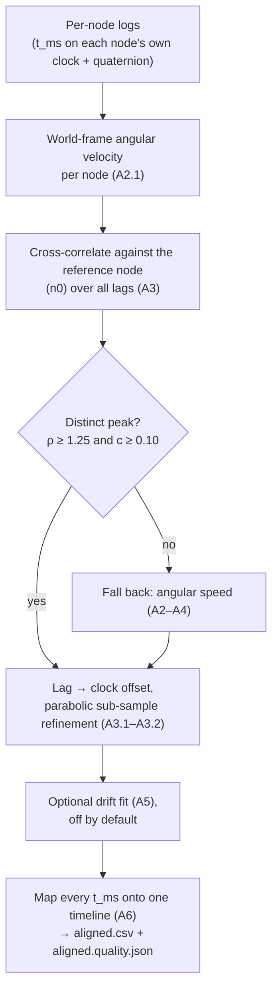

# Methods — the math and the evidence behind the analysis

The deep reference for the analysis: how the node clocks are aligned, how
every metric is computed, and why the solvers are the ones they are. For how
the software is put together and how to change it, see
[`ANALYSIS.md`](ANALYSIS.md); this page is for reviewing, reproducing or
improving a method.

- **[Part A — Clock alignment](#part-a--clock-alignment)** (`reconcile_nodes.py`)
- **[Part B — Metrics](#part-b--metrics)** (`metrics.py`)
- **[Part C — Choosing the pose solver](#part-c--choosing-the-pose-solver)** (`opensense_ik.py` vs the default chain)

> Equations use LaTeX (`$…$` inline, ` ```math ` display blocks), which renders
> on GitHub and in most Markdown viewers. Where a viewer does not render math,
> the symbols are still readable in source form.

---

## Part A — Clock alignment

How the nodes' independent clocks are put on one timeline, as implemented in
`tools/reconcile_nodes.py`. Written so the method can be reviewed, reproduced
and improved independently of the code. The hardware side of the decision (why
alignment is done offline, from the motion) is in
[`WEARABLE.md`](WEARABLE.md#6-multi-node-time-alignment).



### A1. The problem

Each node timestamps its samples with its own free-running `millis()` counter,
which starts at the node's power-on and ticks on its own crystal. For a physical
event at real time $\tau$, node $X$ records

```math
t_X(\tau) = \bigl(\tau - \text{boot}_X\bigr)\cdot 1000 \quad[\text{ms since node } X \text{ booted}]
```

Two nodes therefore disagree in two ways:

1. **Offset** — $\text{boot}_A \neq \text{boot}_B$, so their clocks have
   different origins.
2. **Drift (skew)** — their crystals tick at slightly different rates
   (tens of ppm), so the offset changes slowly over time.

"Reconciling" means finding, for each non-reference node $B$, a mapping onto the
reference node $A$'s timeline:

```math
t_{\text{on }A} = t_B + \text{offset} + \text{drift}\cdot\bigl(t_B - t_{B,0}\bigr) \quad (1)
```

where $\text{offset}$ (ms) and $\text{drift}$ (unitless rate, reported in ppm)
are what we must estimate. This is the **standard two-parameter clock model**
used by NTP, PTP, and distributed-systems clock synchronization.

The design constraint (see [`WEARABLE.md` §6](WEARABLE.md#6-multi-node-time-alignment)): nodes are wireless and
analysis is offline, so we recover $\text{offset}/\text{drift}$ **from the
recorded motion itself**, independent of BLE latency.

---

> **Current default: the vector feature (§A2.1).** Sections A2–A4 describe the
> original angular-*speed* aligner, which is still the fallback
> (`--sync speed`). The default, `--sync vector`, correlates the full
> world-frame angular-velocity **vector** instead; §A2.1 gives its math and
> acceptance rule. The offset/drift machinery (§A3.1, §A3.2, §A5, §A6) is shared.

### A2. The motion feature: angular speed (mounting-invariant)

Each node logs unit quaternions $q_i$ (orientation). Raw quaternions are **not**
comparable between nodes because each sensor is mounted at a different, unknown
orientation. So we reduce each stream to a scalar invariant to mounting:
**angular speed**, the magnitude of the rotation rate.

The rotation between consecutive orientations $q_i, q_{i+1}$ has angle

```math
\theta_i = 2\,\arccos\!\bigl(\lvert\, q_i \cdot q_{i+1}\,\rvert\bigr) \quad (2)
```

(the dot product is the quaternion inner product; the absolute value takes the
shorter arc, since $q$ and $-q$ are the same rotation). Angular speed is

```math
\omega_i = \frac{\theta_i}{\Delta t_i}, \qquad \Delta t_i = \frac{t_{i+1}-t_i}{1000} \quad (3)
```

**Why this works:** for a rigid body, angular velocity is a property of the body
(the same for every frame on it), so its magnitude $\lvert\omega\rvert$ is
identical regardless of how each sensor is bolted on. Two sensors on the same
moving segment therefore produce *correlated* angular-speed signals even though
their raw quaternions differ. (Implementation: `angular_speed()`.)

#### A2.1 The default feature: world-frame angular-velocity vectors

Every node's Rotation Vector lives in the **same** world frame (gravity +
magnetic north), so the angular velocity can be expressed in that shared frame
rather than reduced to a magnitude. With $q_{i+1} = \Delta q_i \otimes q_i$,

```math
\Delta q_i = q_{i+1} \otimes q_i^{*}, \qquad
\boldsymbol\omega_i = \hat{\mathbf u}(\Delta q_i)\,\frac{2\arccos\lvert\Delta q_{i,w}\rvert}{\Delta t_i} \quad (3')
```

puts the increment in the world frame. A rigid segment has one world angular
velocity whatever its mounting, so two nodes that move together show the same
vector, **direction included** (`world_angular_velocity`). Each component is
resampled to the uniform grid and the three cross-correlations are summed, i.e.
the correlation of the vector signals is $\sum_k \boldsymbol\omega_A(k)\cdot\boldsymbol\omega_B(k+\ell)$.
The lag is the arg-max with the same parabolic refinement (§A3.2).

**Acceptance.** Nodes on different segments (torso vs. arm) mostly move on their
own, so the overall normalized correlation $c$ (sum of dot products over the
overlap, divided by the two signals' norms) is low even when one shared sync
gesture pins the lag exactly. What matters is whether the best peak is
**distinct**:

```math
\rho = \frac{C(\hat\ell)}{\max_{\lvert \ell - \hat\ell\rvert > 0.5\,\text{s}} C(\ell)} \ \ge\ 1.25
\quad\text{and}\quad c \ge 0.10 \quad (9')
```

(`VECTOR_PEAK_RATIO_MIN`, `VECTOR_PEAK_EXCLUDE_S`, `VECTOR_CONFIDENCE_MIN`).
If either fails the aligner falls back to the speed method of §§A2–A4. The chosen
method and $\rho$ are written to `aligned.quality.json` as `sync_method` and
`sync_peak_ratio`. On synthetic torso + upper-arm sessions (`timing_bench.py`),
vector sync reaches the accuracy of a perfect-clock oracle where speed sync
failed.

---

### A3. Estimating the offset by cross-correlation

We have two angular-speed signals sampled at slightly different, jittered times.
Resample each onto a uniform grid at $f_s$ (default 100 Hz) in **relative** time
($t - t_0$), giving sequences $a[n]$ (node $A$) and $b[n]$ (node $B$) plus each
node's first timestamp $A_0, B_0$. (Implementation: `resample_uniform()`.)

The lag between the two sequences is found by **cross-correlation** (the classic
time-delay-estimation method):

```math
C[k] = \sum_n \bigl(a[n]-\bar a\bigr)\,\bigl(b[n-k]-\bar b\bigr) \quad (4)
```

```math
\hat k = \arg\max_k C[k], \qquad L = \frac{\hat k}{f_s}\ \ [\text{s}] \quad (5)
```

Positive $L$ means $a$ is delayed relative to $b$. (Implementation:
`_xcorr_full()` via FFT for $O(N\log N)$; `best_lag_seconds()` /
`lag_and_confidence()`.)

#### A3.1 From relative-time lag to an absolute clock offset

The correlation is computed on **relative-time** signals, so $L$ alone is not
the clock offset — it must be combined with the difference of the nodes' start
timestamps. The two signals match when they sample the same real motion, i.e.

```math
\text{boot}_A + \frac{A_0 + s}{1000} \;=\; \text{boot}_B + \frac{B_0 + s - 1000L}{1000}
\quad \forall s
```

The $s$ terms cancel (a constant offset — the "no drift" case), leaving

```math
\bigl(\text{boot}_B - \text{boot}_A\bigr)\cdot 1000 \;=\; (A_0 - B_0) + 1000L
```

The left side is exactly the offset that maps $B$'s timestamps onto $A$'s clock
($t_A = t_B + \text{offset}$). Hence

```math
\boxed{\ \text{offset} = (A_0 - B_0) + 1000L \quad[\text{ms}]\ } \quad (6)
```

- $A_0 - B_0$ converts the relative-time result back to absolute clocks
  (bookkeeping).
- $L$ is the *measured* correction, read from the shared motion.

Equivalently, cross-correlating the two signals in **absolute** timestamps
directly yields $\text{offset}$; the code works in relative time only for
numerical convenience and adds $A_0 - B_0$ back.
(Implementation: `estimate_offset_drift()`.)

#### A3.2 Sub-sample refinement (parabolic interpolation)

$C[k]$ is only evaluated at integer lags (10 ms apart at $f_s = 100$ Hz). The
true peak usually lies between samples, so we fit a parabola through the peak
sample and its two neighbours $y_{-1}, y_0, y_{+1}$
($= C[\hat k -1], C[\hat k], C[\hat k +1]$) and take its vertex:

```math
\delta = \tfrac{1}{2}\,\frac{y_{-1}-y_{+1}}{\,y_{-1}-2y_0+y_{+1}\,}, \qquad \delta\in[-\tfrac12,\tfrac12] \quad (7)
```

```math
L = \frac{\hat k + \delta}{f_s}
```

Near a smooth peak any function is locally quadratic (Taylor), so this is a
standard, well-justified refinement — it takes lag resolution from ~10 ms down
to ~1 ms. (Textbook DSP; used in spectral-peak and pitch estimation.)

---

### A4. Confidence — was there real shared motion?

$\arg\max$ always returns *a* peak, even for unrelated signals. So we separately
score whether the peak reflects genuine shared motion, using the **Pearson
correlation** of the two signals overlapped at the best lag:

```math
r = \mathrm{corr}\bigl(a_{\text{overlap}},\, b_{\text{overlap}}\bigr)\ \text{at lag }\hat k, \qquad r\in[-1,1] \quad (8)
```

Pearson is normalized (divided by each signal's standard deviation), so it
measures *shape* agreement independent of amplitude — a differently-swinging node
still scores high if it moved *together*. We accept the offset only when

```math
r \ge r_{\min} \quad (r_{\min} = 0.40) \quad (9)
```

Below that, the tool flags the result unreliable and the caller falls back to the
BLE clock-offset read and/or a start-of-session sync gesture.
(Implementation: `_pearson_at_lag()`.)

**Limitation this guards:** cross-correlation needs shared motion. Two nodes on
*independently* moving limbs (one arm swings, the other still) share nothing to
lock onto, and $r$ correctly drops toward 0. This is why a shared sync gesture is
required at the start of every block: it guarantees the shared motion
cross-correlation needs (see [`WEARABLE.md` §6](WEARABLE.md#6-multi-node-time-alignment)).

---

### A5. Drift (clock skew) estimation

Drift is **off by default**: over a few-minute record, relative crystal drift is
only a few ms — below the measurement noise and negligible against the 25–50 ms
target — so fitting it adds noise. It is opt-in for long records.

When enabled, the lag is measured in $K$ windows spanning the record, giving
pairs $(t_j, L_j)$. A least-squares line $L = m\,t + c$ is fit; the slope $m$ is
the drift. It is accepted only if it is both statistically significant and large
enough to matter (the code constant `DRIFT_RESOLVE_MS` is written
$\varepsilon_{\min}$ below):

```math
\lvert m\rvert > 3\,\mathrm{SE}(m) \quad\text{AND}\quad \lvert m\rvert\cdot\bigl(t_{\text{last}}-t_{\text{first}}\bigr) > \varepsilon_{\min}\ (=15\text{ ms}) \quad (10)
```

Otherwise $\text{drift}=0$. Reported as `drift_ppm` $= m\times 10^6$.
(Implementation: `_windowed_lags()`, `_lsq_slope()`.)

Two guards keep the windowed lags honest (`_aligned_overlap`, `_windowed_lags`):
the windows are laid over the two nodes' **common** time span after applying
the global offset (so window $j$ of A and of B cover the same real time), and a
window is kept only if the two signals share motion in it (correlation
$\ge r_{\min}$). In a window where one node sits still, the "best" lag is
arbitrary; before this guard a trend fitted through such windows read a false
$+15.9$ s on a real capture. Fewer than 3 usable windows ⇒ no drift.

---

### A6. Applying the mapping and emitting aligned streams

With $\text{offset}$ (and optional $\text{drift}$), node $B$'s timestamps are
mapped onto $A$'s clock via Eq. (1) (`to_A_clock()`). A common uniform time grid
is built over the mutual overlap, and each node's **quaternions** are
interpolated onto it with normalized-linear interpolation (nlerp) along the
shorter arc:

```math
q(t) = \mathrm{normalize}\!\bigl((1-f)\,q_0 + f\,q_1\bigr), \qquad f = \frac{t - t_0}{t_1 - t_0} \quad (11)
```

(with a sign flip when $q_0\cdot q_1 < 0$). For 10 Hz human motion nlerp is
adequate; true SLERP could be substituted. The output is a CSV: one
`t_common_ms` column plus each node's $q_w,q_x,q_y,q_z$, ready for analysis.
(Implementation: `nlerp()`, `align_and_emit()`.)

---

### A7. Validation

`reconcile_nodes.py --selftest` generates two synthetic nodes from a shared
random motion with a **known** injected offset and drift, different mounting
rotations, sensor noise, and timing jitter, then checks recovery:

- recovered offset vs. the injected truth (target: within ~25–50 ms), and
- a **negative control** — a second node given *independent* motion must come
  back with low confidence and be flagged.

Current result: offset recovered to ~15–18 ms; shared-motion confidence
$r\approx 0.93$, independent-motion $r\approx 0.07$. This validates the *math* on
synthetic data; it is **not** a validation against hardware ground truth (§A9).

---

### A8. Known limitations

- **Needs shared motion** (§A4). Independent-limb captures require the sync
  gesture / BLE offset instead.
- **Linear clock model** (Eq. 1) — valid over minutes; a long session with
  temperature-driven crystal changes could need piecewise / periodic re-sync.
  See §A11 for how a full-day capture is handled by tracking $\text{offset}(t)$
  as a fitted curve instead of a single global line.
- **Dropouts/gaps** in the logs degrade the correlation and inflate the residual
  (observed on real captures with intermittent recording).
- **Clock restarts.** A node that reboots mid-log (battery died) restarts
  `millis()` at 0, so one log holds two unrelated clocks. The loader splits at
  any backward jump over `CLOCK_RESET_MS` (1 s), keeps the largest segment,
  warns, and records `clock_restarts` in the quality JSON; the other pieces
  are not analyzed. Offloading at every charge (one block per log) avoids it.
- **Speed fallback is a magnitude** — angular speed discards the rotation axis;
  two motions with identical speed profiles but different axes are
  indistinguishable to it. The default vector feature (§A2.1) keeps the axis.

---

### A9. Algorithm / Technique Justification

The method is an assembly of **standard techniques** mentioned below:

- **Cross-correlation time-delay estimation** — the core. Classic reference:
  Knapp & Carter, *"The Generalized Correlation Method for Estimation of Time
  Delay,"* IEEE Trans. ASSP, 1976 (the GCC / GCC-PHAT foundation).
- **Aligning unsynchronized sensors by a shared signal** — standard practice in
  multi-camera/mocap/audio sync and multi-IMU synchronization (cross-correlate a
  common motion feature such as angular rate).
- **Offset + linear-skew clock model** — the standard model in NTP/PTP and
  sensor-network clock synchronization.
- **Parabolic peak interpolation** — textbook sub-sample estimation.

**Status:** Current implementation has **not** been benchmarked.

---

### A10. Upgrades for a rigorous / publishable result

1. **Ground-truth it** — feed a shared electrical sync pulse to a GPIO on all
   nodes, timestamp it in `millis()`, and report the *actual* alignment error in
   ms rather than a confidence score.
2. **GCC-PHAT** — whiten the cross-spectrum before the inverse FFT for a much
   sharper, more robust delay peak under noise and gaps.
3. **Robust fitting** — RANSAC or weighted least squares for offset/drift so
   dropouts don't skew the estimate.
4. **Richer feature** — correlate the full angular-velocity vector (rotated into
   a common frame after a coarse alignment) instead of only its magnitude, to
   break the axis-ambiguity of §A8.

---

### A11. Long-session drift tracking: $\text{offset}(t)$ as a fitted curve

§A5's single global line (one $\text{offset}$, one $\text{drift}$ for the whole
record) assumes the relative skew is **constant** across the capture. That holds
for a minutes-long record at stable temperature. It does **not** hold for a
full-day wear, where the skew itself drifts as body/ambient temperature moves the
crystals (§A8). This section records the model that covers the long case, and
clarifies two points where the naming ("offset and drift") can mislead.

#### A11.1 The model: one curve, sampled by events

There is a single underlying function

```math
\text{offset}(t) \quad [\text{ms}], \qquad \text{drift}(t) = \frac{d\,\text{offset}}{dt}
```

— the true clock difference between node $B$ and node $A$ at every instant, and
its local slope. Every shared-motion event (the don-time sync gesture of §A3, or
incidental everyday motion, §A11.2) is a **noisy sample** of this function:
cross-correlating the two nodes' motion windows (vector, or speed as fallback) around the event yields
one measurement $\bigl(t_j,\ \widehat{\text{offset}}_j\bigr)$ via Eq. (6), with a
confidence $r_j$ (Eq. 8). Reconciliation **reconstructs the curve** by
fitting/interpolating through these samples.

Two things the naming ("offset and drift") can obscure:

- **`offset` is absolute, not cumulative.** Each event measures
  $\text{offset}(t_j)$ directly and independently; you never add event $j{+}1$'s
  offset onto event $j$'s (that double-counts). The only thing that accumulates
  is *extrapolation error when you stop measuring* ($\approx
  \text{drift}\times\Delta t$) — the cost of a gap, not a property of the model.
- **`drift` is a slope, not a separate measurement.** It becomes observable only
  once samples are separated in time, which is why the don gesture (seconds long)
  gives a good `offset` but a poor `drift` — the lever arm is too short to clear
  the noise floor (`DRIFT_RESOLVE_MS`, Eq. 10). A single event's offset is noisy
  too, so you neither "trust it for $N$ minutes then jump" (which steps
  $\text{offset}(t)$ discontinuously and discards still-good samples) nor discard
  the prior estimate — you **fuse** (§A11.2).

#### A11.2 Getting the anchors, and combining them over time

**Where the samples come from.** They need not be deliberate. Over a day of wear
the body produces many **shared** events — standing up, starting to walk, turning
— each a fresh $\bigl(t_j, \widehat{\text{offset}}_j\bigr)$ measured by the *same*
machinery, with the confidence gate (Eq. 9) selecting which node-pairs each event
is valid for. Prefer **aperiodic transients** (sit→stand, turns); periodic motion
(steady walking) has the multi-peak lag ambiguity of §A3/§A4 and anchors poorly
even when shared. Participation is partial — an event re-anchors only the subset
of nodes that moved together, and different events cover different subsets, so
over a day it averages out. A node still for a long stretch isn't re-anchored, but
its signal is flat then, so the misalignment is harmless and *its next motion is
itself an anchoring event*.

**How the anchors combine.** There is no fixed validity duration; an old anchor
stays useful while its implied extrapolation error stays under budget, set by the
ratio of **process noise** (how fast $\text{drift}$ wanders — temperature
dynamics) to **measurement noise** (how tightly one event pins `offset`). Two
standard estimators carry $\bigl[\text{offset},\ \text{drift}\bigr]$ as a tracked
state rather than switching on a timer:

- **Sliding-window least squares** — fit a line to the $\bigl(t_j,
  \widehat{\text{offset}}_j\bigr)$ in a trailing window $W$, long enough for a
  good lever arm but short enough that drift is ~constant across it.
- **Kalman filter** — predict between events ($\text{offset}\mathrel{+}=
  \text{drift}\cdot\Delta t$; drift a slow random walk; covariance grows) and
  update at each event by the Kalman gain (confidence). Old data decays smoothly
  rather than being dropped, the process-noise parameter setting that forgetting
  time.

Either way a new event neither replaces nor adds to the prior estimate — the
estimate moves *partway* toward it, weighted by relative confidence. Drift moves
only with temperature, so anchors need not be frequent.

**Offline, most of this is moot.** "How long is a stale value good?" bites only
in real time, when all you have is the past. This pipeline is **post-hoc** — the
whole log is on the host at reconcile time — so for essentially any instant,
anchors bracket it on **both sides**. Evaluate $\text{offset}(t)$ by
**interpolating between the bracketing anchors** rather than extrapolating from a
stale one; the residual is far smaller. Extrapolation (and hence "validity
duration") only bites at the ends of the log, or inside a one-sided gap.

#### A11.3 Where the code is, and the upgrade path

`reconcile_nodes.py` today fits the **single global line** of §A5 — the simplest
point on this spectrum, correct for a minutes-long, stable-temperature capture.
Extending to full-day records means replacing that one line with the
**sliding-window fit or Kalman tracker** of §A11.2, seeded by the don anchor and
fed by incidental events, then evaluated by interpolation. The per-event
measurement, confidence gate, and windowed-lag machinery all already exist
(`lag_and_confidence()`, `_windowed_lags()`, `_pearson_at_lag()`); what is new is
carrying `offset`/`drift` as a **tracked state over the whole log** instead of two
scalars. Robust fitting (§A10.3) and GCC-PHAT (§A10.2) compose with this directly —
they sharpen and de-weight the individual samples the tracker consumes.

---

## Part B — Metrics

The per-metric reference for **stage 6** (`metrics.py`). Every value the tool emits
into `metrics.json` is listed below with its plain-language meaning, the exact
method that produces it, its inputs and units, whether it needs calibration, and
the field it lands in. The computation lives in `metrics.py`; this part is the
readable index into it.

- **Which** metrics appear for a given placement is decided by the resolver
  (`motion_capabilities.py`, described in [`ANALYSIS.md` §4.5](ANALYSIS.md#45-capability-tiers)) — you only ever
  get what the montage supports.
- **How** each one is computed is documented here (and in the `metrics.py`
  docstring for the named function).


### B1. The honesty contract (read this first)

Three rules gate every number, so a soft value never masquerades as a hard one:

- **Blocked ≠ fabricated.** A joint whose montage lacks one of its two adjacent
  nodes is reported in `blocked_joints` with the missing node named — never a
  guessed angle.
- **`clinical: false` ⇒ relative-only.** A joint (or segment) whose node(s) are
  not anatomically calibrated — or, for a joint, whose anatomical axes are unknown
  because no confident facing was recovered (top-level `anatomical_axes: false`) —
  still produces numbers, but its zero is "the pose at the neutral window," not
  the anatomical landmark, and without anatomical axes the DOF labels need not
  match the movement. It is flagged, and in the
  stage-7 viewer its rows dim in raw view. Calibration is what turns an orientation
  into an *anatomical* angle ([`ANALYSIS.md` §5.4](ANALYSIS.md#54-calibration-the-sensorsegment-solve)).
- **Unwrap before range.** Angle series are unwrapped (`np.unwrap`) before ROM, so
  a real sweep through ±180° reports its true excursion instead of a fake 360°;
  the unwrapped series is then re-centred by whole turns so its median sits in
  ±180° (an unwrap never shifts the zero). A DOF with undefined stretches (the
  plane of elevation with the arm at the side) is unwrapped only within each
  defined run, each run re-centred on its own (`unwrap_runs_deg`): its value
  inside a singular stretch is arbitrary, and carrying the unwrap through it
  stacked fake turns (a real session read a 1023° range).
- **Implausible ⇒ flagged.** Every DOF carries a `plausibility` check (§B3): a
  range over a full turn, sample-to-sample jumps over `JUMP_MAX_DEG`, or — with
  anatomical axes — more than 2% of samples outside the DOF's physiological
  limits. A failing joint gets a `plausibility_warning` naming the likely causes
  (calibration pose, facing, sensor slip) rather than silently reporting it.
- **Only the protocol is analyzed.** By default the stream is trimmed to the
  *analysis window*: from the neutral hold (the freeze) to where the nodes come
  off (`trim_to_analysis`, both located by stage 5). Strapping on and the sync
  movement before, and taking the nodes off after, never enter ROM, reps or
  activity. Nothing is cut unless the calibration's freeze is this recording's
  own still window (a calibration reused from another take cuts nothing); when
  the nodes are not seen coming off the tail stays in and the run says so.
  `--keep-pre-neutral` analyzes the whole stream.

Session-level trust inputs from reconcile — `sync_confidence`, dropout — are **not**
recomputed here; they travel alongside these numbers and should be surfaced with
them (`gates_note` in the output says so).

---

### B2. The shared chain: quaternion → joint angle

Every joint metric starts from the same four steps (`metrics.py` module docstring,
`compute_joint_metrics`):

```
q_seg(t) = q_WS(t) ⊗ q_SB                     apply the cached mounting offset (stage 5)
q_rel(t) = conj(q_seg_prox) ⊗ q_seg_dist      distal relative to proximal
q_anat   = conj(q_WA) ⊗ q_rel ⊗ q_WA          re-express in anatomical axes
(α,β,γ)  = euler(q_anat, sequence)            decompose in the joint's ISB/Wu sequence
angle_dof = (α|β|γ)[seq_index]                pick the slot that IS this clinical DOF
```

- `q_SB` is the sensor→bone mounting offset from `calibration.json`; **identity when
  uncalibrated** (⇒ `clinical: false`).
- `q_WA` is the **anatomical frame at neutral** from `calibration.json`'s
  `anatomical_frame` block: X = anterior, Y = superior (along a hanging limb),
  Z = X × Y = the subject's right. It is built from gravity plus the subject's
  facing — the torso node's heading, else the elbow hinge axis (the facing that
  makes elbow motion a pure hinge, `estimate_facing_from_elbow`), else
  `--facing-deg`. The
  mounting offset alone zeroes each segment but leaves its axes on the world
  compass (Z = up), while the ISB sequences assume anatomical axes — without
  `q_WA` a pure elbow flexion lands in whichever slot the facing puts it. No
  confident facing ⇒ no `q_WA` ⇒ the joint is `clinical: false`.
- **Wrist frame.** The N-pose holds the palms facing the thighs, i.e. the hand
  is turned `NEUTRAL_FOREARM_DEG` (90°) about the long axis from the
  palms-forward anatomical position the wrist's `ZXY` split assumes. Wrist
  joints are therefore split in the hand's own neutral frame
  (`joint_frame_deg`/`joint_frame_quat`: `q_anat` is additionally rotated by
  that angle about Y), so wrist flexion reads as flexion and not as
  radial/ulnar deviation. Elbow and shoulder are unaffected.
- One frame serves both sides, so for a **left** joint `q_anat` is mirrored
  through the sagittal plane (`mirror_left`: `[w,x,y,z] → [w,−x,−y,z]`) before
  the split. A left joint then decomposes exactly like a right one and every DOF
  has the same clinical sign on both sides:

  | Joint | DOF | Positive = |
  |---|---|---|
  | elbow | `flex_ext` | flexion |
  | elbow | `pro_sup` | pronation |
  | wrist | `flex_ext` | flexion |
  | wrist | `rad_uln` | ulnar deviation |
  | shoulder | `plane_elev` | 0° abduction plane, +90° forward flexion, −90° extension |
  | shoulder | `elevation` | raised (always ≥ 0) |
  | shoulder | `axial_rot` | internal rotation |
- The Euler `sequence` and the `seq_index` each clinical DOF occupies both come from
  `motion_capabilities.JOINTS` — the one body model. This tool never re-declares
  anatomy or invents a convention.
- Because calibration zeroes `q_rel` at the neutral pose, a calibrated angle is
  measured from anatomical zero.

**Singularity guard.** Every Euler split has a pole where the outer two axes align
and their angles become ill-defined (a *proper* sequence like `YXY` at the middle
angle ≈ 0/π — the shoulder's "arm at the side" pole; a *Tait-Bryan* sequence like
`ZXY` at middle ≈ ±90°). Within `SINGULARITY_GUARD_DEG` (10°) of that value the
outer-slot DOFs are marked undefined for those samples, so a joint resting at the
pole never emits a spurious 180° swing or an infinite velocity. The shoulder is
the exception for axial rotation: it is reported as the *sum* of the outer
angles, which is exactly what stays defined at the side, so only
`plane_elev` is masked there (both are masked overhead, where the sum is the
ill-defined part). Affected DOFs carry
`defined_frac` (share of samples that were well-conditioned) and a
`singularity_note`, and their series carry `NaN` at the masked samples so every
downstream consumer skips them the same way.

What the chain produces for one joint, as the review page graphs it (right
elbow flexion over a block of six bends, the freeze shaded at the start, the
session's max and min marked):


---

### B3. Joint-tier metrics

Emitted per computable joint, into `joints[]`. Each joint object has `key`, `name`,
`clinical`, `decomposition` (the sequence), `dofs[]`, and `reps`.

| Metric | Field | Method | Units | Needs calibration? |
|---|---|---|---|---|
| **Per-DOF angle** | `dofs[].` (series, feeds the rest) | Euler decomposition of `q_rel` in the joint's sequence, unwrapped in radians before converting (§B2). | ° | For *anatomical* zero, yes; relative shape works without |
| **Range of motion** | `dofs[].rom` = `{min_deg,max_deg,range_deg,median_deg}` | `range = max − min` over the unwrapped angle (`_rom`/`_stats`). `null` if the DOF is singular for the whole session. | ° | Gates *clinical* ROM; relative-only when `clinical:false` |
| **Angular velocity** | `dofs[].velocity` = `{peak_deg_s,mean_abs_deg_s,rms_deg_s}` | `v = d(angle)/dt` via `np.gradient` (`velocity_stats`); peak = max\|v\|, mean = mean\|v\|, RMS = √mean(v²). Differentiated **only within** contiguous valid runs, so a masked singular gap never fakes a huge peak. | °/s | No (shape metric) |
| **Repetitions** | `reps` = `{count,primary_dof,bouts[]}` | Zig-zag turning points on the joint's primary DOF (`find_rep_bouts`): a rep is one out-and-back swing of at least `rep_threshold` = max(`REP_MIN_AMPLITUDE_DEG` (15°), 25% of the session's 2–98th-percentile range), each swing measured from its own local extremes so a set of small curls still counts beside a big movement elsewhere. Reps are grouped into **bouts**: a dwell at an extreme longer than `REP_PAUSE_S` (5 s) or a swing slower than `REP_MAX_LEG_S` (8 s) ends one — so curls, then rotations, then curls report as separate phases. Each bout = `{t_start_ms,t_end_ms,reps,mean_amplitude_deg}`; `count` is their sum. | count | No — only shape matters |
| **Plausibility** | `dofs[].plausibility` = `{ok,issues[],jumps,outside_limits_frac?,limits_deg?}` | `check_plausibility`: range > 360°, jumps > `JUMP_MAX_DEG` (120°) between samples, and (anatomical axes only) > `PLAUSIBLE_OUTSIDE_FRAC` (2%) of samples outside the DOF's `plausible_deg` from `motion_capabilities`. Any failing DOF adds a joint-level `plausibility_warning`. | — | Limits check needs anatomical axes |

A `clinical:false` joint also carries a `warning` string spelling out that its
angles are relative-only.

**Primary DOF.** Reps, L/R symmetry and coordination use the joint's declared
primary DOF (`Joint.primary`; shoulder = `elevation`, elbow and wrist =
`flex_ext`), falling back to the DOF
that swung the most when none is declared or it is singular all session.

**Shoulder DOFs** follow the ISB `YXY` names rather than flexion/abduction:

| Key | Name | Meaning |
|---|---|---|
| `plane_elev` | Plane of elevation | *Direction* the arm is raised in: 0° = abduction (frontal plane), +90° = forward flexion, −90° = extension. Raw YXY slot 0 + 180° — ISB's negative-elevation branch of the same rotation, so elevation can be reported positive. Undefined with the arm at the side or overhead. |
| `elevation` | Elevation | *How far* the arm is raised, in whatever plane — a forward and a sideways 60° raise both read 60°. Primary DOF. |
| `axial_rot` | Axial rotation (int / ext) | Twist about the humerus, internal positive: raw slot 0 + slot 2. ISB's own third angle trades with the plane (20° of internal rotation reads +20° in abduction but −70° in forward flexion); the sum reads +20° in both, and it stays defined with the arm at the side. Undefined only overhead. |

---

### B4. Segment-tier metrics

Emitted per placed node, into `segments[]` (`segment`, `node_id`, `calibrated`, …).
Speed and travel use the **raw** quaternion (mounting-invariant), so they are honest
with or without calibration; elevation and posture-dwell use the **calibrated**
frame.

| Metric | Field | Method | Units | Needs calibration? |
|---|---|---|---|---|
| **Angular speed** | `angular_speed` = `{mean_deg_s,peak_deg_s}` | Geodesic step between consecutive orientations: `Δ = 2·arccos(\|q_t · q_{t+1}\|)`, divided by `dt` (`segment_angular_speed`). Measures how much the bone turned, not where it points — so it is mounting-invariant. Also feeds SPARC. | °/s | No |
| **Angular travel** | `travel` = `{travel_deg, active_time_frac}` | `travel = ∫\|angular speed\| dt` (cumulative rotation, direction-agnostic). `active_time_frac` = share of time above `ACTIVE_SPEED_DEG_S` (20°/s). Session aggregates — valid even when two limbs aren't time-aligned (`segment_travel_deg`). | °, fraction | No |
| **Elevation** | `elevation` = `{min,max,range,median,mean}_deg` | Tilt of the bone's long axis from vertical: `arccos(R[2,2])` of the (calibrated) segment frame per sample (`segment_elevation_series`). Uncalibrated it is the board's own tilt — a real inclination, just not anchored to the bone (flagged by `calibrated`). | ° | For anatomical meaning, yes |
| **Smoothness (SPARC)** | `smoothness_sparc` | Spectral arc length of the speed profile (Balasubramanian et al. 2015, `sparc`): normalize the magnitude spectrum by DC, take the arc length of the normalized spectrum up to the cutoff band (≤ `SPARC_FC_MAX_HZ` and above `SPARC_AMP_THRESH`). Smoother → nearer 0; jerkier → more negative (≈ −1.5 smooth … −5+ jerky). `null` when there is essentially no movement. | unitless (≤ 0) | No |
| **Posture dwell** | `posture_dwell` = `{edges_deg, fraction}` | Time-in-posture histogram: fraction of the session spent in each elevation band (`POSTURE_BIN_EDGES_DEG` = 0/30/60/90/120/150/180°), **time-weighted** by inter-sample dt so a non-uniform grid stays correct (`posture_dwell`). | fraction per band | **Yes** — emitted only when the segment is calibrated |

---

### B5. Derived-tier metrics

Cross-joint / cross-segment metrics, emitted into `derived[]` **only when the
resolver unlocks them** for the montage (`compute_derived`). Each entry has
`target`, `name`, `requires[]`, and a `metrics{}` block; most carry a `clinical`
flag and/or a `note`.

| Metric | `target` | `metrics{}` | Method |
|---|---|---|---|
| **L/R ROM symmetry** | `symmetry_<joint>` | `symmetry_index`, `rom_ratio`, `left_rom_deg`, `right_rom_deg`, `dof` | On each side's primary DOF: `symmetry_index = 100·\|L−R\| / (½(\|L\|+\|R\|))` (0 = identical, → 200 opposite); `rom_ratio = min/max`. `clinical` = both sides calibrated. |
| **Bilateral activity asymmetry** | `activity_asymmetry_<segment>` | `asymmetry_index`, `use_ratio`, `active_time_ratio`, `left_travel_deg`, `right_travel_deg` | Signed laterality from segment **travel**: `asymmetry_index = 100·(R−L)/(R+L)` in [−100, +100] (+ = right used more). A session aggregate, so **valid even at low sync confidence** (stated in its `note`) — the sparse-montage workhorse. |
| **Inter-joint coordination** | `coordination_<a>_<b>` | `pair`, `peak_r`, `lag_s` | Peak normalized cross-correlation of the two joints' primary-DOF series and its lag (`cross_correlation`): both series mean-removed and unit-normalized so `peak_r ∈ [−1,1]`; positive `lag_s` = the second joint follows the first. |
| **Trunk compensation** | `compensation_<...>` | `trunk_travel_deg`, `trunk_elevation_range_deg` | Trunk excursion during the task, from the torso segment's travel + elevation range. `clinical` = torso calibrated; when false, `note` flags the excursion as relative. |

---

### B6. Constants (the tuning knobs)

All defined at the top of `metrics.py`:

| Constant | Value | What it gates |
|---|---|---|
| `SINGULARITY_GUARD_DEG` | 10° | Band around each Euler pole where outer-slot DOFs are marked undefined |
| `ACTIVE_SPEED_DEG_S` | 20°/s | Threshold for "active" (active-time fraction, activity comparison) |
| `REP_MIN_AMPLITUDE_DEG` | 15° | Floor of the rep threshold (the threshold is the larger of this and 25% of the range) |
| `REP_PAUSE_S` | 5 s | A dwell at an extreme longer than this ends a rep bout |
| `REP_MAX_LEG_S` | 8 s | A single swing slower than this ends a rep bout |
| `NEUTRAL_FOREARM_DEG` | 90° | Hand rotation from palms-forward at the N-pose (wrist frame) |
| `JUMP_MAX_DEG` | 120° | Sample-to-sample step flagged as implausible |
| `PLAUSIBLE_OUTSIDE_FRAC` | 0.02 | Share of samples outside physiological limits that fails plausibility |
| `POSTURE_BIN_EDGES_DEG` | 0/30/60/90/120/150/180° | Elevation bands for the posture-dwell histogram |
| `SPARC_FC_MAX_HZ` | 10 Hz | Upper frequency ignored by SPARC |
| `SPARC_AMP_THRESH` | 0.05 | Normalized-magnitude floor that sets the SPARC cutoff band |
| `_GIMBAL_SIN` | 1e-6 | \|sin(middle)\| below which the Euler split is collapsed onto the well-defined sum |

---

### B7. Output shape (`metrics.json`)

```jsonc
{
  "schema_version": "1.0",
  "subject": { ... }, "session": { ... },
  "calibration_used": true, "anatomical_axes": true,
  "sample_rate_hz": 50.0, "n_samples": 4000, "duration_s": 79.98,
  "analysis_window_ms": [t0, t1],            // freeze → nodes coming off
  "trimmed_before_neutral_s": 12.4 | null,   // setup dropped before the hold
  "trimmed_after_end_s": 8.1,                // tail dropped (taking the nodes off)
  "end_detected": true, "end_method": "pause_before_takeoff",
  "joints": [ { "key","name","clinical","decomposition",
                "dofs": [ { "key","name","plane",
                            "rom": {min_deg,max_deg,range_deg,median_deg} | null,
                            "velocity": {peak_deg_s,mean_abs_deg_s,rms_deg_s} | null,
                            "plausibility": {ok,issues,jumps,...},
                            "defined_frac"?, "singularity_note"? } ],
                "reps": {count,primary_dof,
                         bouts: [ {t_start_ms,t_end_ms,reps,mean_amplitude_deg} ]},
                "warning"?, "plausibility_warning"? } ],
  "blocked_joints": [ { "key","name","missing": [ ... ] } ],
  "segments": [ { "segment","node_id","calibrated",
                  "angular_speed": {mean_deg_s,peak_deg_s},
                  "travel": {travel_deg,active_time_frac},
                  "elevation": {min_deg,max_deg,range_deg,median_deg,mean_deg},
                  "smoothness_sparc": <float|null>,
                  "posture_dwell"?: {edges_deg,fraction} } ],
  "derived": [ { "target","name","requires": [...],
                 "metrics": { ... }, "clinical"?, "note"? } ],
  "gates_note": "clinical=false ⇒ relative-only ..."
}
```

---

### B8. Where the code is, and how to check it

- Computation: `tools/metrics.py` — the function named in each row above.
- Catalogue / gating (which metrics unlock): `tools/motion_capabilities.py`,
  [`ANALYSIS.md` §4.5](ANALYSIS.md#45-capability-tiers).
- Body model (segments, joints, DOFs, Euler sequences): `motion_capabilities.JOINTS`.
- Validation with no hardware:

  ```
  python tools/metrics.py selftest
  ```

  round-trips every Euler sequence, recovers a known injected flexion sweep (and
  a forearm twist) at several facings, checks the calibration and anatomical-axis
  gates and wrap handling, the wrist's hand-frame signs, the analysis-window trim
  (and its guard against a reused calibration), plausibility flags, rep bouts,
  the SPARC/cross-correlation primitives and the full derived tier.

---

## Part C — Choosing the pose solver

Which path should produce the reported joint angles?

- **Default chain:** `calibrate_segments.py` → `metrics.py`.
- **OpenSim OpenSense** (`opensense_ik.py`) on one of two published models:
  - **Thoracoscapular Shoulder Model** (TSM): Seth et al. 2019; right arm; the
    upper-limb model.
  - **Rajagopal 2016**: full body; built for gait.

Assessed 2026-09-25 with OpenSim 4.6, after the pipeline fixes in the same
series of changes: auto neutral window, facing from the elbow hinge, wrist in
its palms-in frame, plausibility flags.

### Verdict

**For a reference-able method, use OpenSense with the Thoracoscapular Shoulder
Model** for right-arm sessions (`--opensense-model ThoracoscapularShoulderModel.osim`):

- It is as accurate as the default chain in every tested condition (within
  about 1°), with and without a torso node.
- Its raw coordinates agree with the reported angles.
- It fits the real capture best (median residual 4.4°) and solves in about 10 s.
- It lets the method be cited as published model + published IK method +
  ISB angle conventions (see *Methods text* below), instead of "our own chain".

Keep the **default chain** as the dependency-free path and as a built-in
cross-check — and always look at it beside the model. IK can lose the sensors
after a fast movement and hold a wrong pose for seconds (§C2b). Such stretches
are now detected, shaded in the viewer and excluded from the model's metrics,
and the review page switches between the direct sensor view and each model
solve on the same timeline (`analyze_session.py run … --opensense-model A.osim
--opensense-model B.osim`). Use **Rajagopal** only where TSM has no body: the left arm and the
wrists. Report its raw coordinates only with a torso node (see finding 3).

### C1. Synthetic ground truth (`tools/evaluation/compare_paths.py`)

**Truth.** A protocol-shaped 40 s session is played on the Rajagopal model:

- neutral hold (palms facing the thighs)
- shoulder swing
- 4 supinated curls
- pro/supination at 65° abduction
- full swing with humeral rotation
- rest, with trunk sway throughout

**Nodes.** Virtual nodes have random strap mountings, and the subject faces
37° off world +Y. The TSM runs solve on a *different* model from the one that
made the truth, so its joints don't match the "subject's", as with a real arm.

**Scoring.** Both paths get the same node streams and calibration step, and
all angles go through the same `metrics.py` ISB definitions.

**Conditions:**
- **clean:** 60 Hz, ~1° RMS slow sensor error
- **realistic:** 8.3 Hz (the firmware when this was run; it logs ~10 Hz now),
  ~3° RMS slow error per strap (sensor + soft tissue), 50 ms clock offset on
  distal nodes

RMS error, degrees. Each solver column sits next to its own run's
default-chain column; the random draws differ slightly between runs.

**Full right arm (torso + upper arm + forearm; + hand for Rajagopal):**

| DOF | clean: default | clean: Rajagopal | clean: default | clean: TSM | realistic: default | realistic: Rajagopal | realistic: default | realistic: TSM |
|---|---|---|---|---|---|---|---|---|
| shoulder elevation | 2.7 | 2.1 | 2.7 | **2.0** | 6.0 | 5.6 | 6.2 | **5.6** |
| shoulder axial rot. | 0.8 | 0.8 | 0.8 | 0.8 | 4.7 | 4.7 | 4.6 | 4.6 |
| elbow flexion | 0.4 | 0.3 | 0.4 | 0.3 | 2.4 | 2.4 | 2.3 | 2.3 |
| elbow pro/sup | 1.5 | 1.0 | 1.5 | 1.5 | 2.1 | 3.1 | 2.0 | 2.0 |
| wrist flex / dev | 0.6 / 0.5 | 1.0 / 0.4 | — | — | 2.1 / 5.1 | 2.3 / 5.3 | — | — |

**Torso + upper arm (the 2-node shoulder montage):**

| DOF | clean: default | clean: Rajagopal | clean: TSM | realistic: default | realistic: Rajagopal | realistic: TSM |
|---|---|---|---|---|---|---|
| plane of elevation | — | — | — | 10.7 | 10.8 | **9.8** |
| elevation | 0.9 | 0.9 | 1.0 | 5.8 | 5.8 | 6.0 |
| axial rotation | 0.5 | 0.5 | 0.5 | 4.6 | 4.6 | 5.2 |

(Plane of elevation is undefined with the arm near the side; the clean run's
motion kept it there too often to score.)

**Upper arm + forearm (no torso; today's capture):**

| elbow DOF | clean: default | clean: Rajagopal | clean: TSM | realistic: default | realistic: Rajagopal | realistic: TSM |
|---|---|---|---|---|---|---|
| flexion | 1.2 | 1.1 | 1.1 | 4.2 | 4.7 | 4.3 |
| pro/sup | 8.3 | 8.1 | 8.2 | 9.4 | 9.2 | 9.2 |

The ~8° pro/sup floor in that table is common to all three. Truth is split in
the trunk's frame, but the elbow's hinge plane is 13° off it, so part of the
flexion leaks into the "true" pro/sup. Scored against the Rajagopal model's
own coordinates instead, the default chain's pro/sup error is 1.9° (clean)
and 4.5° (realistic).

#### Findings
1. **The solvers are equivalent on reported angles.** With every path's pose
   read out through the same ISB definitions, OpenSense and the default chain
   differ by 0.1–1.3° RMS frame-by-frame on the no-torso sessions, and by
   about 1° or less in the tables above otherwise.
   Errors roughly double from clean to realistic, and that comes from the
   input (8 Hz, strap wobble, clock offset), not the solver.
2. **Joint constraints help the shoulder slightly.** Elevation is 0.4–0.7°
   better with either model when the elbow chain is present, because the
   model's joints pull the humerus into a consistent pose.
3. **The raw model coordinates differ, and that decides which model is
   citable.** The raw coordinates are what OpenSense users usually report.
   RMS difference from the reported angles:

   | | full arm + torso | no torso (synthetic) | real capture (no torso) |
   |---|---|---|---|
   | TSM `pro_sup` | 0.2° | 0.6–0.7° | 1.7° |
   | TSM `elbow_flexion` | 0.3° | 3.8° | 4.3° |
   | Rajagopal `pro_sup_r` | 1.9° | 6.3–6.4° | 6.2° |
   | Rajagopal `elbow_flex_r` | 0.3° | 0.7–1.3° | 5.2° |

   - Without a torso node, the facing comes from the elbow hinge. That hinge
     plane is 13° from the Rajagopal model's trunk axis, so Rajagopal's
     humerus is placed 13° rotated and its pro/sup coordinate absorbs the
     difference.
   - TSM's forearm coordinate is unaffected.
   - TSM's `elbow_flexion` differs by ~4% of the flexion range without a
     torso node: its oblique elbow axis defines flexion slightly differently
     from the hinge frame.
4. **TSM needed three preparation fixes to be usable.** All are listed in
   `opensense_ik.py`:
   - the default pose set to the N-pose (the published default has the
     trunk tilted and the arm abducted)
   - clamping on for the elbow and forearm, which ship unclamped (a solve
     wandered to −368°)
   - the glenohumeral angles left unclamped: they must wrap and have poles
     at 0°/180°, where a clamped solve stuck with the arm overhead
5. **Facing recovery:** from the torso, within 0.8–3.7° (clean) and 1.4–4.1°
   (realistic).

### C2. Real capture (upper arm + forearm, 2026-09-25)

No ground truth, so this measures agreement and fit, not accuracy.

| | default | Rajagopal | TSM |
|---|---|---|---|
| neutral window | auto 36.7–38.7 s (placeholder rejected) | same | same |
| facing | elbow hinge −45° | same | same |
| elbow flexion ROM | −21…145° | −18…145° | −12…145° |
| pro/sup ROM | −80…100° | −83…92° | −82…99° |
| vs default, frame by frame | — | 5.4° flex, 2.3° pro/sup | **1.8° flex, 1.4° pro/sup** |
| fit residual, median / p95 | — | 5.6° / 20° | **4.4° / 16°** |
| run time | < 1 s | ~35 s | ~10 s |

The residual marks frames where the nodes disagree with any rigid skeleton.
On this capture those are the fast movements, where 8 Hz sampling and
inter-node timing (sync confidence 0.52) dominate.

#### C2b. Solver stability: the model can lose the sensors (2026-09-27)

Re-running the same capture after the vector clock sync (an input change of
under 1 ms in the node alignment) made TSM's IK settle in a wrong pose for
**12 s** (25.7–37.6 s into the analysis window, during the wide shoulder
swing): the elbow pinned at its 168° flexion limit while the sensors read an
almost straight arm, with every sensor ~90° from the solved skeleton. The
earlier run on the old alignment tracked that stretch fine. Rajagopal on the
new alignment lost the fit for only 1.1 s in short blips.

IK solves each frame starting from the previous pose, so a fast movement
sampled at ~8 Hz can move the arm past the basin of the right solution; once
there it stays until the motion carries it back. The fit residual shows it
plainly (median error ~92° inside the stretch vs 2–6° elsewhere), so
`opensense_ik.py` now marks frames where any sensor sits more than
`FIT_LOST_DEG` (30°) from the solved skeleton as **fit lost**:

- they are left out of the model's metrics (TSM elbow ROM back to −12…145°
  instead of −12…168°), and listed in `pose_solver.fit_lost`;
- `opensense_fit.csv` records the per-frame fit, and the review page shades
  those stretches on the angle graph, warns in the live panel and the header
  chip, and blanks them from the solver-comparison overlay.

Implication for reporting: a model solve is only as good as its fit, frame by
frame. Report the fit-lost time with any model-based number, and treat a
session with long lost stretches as needing the direct sensor path there.

#### C2c. Torso + upper arm: the model adds no constraint (2026-10-01)

First real torso + upper-arm session (two nodes, new firmware at ~10.6 Hz;
three sideways raises to ~125°, alternating forward and sideways raises to
~70°, then fast small swings). On this montage TSM has exactly as many free
coordinates as the nodes measure (thorax 3 + glenohumeral 3 = 2 × 3), so IK
fits the nodes exactly: median residual **0.0°**, and its elevation (0…126°)
and axial rotation (−76…69°) equal the direct path's. The model can only
constrain what the nodes over-determine, which two nodes on a ball joint never
do. Rajagopal, whose shoulder ranges are clamped, could not follow the large
raises and lost the fit for 9.9 s.

So with torso + upper arm, report the direct path (or TSM, identically) and
treat the model as a cross-check. Model constraints start to matter with a
forearm node (the elbow hinge over-determines the chain) or with joint limits
that the subject's real motion respects.

### C3. Methods text (draft)

> Segment orientations were measured with inertial nodes (BNO086, 9-axis
> fusion) strapped to the thorax, upper arm and forearm. Sensor-to-segment
> alignment was obtained from a static neutral pose (arms at the sides,
> palms facing the thighs), detected automatically as the first deliberate
> still hold of each recording. Joint kinematics were estimated with OpenSim 4.6
> OpenSense [Delp 2007; Seth 2018; Al Borno 2022]: IMUPlacer registered the
> nodes to the Thoracoscapular Shoulder Model [Seth 2019; Seth 2016] in the
> neutral pose, and IMU inverse kinematics solved the pose at every sample.
> The model's default pose was set to the neutral pose. Sternoclavicular and
> scapulothoracic coordinates were held at the model's resting posture, as
> the scapula was not instrumented. Ranges were widened to elbow flexion
> −15–160° and pro/supination ±100°. Shoulder, elbow and forearm angles were
> expressed from the solved segment orientations following the ISB
> recommendations [Wu 2005].

References (verify volume/pages before use):
- Delp SL et al. 2007, *IEEE Trans Biomed Eng* 54(11)
- Seth A et al. 2018, *PLoS Comput Biol* 14(7)
- Al Borno M et al. 2022, *J NeuroEng Rehabil* 19:22
- Seth A, Dong M, Matias R, Delp SL 2019, *Front Neurorobot* 13:90
- Seth A et al. 2016, *PLoS ONE* 11(1)
- Wu G et al. 2005, *J Biomech* 38(5)

Limits to state with it:
- **Scapula:** held fixed, so "glenohumeral" motion here is humerothoracic.
- **Validation:** OpenSense's published validation is lower-limb gait. This
  device's accuracy still needs its own check against optical motion capture
  or a goniometer.
- **Coverage:** right arm only (TSM). The left arm needs Rajagopal or a
  mirrored model.

### C4. Recommendations

1. **Collect torso + upper arm** for shoulder work with the two nodes.
   Every path gets the shoulder right there (about 6° RMS realistic, 1° clean).
   Use the upper arm + forearm pair for elbow and forearm sessions.
2. **Report** ISB angles from the TSM-solved pose. The raw TSM coordinates
   agree for pro/sup; use the ISB flexion.
3. **The biggest accuracy lever is still the input, not the solver:** the
   realistic condition roughly doubles every error.
   - Raise the log rate from 10 Hz toward 30–60 Hz.
   - Keep full rate through the neutral hold.
   - Tighten straps.
4. **Review every model solve against the direct sensor view** (the page's
   solver switch and the graph's "compare solvers" overlay), and report the
   fit-lost time alongside model-based numbers (§C2b).
5. **Both arms at full scale:** TSM is right-arm only. The published model
   could be mirrored for the left arm, which is a modification to report, or
   Rajagopal used for the left, with the raw-coordinate caveat in finding 3.

### Reproduce

```bash
pip install opensim
git clone --depth 1 --filter=blob:none --sparse https://github.com/opensim-org/opensim-core
(cd opensim-core && git sparse-checkout set --no-cone OpenSim/Tests/shared/ThoracoscapularShoulderModel.osim)
git clone --depth 1 --filter=blob:none --sparse https://github.com/opensim-org/opensim-models
(cd opensim-models && git sparse-checkout set Models/Rajagopal_OpenSense)
RAJ=opensim-models/Models/Rajagopal_OpenSense/Rajagopal2015_opensense.osim
TSM=opensim-core/OpenSim/Tests/shared/ThoracoscapularShoulderModel.osim
python tools/evaluation/compare_paths.py --model $RAJ                    # Rajagopal
python tools/evaluation/compare_paths.py --model $TSM --truth-model $RAJ # Thoracoscapular
```

### C5. Appendix — OpenSense feasibility and partial montages (2026-09-25)

Question: can OpenSim/OpenSense (Stanford, Apache-2.0) replace our own
calibration + joint-angle stage, and how does it behave when only some nodes
are worn? Harness: `tools/evaluation/opensense_feasibility.py` (synthetic ground truth, no
hardware). Run 2026-09-25 with OpenSim 4.6.

#### C5 · Setup

- **Install:** `pip install opensim` — official Stanford wheels for Windows /
  macOS / Linux, Python 3.11–3.13. No conda needed.
- **Model:** `Rajagopal2015_opensense.osim` from `opensim-org/opensim-models`
  (the OpenSense tutorial model). It has a trunk (torso), both humeri,
  ulna/radius (elbow + pronation/supination) and hands (wrist flex/deviation).
  Legs, lumbar and pelvis translation were locked; pelvis rotations stand in
  for trunk motion.
- **Synthetic session:** 20 s at 60 Hz with a 1 s neutral hold. Every arm DOF
  moves at once: shoulder flexion to 140°, abduction to 70°, humeral rotation
  ±35°, elbow 5–125°, pro/sup 7–83°, wrist ±45° / −14–22°. The trunk tilts,
  lists and twists by 8–18°.
- **Virtual sensors:**
  - limb nodes strapped at random orientations; the torso node's +z points
    forward (5° tilt)
  - sensor world is Z-up, and the subject faces 37° off magnetic north
  - 1° orientation noise per sample
- **Calibration:** the Markley average of the neutral hold, fed to IMUPlacer.
  IK runs over the whole record. Error = IK coordinate − truth, reported as
  RMS / max in degrees after the neutral hold.

#### C5 · Results (wide shoulder ranges; RMS / max °)

"—" = coordinate not measurable with that montage (no sensor on one side of the
joint), so it was locked and is not reported.

| Montage (nodes) | Trunk | Shoulder flex / add / rot | Elbow | Pro/sup | Wrist flex / dev |
|---|---|---|---|---|---|
| **A** torso + UA + FA + hand (R) | 0.7 / 0.8 / 0.6 | 4.2 / 2.9 / 5.0 (max 19) | 0.8 | 3.2 | 1.4 / 2.1 |
| **G** all 7 nodes (bilateral) | same as A | R same as A; L 2.5 / 3.0 | 0.8 (L 0.9) | 3.2 (L 2.7) | 1.4 / 2.1 (L 1.2 / 1.9) |
| **B** torso + UA | 0.7 / 0.8 / 0.6 | 4.1 / 2.7 / 5.2 | — | — | — |
| **C** torso + FA (no UA) | ok | **41 / 22 / 28** | **36** | **19** | — |
| **D** UA + FA, no torso, facing known | — (assumed upright) | 16 / 10 / 17 | 1.0 | 1.1 | — |
| **D2** UA + FA, no torso, facing unknown | — | 18 / 35 / 32 | 5.9 | **25** | — |
| **E** FA + hand, shoulder & elbow locked | — | — | wrong (63) | wrong (32) | **28 / 23** |
| **E2** FA + hand, upper chain left free | — | meaningless | meaningless | meaningless | 0.8 / 0.8 |
| **F** both UAs, no torso (facing known) | — | R 16 / 10 / 17, L 12 / 11 | — | — | — |

IK speed: about 45–75 s per 1200 frames (~40–65 ms per frame) on one core,
which is fine for offline processing.

#### C5 · Findings

1. **The full set works well.** With the heading handled (point 3) and wide
   shoulder ranges (point 4), elbow and wrist come out at ~1–2° RMS,
   pronation/supination at ~3°, and the trunk at <1°.
2. **The shoulder is the weak joint, because of how the model defines it.**
   Rajagopal's shoulder is a flexion → adduction → rotation Euler sequence
   directly between torso and humerus (no scapula).
   - The 19° spikes all fall in high-abduction frames (abduction ~60–70°).
     There, flexion and rotation errors are equal and opposite: the model is
     near gimbal lock, and one rotation gets split between two nearly
     aligned axes.
   - The humerus orientation relative to the torso is still accurate: 4.5° RMS,
     8.3° max.
   - These are not the ISB Y-X-Y shoulder angles we report today. Switching to
     OpenSense means either accepting the model's shoulder definition or
     re-decomposing the humerus-vs-torso rotation ourselves.
3. **OpenSense's heading correction doesn't reach IK.** `IMUPlacer`'s
   `base_imu_label` / `base_heading_axis` shape only the sensor placement; the
   IK input is not de-rotated.
   - Symptom: a constant 40° trunk-rotation error, plus 4–5° of trunk
     tilt/list crosstalk.
   - Fix: rotate all quaternions about vertical by the torso node's heading at
     neutral before writing the .sto. This is what
     `calibrate_segments.compute_heading` already provides.
4. **The shipped joint ranges must be widened for rehab.** Out of the box,
   shoulder flexion is clamped to ±90° (arms are also locked). With those
   limits, a 140° reach fails silently: flexion error is 50° max, and IK bends
   the trunk (up to 25°) and the elbow (up to 25°) to compensate. That corrupts
   joints that were measured correctly. The harness widens flexion to −90…180°
   and adduction to −180…90°. Clamping will also hide real hypermobility, so
   pick patient-appropriate limits.
5. **Partial montages: OpenSense does not recover what isn't measured.**
   A joint angle is only valid when **both** of its segments carry a node.
   This is the same rule our `motion_capabilities.JOINTS` already encodes.
   - **Missing middle segment (C):** the forearm orientation (3 constraints)
     is shared across shoulder + elbow + pro/sup (5 DOF), so the solution is
     underdetermined. It returns a plausible-looking but wrong pose (elbow
     36° RMS). A torso + forearm montage cannot give elbow or shoulder angles.
   - **No torso node (D, F):** elbow and pro/sup stay good (~1°) *if the
     facing is known*. Shoulder angles become humerus-vs-assumed-upright-trunk,
     so any real trunk sway goes into them (16° RMS here with 8–18° sway).
     Report them as "arm vs vertical", not as shoulder joint angles.
   - **No torso and unknown facing (D2):** the wrong heading gets baked into
     each sensor's calibration offset, and errors spread to every joint,
     including pro/sup (25° RMS). Without a torso node the facing must come
     from elsewhere, e.g. our `--facing-deg`.
   - **Distal-only montage (forearm + hand, E/E2):** the relative joint is
     only right if the chain *above* the proximal node is left free to absorb
     its orientation (E2: wrist 0.8°). Lock it and IK distorts the wrist to
     compromise (E: 28°). Coordinates above the proximal node come out as
     arbitrary numbers and must be masked, not reported.
   - **Coordinates with no node on either side** are unconstrained. IK leaves
     them wherever it likes, so lock them or drop them from the output.

#### C5 · What adopting OpenSense would take

- **Export:** the aligned stream → a `DataType=Quaternion` .sto with
  `<body>_imu` columns (w,x,y,z), heading-corrected and at the Z-up →
  OpenSim rotation (`sensor_to_opensim_rotations = (−90°, 0, 0)`). Plus a
  one-row calibration .sto from the neutral window.
- **Montage → model mapping:**
  - torso → `torso`
  - upper_arm_* → `humerus_*`
  - forearm_* → `radius_*` (it carries pro/sup)
  - hand_* → `hand_*`
- **A prepared model:** legs locked, shoulder ranges widened, and per-session
  locking of unmeasured coordinates.
- **Output handling:** a mask per montage so only measurable joints are
  reported. Our metrics (ROM, velocity, reps, SPARC) then run on IK
  coordinates instead of our Euler angles. Shoulder definition: see point 2.
- **Validation:** OpenSense's published validation (Al Borno et al., 2022)
  is lower-body; the upper-limb accuracy of *this device* still needs a check
  against optical motion capture or goniometry.
