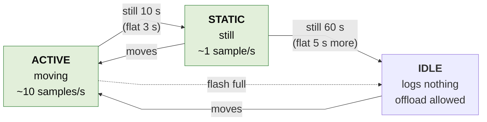
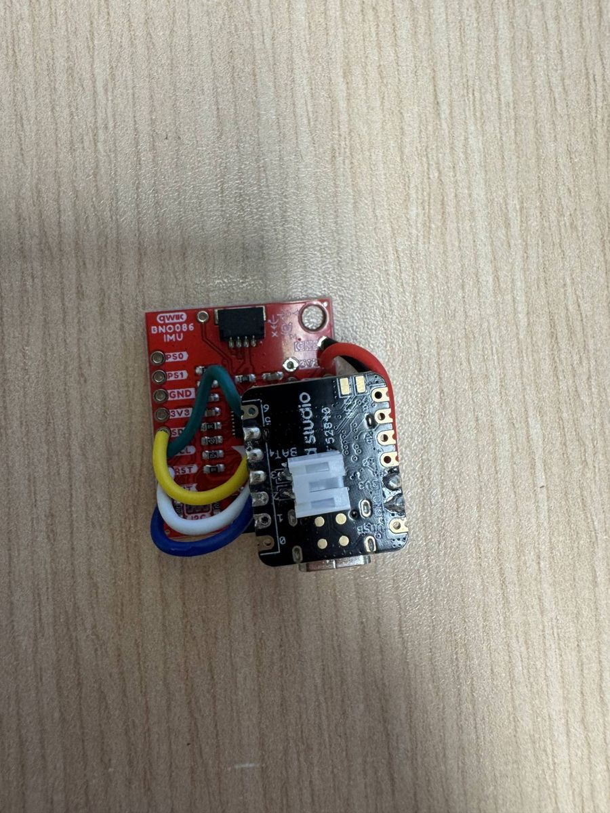
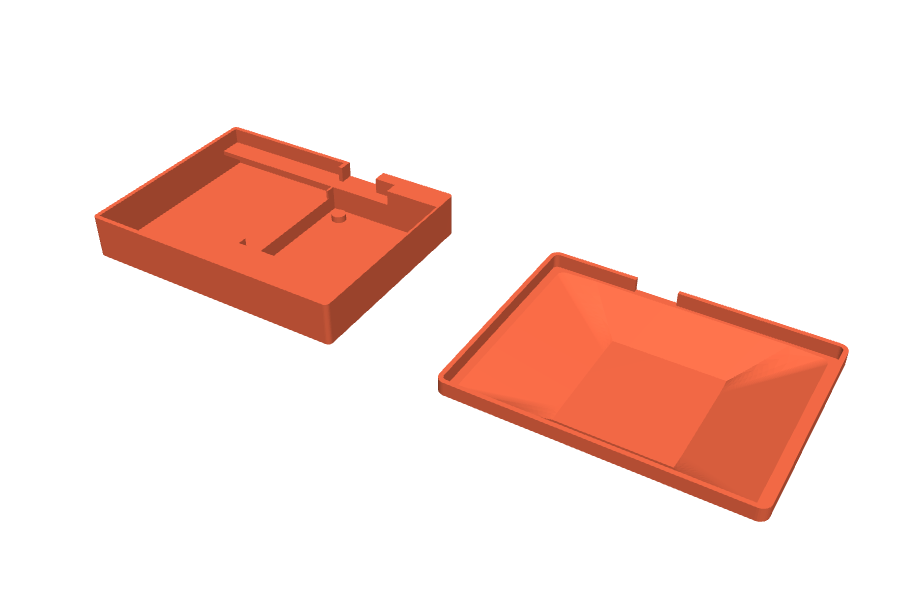
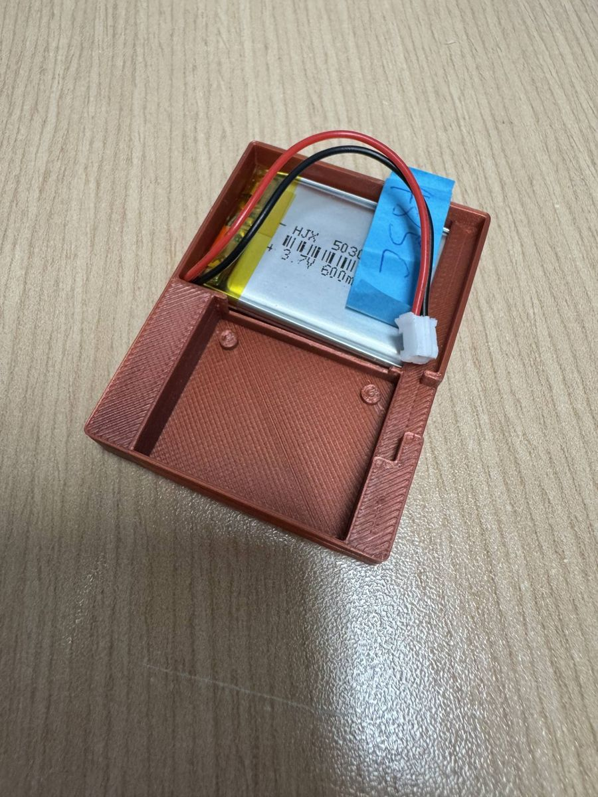
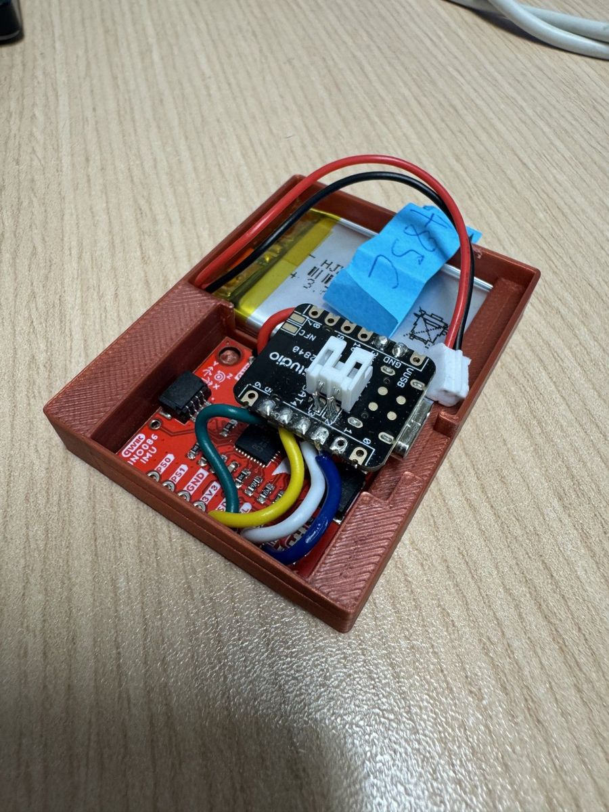
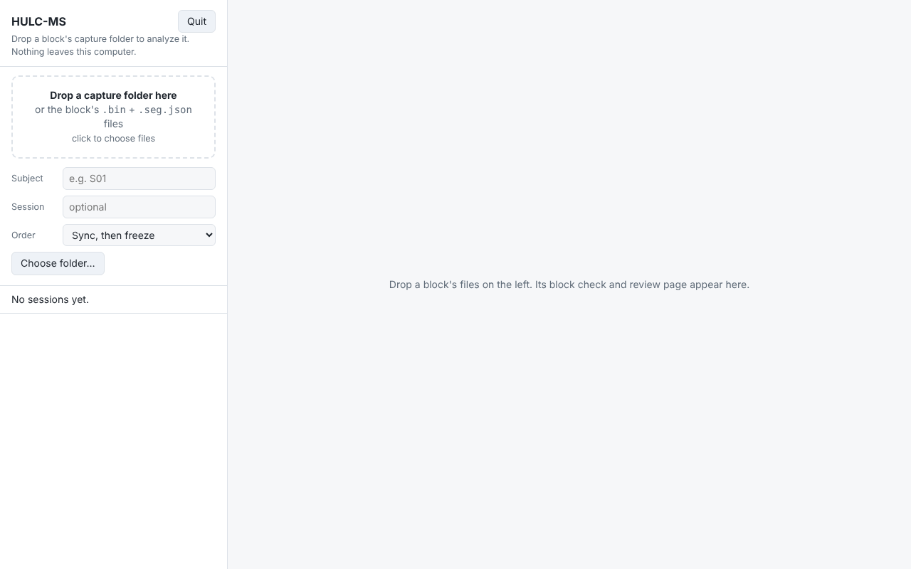
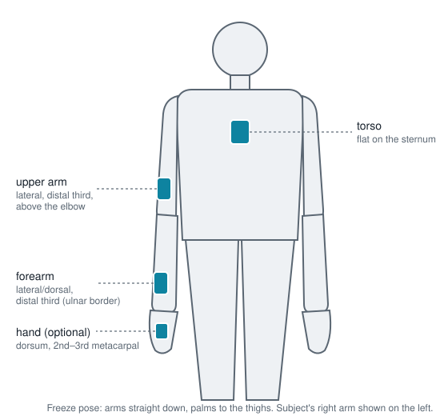
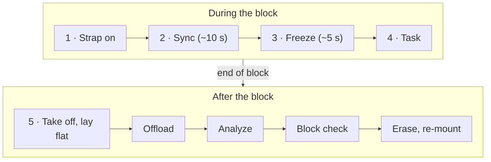
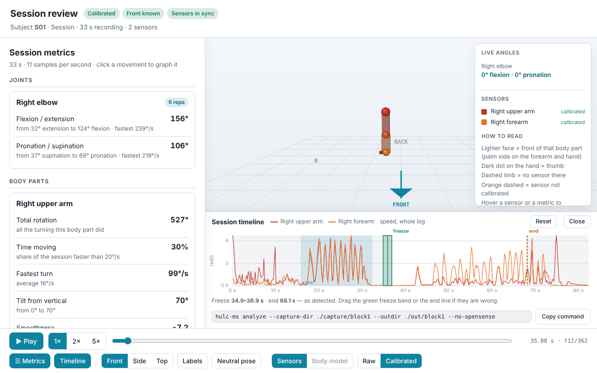

# HULC Motion Shirt: How to Build & Use

*Standard operating procedure (SOP) for building the nodes, setting up the software, recording a session, and analyzing and reviewing the data.*

*Version: October 2026. Prepared by Jamie Kim.*

The operating manual: everything hands-on in one place. This file is also the
source of the *HULC Motion Shirt: How to Build & Use* Word document. How the
nodes and the analysis work inside, and why, is in
[`TECHNICAL_REFERENCE.md`](TECHNICAL_REFERENCE.md).

- [1. Purpose and scope](#1-purpose-and-scope)
- [2. Building a node](#2-building-a-node)
- [3. Software setup](#3-software-setup)
- [4. Setting up the nodes (once per rig)](#4-setting-up-the-nodes-once-per-rig)
- [5. Pre-session checklist](#5-pre-session-checklist)
- [6. Recording a block](#6-recording-a-block)
- [7. After the block recording (offload)](#7-after-the-block-recording-offload)
- [8. Reviewing the analysis](#8-reviewing-the-analysis)
- [9. Data handling](#9-data-handling)
- [10. Troubleshooting](#10-troubleshooting)
- [11. After the session](#11-after-the-session)
- [Appendix A. hulc-ms command reference](#appendix-a-hulc-ms-command-reference)
- [Appendix B. Running from Python, and the regression library (for developers)](#appendix-b-running-from-python-and-the-regression-library-for-developers)
- [Appendix C. Releasing a new version (for developers)](#appendix-c-releasing-a-new-version-for-developers)
- [Appendix D. Bench checks](#appendix-d-bench-checks)


## 1. Purpose and scope

This SOP describes how to build the HULC Motion Shirt nodes, set up their
software, record a session with a participant, and analyze and review the
recording. It covers the system as it currently exists: sensor nodes strapped
to the body, offloaded over Bluetooth from a laptop, and analyzed by the
*hulc-ms* program on a computer.

**How it works.** Each node is a small board with an orientation sensor,
strapped to one body segment (for example the upper arm). While the
participant moves, every node records its orientation about 10 times a second
(about once a second when still) to its own memory. While the nodes are idle, the laptop copies each node's recording into a folder (one folder per block). The
analysis lines up the nodes' clocks from a short shared movement, calibrates
each node to its bone from a freeze held for about 5 seconds (s), and reports
joint angles and range of motion, with an OK / UNUSABLE check of the
recording and a 3D review page.

Key terms used in this SOP:

- **Node.** One sensor unit in its case, strapped to one body segment. Each
  advertises a unique Bluetooth name, `HULC-IMU-XXXX`.
- **Segment.** The body part a node is on: `torso`, `upper_arm_l/_r`,
  `forearm_l/_r`, `hand_l/_r`.
- **Montage.** Which node is on which segment. A joint can be measured only
  if both of its segments have a node (shoulder: torso + upper arm; elbow:
  upper arm + forearm).
- **Block.** One segment of the data collection: mount the nodes, collect
  (starting with the sync movement and the freeze), then offload and erase. Each block gives one **capture folder**, analyzed on its
  own. Re-mounting the nodes, or a strap slipping, starts a new block.
- **hulc-ms.** The analysis program. It runs as the **HULC-MS app** (a page
  in your web browser that runs entirely on your computer; no internet
  connection is needed) or as `hulc-ms` commands in a terminal (§3.3).
- **Enroll.** Telling each node, once, which segment it is on (§4.1).
- **Sync movement / freeze.** The short shared movement and the 5 s still
  pose at the start of every block (§6.2, §6.3).
- **Block check.** The analysis's verdict on a block: **OK**, **NOTE** (usable,
  read the note) or **UNUSABLE** (its numbers can't be trusted unless fixed in
  the analysis) (§7, §10.1).
- **Body model (optional).** A second way to turn the nodes' orientations
  into joint angles: OpenSim fits a published body model to all the nodes
  at once. It needs the Python install with OpenSim (Appendix B); the review
  page then gets a **Sensors / Body model** switch.

### 1.1 The node's states

What a node does depends on how it is moving (Figure 1).



*Figure 1. The node's states and what triggers each change.*

| **State** | **Logging** | **Can the laptop connect?** | **Reached by** |
|---|---|---|---|
| ACTIVE | ~10 samples per second | No | Movement |
| STATIC | ~1 sample per second | No | 10 s without movement, or 3 s lying flat |
| IDLE | Nothing | Yes (offload, erase, enroll) | 60 s without movement, or about 8 s lying flat |

Keep in mind:

- The laptop can only reach a node in **IDLE**: lay the nodes flat (e.g. on
  the charger) and wait about 10 s before offloading.
- A node still for **60 s or more** stops logging until it is moved again.
  Keep rests short (§6.2, step 4).
- A recording stays on the node until it is erased. **Erase only after the
  offload is complete and checked** (§7).

> **Safety and use limits.** This is a research prototype worn on the body.
> Each node runs on a 3.7 V LiPo battery: do not wear a node while it is
> charging, do not use a node whose battery is swollen or damaged, and keep
> the case closed when worn. Check the skin under the straps after each
> session.

## 2. Building a node

To assemble a node you need the following materials and equipment. The
assembly involves soldering: follow the safety instructions for each piece
of equipment, wear the appropriate personal protective equipment, and work
in a well-ventilated area.

| **Qty** | **Item** | **Notes** |
|---|---|---|
| 1 | Seeed Studio XIAO nRF52840 | Microcontroller with Bluetooth, onboard 2 MB flash for the log, and a battery charger on its USB-C port |
| 1 | SparkFun BNO086 IMU breakout (Qwiic) | Orientation sensor; connected over I²C |
| 1 | 3.7 V 600 mAh LiPo battery | With a 2-pin JST plug |
| 1 | 2-pin JST socket | Soldered to the XIAO's battery pads, so the battery can be unplugged |
|  | Hook-up wire | Four short signal wires (SDA, SCL, INT, RST) plus a red / black pair for power |
|  | Soldering iron, solder, flux | Flux is optional |
|  | Wire cutter and stripper, tweezers |  |
|  | Multimeter | To check the joints and the battery polarity |
| 1 | 3D printed case (body + lid) | Printed from `hardware/HULC_MS_Wearable_Case.stl` in the repository |
|  | Label tape | To mark each node with its ID (§4.1) |
|  | Elastic straps | To hold each node firmly on its segment; other secure mountings can be used instead |

### 2.1 Wiring

The XIAO sits directly on top of the BNO086 breakout (Figure 2), joined by
short wires:

| **BNO086 pin** | **XIAO pin** | **Purpose** |
|---|---|---|
| 3V3 | 3V3 | Power (red) |
| GND | GND | Ground (black) |
| SDA | D4 (SDA) | I²C data |
| SCL | D5 (SCL) | I²C clock |
| INT | D2 | Sensor interrupt |
| RST | D3 | Sensor reset |

1.  Cut six short wires, just long enough to reach between the stacked
    boards, and strip both ends (about 2 mm).
2.  Solder the red wire from the breakout's **3V3** pad to the XIAO's
    **3V3** pin, and the black wire from **GND** to **GND**.
3.  Solder the four signal wires as in the table above. Check each wire against the pin labels printed on both
    boards.
4.  With the multimeter, check each joint for continuity and that no two
    neighbouring pins are bridged.
5.  *(For deployment)* Cut the **LED** solder jumper on the BNO086 breakout, and the XIAO's
    power-LED jumper. These LEDs are wired to power and cannot be turned off
    in firmware; each draws about 1–3 mA, all the time.



*Figure 2. The board stack: the XIAO nRF52840 on top of the SparkFun BNO086 breakout, joined by short hook-up wires.*

### 2.2 Battery connector

1.  Solder the 2-pin JST socket to the battery pads on the underside of the
    XIAO: **BAT+** and **BAT−**.
2.  Before plugging in a battery, check with the multimeter that the
    battery's red lead will meet **BAT+**. A reversed LiPo can destroy the
    board.
3.  Plug in the battery and connect USB-C: the XIAO charges the battery from
    its USB-C port.

### 2.3 Case

1.  3D print the case from `hardware/HULC_MS_Wearable_Case.stl` (Figure 3).
    The file holds both parts, laid flat: the **body** and the **lid**. Each
    part is about 48 mm wide, and the body about 17 mm tall (model units,
    assumed mm). For the MSK-IF prototype, PLA filament was used.



*Figure 3. The two printed parts: the body and the lid.*

2.  Remove the supports from the prints and clean up the rough edges.
3.  Carefully lay the battery flat in the body's back compartment, its lead running
    round the side towards the JST socket (Figure 4).



*Figure 4. The battery in the back compartment of the body.*

4.  Place the board stack in the front well with the XIAO's USB-C port in the
    side cut-out (Figure 5). When it
    is properly placed, the cylindrical pegs stop the BNO086 from moving. The
    cut-out fixes the node's orientation in the case, which is what keeps
    "same node, same way round" repeatable when it is strapped on.
5.  Close the lid, lining it up with the USB-C opening. Use adhesive for a
    more secure lid.

**Note: the USB-C opening is narrow.** USB-C cables with a thicker plug do
not fit. Widening the opening is listed as a next step in the project
handover (§1.2).



*Figure 5. A complete node: the board stack in the front well, the USB-C port at the side cut-out.*

Once done, flash the firmware (§3.2), then label each node with its
`HULC-IMU-XXXX` suffix (the blue tape in Figure 4) so it can be identified
without connecting to it.

## 3. Software setup

### 3.1 Firmware tools

The Arduino IDE is used to load the firmware onto a node.

1.  Install the Arduino IDE (version 2.x) from arduino.cc (or use
    `arduino-cli`).
2.  Open **Tools → Board → Boards Manager**, search for **Seeed nRF52
    mbed-enabled Boards** and click **Install**.
3.  Open **Tools → Manage Libraries**, then search for and install
    **ArduinoBLE** and the **SparkFun BNO08x Arduino Library**. (The flash
    driver ships with the board package; nothing else to install.)

### 3.2 Flashing a node

1.  Download the project files from the repository
    (https://github.com/Jamie215/HULC_motionshirt): green **Code** button →
    **Download ZIP**, then unzip.
2.  Connect the node by USB-C. In the Arduino IDE, open
    `firmware/firmware.ino`.
3.  Select the **XIAO nRF52840** board (in the Seeed nRF52 mbed-enabled
    list) and its port (**Tools → Port**), then click **Upload** (→ arrow).
    Wait for **Done uploading**.
4.  Open **Tools → Serial Monitor**. The node prints
    `[BLE] Advertising as HULC-IMU-XXXX`; write the four characters on the
    node's label. Moving the node should show its state changing.

Every node gets the same firmware; each derives its unique name from its
Bluetooth address.

### 3.3 Installing hulc-ms

**Standalone app (no Python needed).** Download the latest release from the
repository's **Releases** page
(https://github.com/Jamie215/HULC_motionshirt/releases/latest; no GitHub
sign-in needed):

- **Windows:** `hulc-ms-windows.zip`. Unzip it into a normal folder (not from
  inside the zip) and double-click `hulc-ms\hulc-ms.exe`. On first launch,
  "Windows protected your PC" appears: choose **More info → Run anyway** (the
  app is not code-signed).
- **macOS:** `hulc-ms-macos.zip`. Unzip it, then the first time open
  `hulc-ms.app` with right-click → **Open**.
- **Linux:** `hulc-ms-linux.tar.gz`. Run `tar xzf hulc-ms-linux.tar.gz`, then
  `hulc-ms/hulc-ms`.

Double-click **hulc-ms** to start the HULC-MS app: a browser tab opens at
`http://127.0.0.1:8765/` (Figure 6). Keep the black window open while you use
it; **Quit** on the page stops it.



*Figure 6. The HULC-MS app's home page: the drop area and the subject, session and order fields.*

The same program runs every command in a terminal (Appendix A). On Windows,
open a Command Prompt in the hulc-ms folder and type `hulc-ms`; on macOS use
`hulc-ms.app/Contents/MacOS/hulc-ms`, on Linux `hulc-ms/hulc-ms`.

To run from the repository with Python instead (needed for body-model solves
with OpenSim), see Appendix B.

**Bluetooth connection.** A Windows desktop forces a slow Bluetooth
connection (unless it has a dedicated Bluetooth dongle), so offloads can take
minutes instead of seconds (§10.2). Other platforms (for example Linux, macOS
or a phone) can be faster, but their speed has not been measured yet.

## 4. Setting up the nodes (once per rig)

### 4.1 Enroll

Enroll tells each node which segment it is on. The node stores it, through
power cycles and erases, and every recording then carries it.

1.  Run the command with the segments you will use. For example:
    `hulc-ms nodes enroll --segments upper_arm_r,forearm_r`
2.  When asked for the first segment, power on **only** that node and press
    Enter. With only one node advertising, its ID is unambiguous.
3.  Type a physical label (e.g. "orange tape") and mark the node. This makes
    the node easy to identify later.
4.  The node is erased if it holds data (you are asked `[y/N]` first;
    `--no-erase` skips this), its segment is stored, and it is read back.
5.  Repeat for each segment.

Enroll also writes `montage.json` (a record of the rig) and
`nodes_registry.json` (each node's ID, segment and label). Next time, the same
labelled nodes can be reused with `enroll … --reuse`, which only scans. To see what each node
stores: `hulc-ms nodes read-segments`. Moving a node to a different segment
requires enrolling it again.

The options:

| **Option** | **What it does** |
|---|---|
| `--segments` (required) | The segments to enroll, separated by commas, in the order you will power the nodes on: `torso`, `upper_arm_r`, `forearm_r`, `hand_r` (and `_l` for the left side) |
| `--reuse` | Use the nodes already listed in `nodes_registry.json`, without powering them on one at a time |
| `--no-erase` | Do not erase a node that still holds data (its segment is still stored) |
| `--subject`, `--session` | The participant and session IDs written into `montage.json` (an ID, never a name) |

A `montage.json` edited by hand must stay UTF-8. The tools accept a UTF-8 BOM
(Notepad, PowerShell `>`), but a UTF-16 file must be re-saved.

**Connections are the slow part.** Every Bluetooth command connects to each
node first (slow, especially from Windows), so a routine block touches
Bluetooth only twice: erase before strapping on (skipped if the node is
already empty) and offload. Nothing is connected while the
participant records.

### 4.2 Link check (new rig, or a flaky link)

With the nodes still and powered:
`hulc-ms nodes check --count 2 --duration 30`.
Every node should read `synced=True` with a small, stable cross-node offset.
A bad result points at the Bluetooth link before a recording is wasted on it.

### 4.3 Erase before the first block

`hulc-ms nodes erase --count N`, where N is the number of nodes, wipes
every node that holds data (about 30 s
each; empty nodes are skipped). Do not power a node off mid-wipe.

## 5. Pre-session checklist

- [ ] Every node is **charged**, enrolled for its segment (§4.1), and
  **erased** (§4.3).
- [ ] The montage fits the question: **shoulder** → torso + upper arm;
  **elbow / forearm** → upper arm + forearm; both → all three.
- [ ] If possible, choose a recording spot **away from large metal**, which
  can disturb the sensors' magnetometers. Use the same spot for the whole
  session.
- [ ] The laptop has hulc-ms installed (§3.3).
- [ ] Straps are ready: they hold each node firm and flat on its segment. Strap wobble is
  the largest error left at 10 samples per second.

## 6. Recording a block

### 6.1 Where each node goes

The calibration removes the effect of how a node sits on its segment. What it cannot fix is muscle moving the node
without the bone moving, and a different placement between sessions. Place
each node **over the least muscular tissue, next to a bony landmark you can
feel, flat, the same way round every time** (Figure 7).

| **Segment** | **Recommended location** | **Referenced to** | **Avoid** |
|---|---|---|---|
| Torso | Front, flat on the **sternum** | Sternal midline | Chest muscle and upper abdomen (muscle and breathing) |
| Upper arm | **Outer side**, lower third, just above the elbow | Lower end of the humerus | The biceps belly (bulges when the elbow bends) |
| Forearm | **Outer / back side**, lower third | The ulnar border (bone under the skin) | Palm-side muscles |
| Hand (optional) | Flat on the **back of the hand** | 2nd–3rd knuckle bones | — |



*Figure 7. Where each node goes (front view).*

The torso node must be on the front of the chest: the analysis works out
which way the subject faces from it. A good mounting lies flat (it does not
rock when one edge is pressed), does not slide when the skin is pushed, and
has its case mark facing the same way every time.

### 6.2 Data collection workflow

| **#** | **Steps** | **Sample instructions to participant** |
|---|---|---|
| 1 | **Strap on** every node. Each node should be connected to its battery before it is strapped on (there is no power switch). | — |
| 2 | **Sync movement, about 10 s.** Every node must move. | *With a torso node:* "Hand on your hip. Twist your upper body left and right, five times." *Arm only:* "Arm straight. Swing it forward and back, five times." |
| 3 | **Freeze, about 5 s,** straight after. | "Arms down, palms to your legs. Freeze ... two, three, four, five." |
| 4 | **The task.** Smooth, at most about 1 repetition per second. Rest 5–8 s between sets. Never stay still for a minute or more. Arm-only sessions: include a few elbow bends. | "Raise your arm forward, as high as is comfortable, and down, five times." |
| 5 | **Done:** take the nodes off and lay them flat (on the charger, if they need charging). | — |

After a long break, repeat steps 2–3 first. Figure 8 shows the whole cycle, including the
routine after the block (§7).



*Figure 8. One block, from strapping on to the next block.*

### 6.3 The sync movement and the freeze

Both are needed at the start of every block to align all nodes and
calibrate their mounted orientation for the block.

| **Montage** | **Sync movement** | **Key points** |
|---|---|---|
| Upper arm + forearm | **Whole-arm swings** forward and back from the shoulder, elbow **locked straight**, about 60–90° each way | Bending the elbow during the swing weakens the match |
| Torso + upper arm | **Trunk twists** left and right, ±30–45°, with the hand **on the hip** | An arm swing leaves the torso still, so it cannot align the torso node |
| Torso + upper arm + forearm | **Trunk twists** as above, whole arm against the side | One movement moves all three nodes |

**The freeze pose (N-pose):** a neutral pose: standing upright, weight even, looking ahead
(seated is fine if the trunk is upright and the arms hang free of the chair);
arms straight down at the sides, **elbows fully straight**, shoulders
relaxed; **palms facing the thighs** (thumbs forward).

### 6.4 Task rules and timings

- **Speed:** at most about 1 repetition per second, smooth. Fast snaps
  (above about 300°/s) are where the angles are worst.
- **Range:** the full range of interest, but not past what the participant
  can hold steadily.
- **No torso node:** the front direction then comes from the elbow's hinge,
  which needs at least 30° of elbow bending somewhere in the block. Curls
  cover it; otherwise add three slow elbow bends.
- **Straps:** if a strap slips or is adjusted, end the block there (take the
  nodes off, offload) and start a new one.

How long each step should last. The analysis looks for these patterns
automatically, so a step that is too short or too long may not be found:

| **Step** | **Duration** | **Why** |
|---|---|---|
| Sync movement | At least 4 s, ideally about 10 s: 3–5 cycles of about 1–1.5 s each | The clocks are aligned by matching the nodes' movement; faster than about 2 cycles per second is too fast for 10 samples per second |
| Freeze | At least 3 s, ideally about 5 s, at most 8 s; starting within 20 s of the movement | It must be the first still stretch after the movement |
| Nodes taken off | Lying flat for at least 10 s | Offload needs the nodes in IDLE |

The analysis uses only the part of the recording from the freeze to where
the nodes come off (Figure 9).

```mermaid
%%{init: {"gantt": {"useWidth": 960, "fontSize": 20, "sectionFontSize": 20, "barHeight": 34, "barGap": 8, "leftPadding": 190, "gridLineStartPadding": 40}}}%%
gantt
    dateFormat X
    axisFormat %s s
    section Subject
    Strap on (not analyzed)       :a1, 0, 20
    Sync movement (4–10 s)        :crit, a2, 20, 30
    Freeze (3–8 s, within 20 s)   :crit, a3, 30, 35
    Task set 1                    :a4, 35, 55
    Rest (5–8 s)                  :a5, 55, 61
    Task set 2                    :a6, 61, 81
    Nodes taken off, flat (≥ 10 s) :a7, 81, 95
    section Analysis window
    Calibrated and measured       :active, b1, 30, 81
```



*Figure 9. An example composition of a block (seconds; the task part varies).*

## 7. After the block recording (offload)

> **For the current prototype.** This chapter is the routine used while the
> prototype is being tested and validated: after every block, the operator
> offloads, analyzes and erases the nodes from a laptop, so that each block
> is checked straight away. In the planned deployment, the nodes are not
> expected to be sent commands after every block; how offloading fits into
> that routine, through the planned mobile app, is still to be designed
> (project handover §1.2, item 4).

The laptop can offload a node whenever the node is idle (§1.1). The intended
routine is to offload while the nodes charge, so that they are ready for the
next block.

1.  **Take the nodes off** and lay them flat (on the charger, if they need
    charging). Lying flat sends them to IDLE within about 8 s; only then can
    the laptop connect.
2.  **Offload** into a new folder for this block. For example, to offload 2
    nodes for participant S01:
    `hulc-ms nodes offload --count 2 --out-dir ./capture/block1 --subject S01`

    The command looks for idle nodes, connects to each, and copies its log
    into the folder. Any part lost on the way is requested again, and each
    node reports `COMPLETE — saved N bytes` when its log is whole. If a node
    is not complete, run the same command again: it asks only for the
    missing parts, and the log stays on the node until it is erased. The
    folder then holds everything about the block: each node's log, which
    segment it was on, and a `montage.json` built from that. Keep the folder
    whole. (A `montage.json` already in the folder for the same nodes is
    kept; one for other nodes is never overwritten.)

    | **Option** | **What it does** |
    |---|---|
    | `--count` | How many nodes to offload (default 2). The command waits until it finds this many idle nodes |
    | `--out-dir` | The block's folder; use a new folder for every block |
    | `--subject`, `--session` | The participant and session IDs written into `montage.json` (an ID, never a name) |
    | `--name` | Only the node whose name contains this text (e.g. `--name 485C`) |
    | `--erase-after` | Erase each node straight after its offload is verified (step 5) |

3.  **Analyze** the block, in either of two ways:
    - **The HULC-MS app:** type the subject ID and drop `./capture/block1` on
      the page.
    - **The command:**
      `hulc-ms analyze --capture-dir ./capture/block1 --outdir ./out/block1`
      (`--capture-dir` is the block's folder, `--outdir` where the results
      go).

    The command first prints which montage it used and which log belongs to
    which segment (`n0 upper_arm_r <- HULC-IMU-485C.bin`, …): check this
    against where the nodes really were. If a node stored the wrong segment,
    `--montage FILE` gives the right montage instead, and the run warns where
    it disagrees with a node. With OpenSim installed (Appendix B), every
    block is also solved on the body models, and the review page gets a
    **Sensors / Body model** switch.
4.  **Read the block check** at the top of the app page (Figure 10), or at
    the end of the command's output:
    - **OK:** the block is usable (read any NOTE lines).
    - **UNUSABLE:** first try the fix in the analysis (set the freeze or the
      end on the Timeline, §8). If that does not help, note the block as
      unusable in the session notes, and apply what the line says to the
      next block. A collection period cannot be repeated, so the check is
      there to keep spoiled data out of the results and to improve the
      blocks still to come. Each line is explained in §10.1.


*Figure 10. The app after analyzing a block: the block check at the top (OK, with one NOTE), the review page below.*

5.  **Erase** the nodes: `hulc-ms nodes erase --count N` (N nodes). Erasing only after
    the check keeps the block on the node until then, in case a transfer
    looked complete but was not. A node that is already empty is skipped;
    for one that holds data, the command asks `[y/N]` first (`--yes` skips
    the question). Offloading with `--erase-after` does steps 2 and 5 in one
    connection, which is faster, but the block is then gone from the node
    before it has been checked.
6.  **Re-mount** for the next block: same node, same segment, same spot and
    orientation. Start again at §6.2, step 1.
7.  *Optional, but it is how the analysis gets better:* if the block was new
    in some way (a new person, montage or room) or the analysis got it
    wrong, keep it as a test case with **Keep as test case…** in the app
    (Appendix B).

**Why one block per folder.**

- One block is one mounting. A re-mounted node sits at a slightly different
  angle, so it needs its own freeze, and each folder is calibrated on its
  own.
- If a node must come off mid-block without an offload (avoid this),
  analyze the part after it separately, with that part's own freeze:
  `hulc-ms analyze … --window t0,t1`.
- If a battery runs flat mid-block, the node's clock starts again from zero
  when it is recharged. The analysis keeps the larger part and warns; the
  rest is not analyzed.
- Never swap nodes between segments without enrolling them again: each node
  stores its segment, and the block's montage is built from what the nodes
  store. (A one-off swap can be fixed afterwards with `--montage`.)

## 8. Reviewing the analysis

The review page (Figure 11) shows the movement as a 3D figure beside the
session metrics: range of motion per joint and movement, speed, repetitions,
and per-segment activity. **Play** and the slider move through the
recording; **Front / Side / Top** change the view; hovering a metric
highlights the body part it measures.


*Figure 11. The review page: session metrics on the left, the 3D figure with live angles on the right.*

**Check the calibration.** Click **Neutral pose**, then switch **Raw ↔
Calibrated** (Figure 12). In Calibrated, the arm should hang straight down,
palms to the thighs. If it does not, the freeze pose or the strap was wrong.


*Figure 12. The same freeze in side view. Left, Raw: the nodes as they sit. Right, Calibrated: the arm hanging straight, as it should.*

**Correct the freeze or the end.** Click **Timeline** (Figure 13). It shows
each node's speed over the whole recording, the sync movement, the freeze
(green band) and the end (dashed line). If either was found in the wrong
place, drag it to where it really was (the freeze snaps to the quietest 2 s
nearby), then press **Apply** in the app, or **Copy command** and run it.



*Figure 13. The Timeline: each node's speed, the sync movement, the freeze band and the end line, and the command box.*

**Graph a movement.** Click a movement in the metrics (e.g. *Flexion /
extension*) to graph it over time (Figure 14), with the session's maximum
and minimum marked.


*Figure 14. Elbow flexion / extension over a block of six bends.*

What the analysis writes (in `./out/block1`, or in the app's session folder):

| **File** | **Content** |
|---|---|
| `block_check.json` | The verdict (OK / UNUSABLE) and one line per check |
| `session.html` | The review page; opens in any browser, no installation needed |
| `metrics.json` | Range of motion, speed, repetitions and plausibility per joint and movement; segment and derived metrics |
| `calibration.json` | The freeze window, mounting offsets, facing, and where the recording ends |
| `aligned.csv` | All nodes' orientations on one timeline |
| `aligned.quality.json` | Per node: clock offset, alignment confidence, data gaps, clock restarts |

## 9. Data handling

- **Where files live.** Capture folders are wherever you offload them. The
  HULC-MS app keeps copies of the dropped files and every analysis in the
  `HULC_sessions` folder in your home folder; the original files are never
  changed, and **Remove** deletes a session's copies.
- **Keep each block's folder whole.** Without the `.seg.json` files a log
  does not say what it measured.
- **Use participant IDs, never names**, in the subject field, folder names
  and test-case names.
- **Never commit recordings to the repository.** Capture folders, logs and
  generated files are excluded from it by design. The regression library's
  recordings are kept for reference.
- **Storage and access rules** follow the study's data-governance plan.

## 10. Troubleshooting

### 10.1 The block check, line by line

The analysis ends with `BLOCK CHECK: OK` or `UNUSABLE` and one line per check
(also saved as `block_check.json`). A real one, from an upper arm + forearm
block:

```
===== BLOCK CHECK: OK (1 note) =====
  OK    Sync         every node lined up on one clock
  OK    Freeze       freeze found 3 s after the sync movement (15824–32360 ms): 34868–36868 ms
  OK    Facing       from the elbow bending
  OK    Session end  analysis ends at 68.1 s where the nodes came off
  NOTE  Angles       Right elbow + forearm: implausible angles
                     -> check the freeze pose (palms, elbows straight) and strap slip
```

What each line means, and what to do:

| **Check** | **UNUSABLE / NOTE when** | **For the next block** |
|---|---|---|
| Sync | UNUSABLE: a node was not aligned, or the match was weak | A bigger sync movement that moves every node (§6.3) |
| Clock | NOTE: a node rebooted mid-block | Charge before the battery runs out |
| Logging rate | NOTE: under 8 samples per second | Check the firmware version; the flash may be nearly full |
| Freeze | UNUSABLE: no clean freeze after the sync movement; NOTE: a node was not fully still | Freeze about 5 s right after the movement, palms to the thighs (this block: set the freeze on the Timeline if there was a still hold) |
| Facing | NOTE: front direction unknown, angles relative only | Torso node flat on the sternum; no torso node: include elbow bends |
| Session end | NOTE: the nodes were not seen coming off | Set the end on the Timeline (§8) |
| Trunk | UNUSABLE: the torso tilted over 30° for most of the session (calibrated in the wrong pose, or its strap moved) | Strap the torso node on before the sync movement (this block: set the freeze on the Timeline) |
| Angles | UNUSABLE: a joint outside physiological limits for over 25% of the session; NOTE: some implausible angles | Check the freeze pose, the facing, and strap slip |
| Model fit | NOTE: the body model lost the sensors for some seconds | Compare with the Sensors view on the review page |

### 10.2 Common problems

| **Symptom** | **Likely cause** | **Action** |
|---|---|---|
| Offload takes minutes or hours | A Windows desktop forces a slow Bluetooth connection | Use a dedicated Bluetooth dongle or another platform (§3.3); `offload --count 1` prints the speed |
| Many `pass 2: re-requesting …` lines | Weak link, distance, the body blocking the signal | Node close to the laptop, in line of sight; run offload again to fill the gaps |
| Offload rejected or empty | Node not in IDLE, or nothing recorded | Lay the nodes flat and wait about 10 s; check the block was recorded |
| Enroll: "N nodes advertising" | More than one node powered on | Power on only the node being enrolled |
| Enroll: "no HULC node advertising" | Node off, not advertising yet, or connected to something else | Power it on, wait a few seconds, retry |
| `analyze: node log not found` | Wrong folder, or a node did not offload COMPLETE | Point at the block folder; run offload again for the missing node |
| `no montage: … cannot describe itself` | A log without a `.seg.json` (node never enrolled, or older firmware) | Enroll the node, or pass `--montage montage.json` |
| `json … Expecting value` | A hand-edited `montage.json` is empty or saved as UTF-16 | Re-save it as UTF-8 |
| Part of the task missing from the data | Still for 60 s or more: the nodes stopped logging until moved | Keep rests to 5–8 s; after a long break repeat the sync movement and freeze |
| Nodes disagree on direction, no warning | Working next to metal | Record away from large metal (§5) |
| Rest of a block calibrated wrongly | Re-mounted without offloading | Always offload and erase before re-mounting |

## 11. After the session

1.  Make sure every block was offloaded **COMPLETE** and its block check
    read (§7).
2.  Copy the capture folders and the analysis to the study storage (§9).
3.  Erase the nodes (§4.3), then charge them.
4.  Note any problems (UNUSABLE blocks, slow offloads, a node that would not
    connect) for the next session.

## Appendix A. hulc-ms command reference

What to type for `hulc-ms`:

| **You have** | **Type `hulc-ms` as** |
|---|---|
| Standalone app, Windows | `hulc-ms` in a Command Prompt opened in the hulc-ms folder (in PowerShell, `.\hulc-ms`) |
| Standalone app, macOS / Linux | `hulc-ms.app/Contents/MacOS/hulc-ms` / `hulc-ms/hulc-ms` |
| Repository, Windows | `hulc-ms` in a Command Prompt in the repository folder |
| Repository, macOS / Linux | `python3 hulc-ms.py` (or `./hulc-ms.command`) |

| **Command** | **What it does** |
|---|---|
| `hulc-ms` | Starts the HULC-MS app |
| `hulc-ms nodes enroll --segments torso,upper_arm_r` | Once per rig: power one node at a time; each node stores its segment (§4.1) |
| `hulc-ms nodes read-segments` | Shows the segment each node stores |
| `hulc-ms nodes offload --count 2 --out-dir ./capture/block1 --subject S01` | After a block (nodes idle): each node's log and the block's montage into the folder (§7) |
| `hulc-ms analyze --capture-dir ./capture/block1 --outdir ./out/block1` | The analysis: block check at the end, review page `out/block1/session.html` |
| `hulc-ms validate --capture-dir ./capture/block1` | Checks a capture folder (`--recursive`: a whole export of many blocks) |
| `hulc-ms nodes erase --count 2` | Wipes the nodes for the next block (§4.3) |
| `hulc-ms nodes check --count 2` | Link check: sync and cross-node clock offset |
| `hulc-ms regress run --data <folder>` | The regression library (Appendix B) |
| `hulc-ms opensense fetch-models` | Once, for body-model solves (Python install with OpenSim) |
| `hulc-ms selftest` | Every tool's self-test: checks an install or a build |

The values in these examples are placeholders; replace them with your own:

| **Option** | **What to put** |
|---|---|
| `--count 2` | The number of nodes to connect to (here 2) |
| `--segments torso,upper_arm_r` | The segments to enroll, separated by commas (§4.1) |
| `--out-dir ./capture/block1` | The folder for this block's offload; a new one for every block |
| `--subject S01` | The participant ID (an ID, never a name) |
| `--capture-dir ./capture/block1` | The block's folder to analyze or check |
| `--outdir ./out/block1` | Where the analysis writes its results |
| `--data <folder>` | The folder that holds the regression library's recordings |

`hulc-ms <command> --help` lists every option. The ones you may need for
`analyze`: `--window t0,t1` and `--end t_ms` (set the freeze and the end by
hand; the Timeline writes these for you), `--protocol hold-first`
(recordings made before October 2026, when the freeze came before the sync
movement), `--montage FILE`
(override the folder's montage), `--facing-deg` (no torso node and too
little elbow bending), `--no-opensense` (skip the body-model solves) and
`--opensense-model PATH` (solve on another model). The options for `enroll`
and `offload` are explained in §4.1 and §7.

## Appendix B. Running from Python, and the regression library (for developers)

You only need this to change the analysis, to run the body-model solves, or
to use a system without a ready-made build.

1.  Install Python 3.11–3.13.
2.  Open a terminal in the repository folder and run:

        pip install -r requirements.txt
        pip install -r requirements-opensense.txt   # optional: OpenSim body-model solves
        python3 hulc-ms.py selftest

    (`hulc-ms.bat` / `hulc-ms.command` offer to do the installation the
    first time they run.)
3.  Start the app with `python3 hulc-ms.py`, or run any command as in
    Appendix A.

**The regression library.** Before and after any change to the analysis,
every case must still pass:

    hulc-ms regress run --data <regression data folder>

The expectations are in the repository (`tools/regress_cases/`); the
recordings are on the lab drive (§9). To add a case, use **Keep as test
case…** in the app, or:

    hulc-ms regress add <date>_<montage> --capture-dir ./capture/block1 --description "what was done, when"

The expectations are pre-filled from today's analysis: **check them against
what really happened**, edit, and commit the new file.

**Running the stages by hand.** `hulc-ms analyze` runs these in order (logs
in montage column order):

    python tools/reconcile_nodes.py <n0>.bin <n1>.bin --out aligned.csv
    python tools/motion_capabilities.py montage.json
    python tools/calibrate_segments.py calibrate aligned.csv montage.json --out calibration.json
    python tools/metrics.py compute aligned.csv montage.json --calibration calibration.json --out metrics.json
    python tools/skeleton_viewer.py render aligned.csv montage.json --calibration calibration.json --metrics metrics.json --out session.html

## Appendix C. Releasing a new version (for developers)

The Windows, macOS and Linux builds are made automatically by GitHub Actions
when a version tag is pushed. This needs Git, a clone of the repository (not
the ZIP), and write access to it.

1.  Create a branch and make the change in `tools/`.
2.  Run `python3 hulc-ms.py selftest` and the regression library
    (Appendix B). All must pass.
3.  Push the branch and open a pull request. CI runs the self-tests and
    builds the standalone app (downloadable from the run's **Artifacts**), so
    it can be tried before merging.
4.  Merge, then tag a version (`v1.1`, …) and push the tag. The builds are
    attached to a GitHub release, and the lab computers download the new
    version from **Releases**.


## Appendix D. Bench checks

**Link check** (§4.2). The offset is only known to within the time one
Bluetooth read takes, so treat it as an upper bound. A large or negative
drift below that is a measurement artifact (`NOT RESOLVABLE`), not the
clocks; real crystal drift is far smaller.

**Offload speed on any central.** The node prints `[OFFLOAD] Done` on its USB
serial with the speed (KB/s) and the time per chunk, which is about the
Bluetooth connection interval the central chose. On a Mac,
`hulc-ms nodes offload --count 1` also prints the speed.

**Re-mount check (optional).** Every block has its own freeze, so this only
confirms that a previous calibration still holds after a node was taken off
and put back. Record a short still hold, offload it into `./redon`, then:

    python tools/reconcile_nodes.py ./redon/<n0>.bin ./redon/<n1>.bin --out redon.csv
    python tools/calibrate_segments.py verify redon.csv montage.json --calibration calibration.json

**Without hardware:** `hulc-ms selftest` checks every tool on synthetic data.
For the Bluetooth side alone: `python tools/reconcile_nodes.py --selftest`
(the clock-alignment math) and `python tools/multinode_test.py selftest` (the
enroll logic). `hulc-ms nodes check --count 1` measures a single link's
delay on its own, separating it from the scheduling of several connections.
