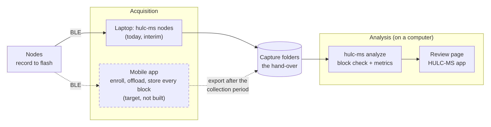
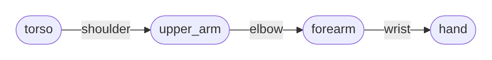
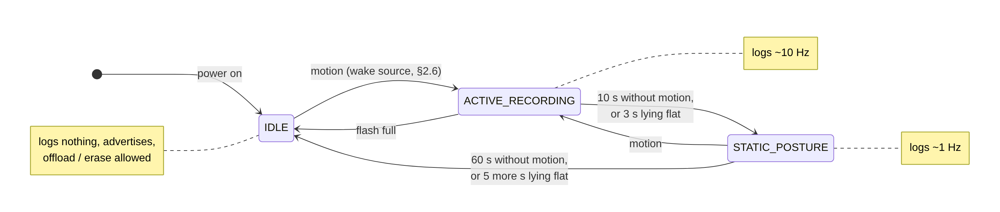
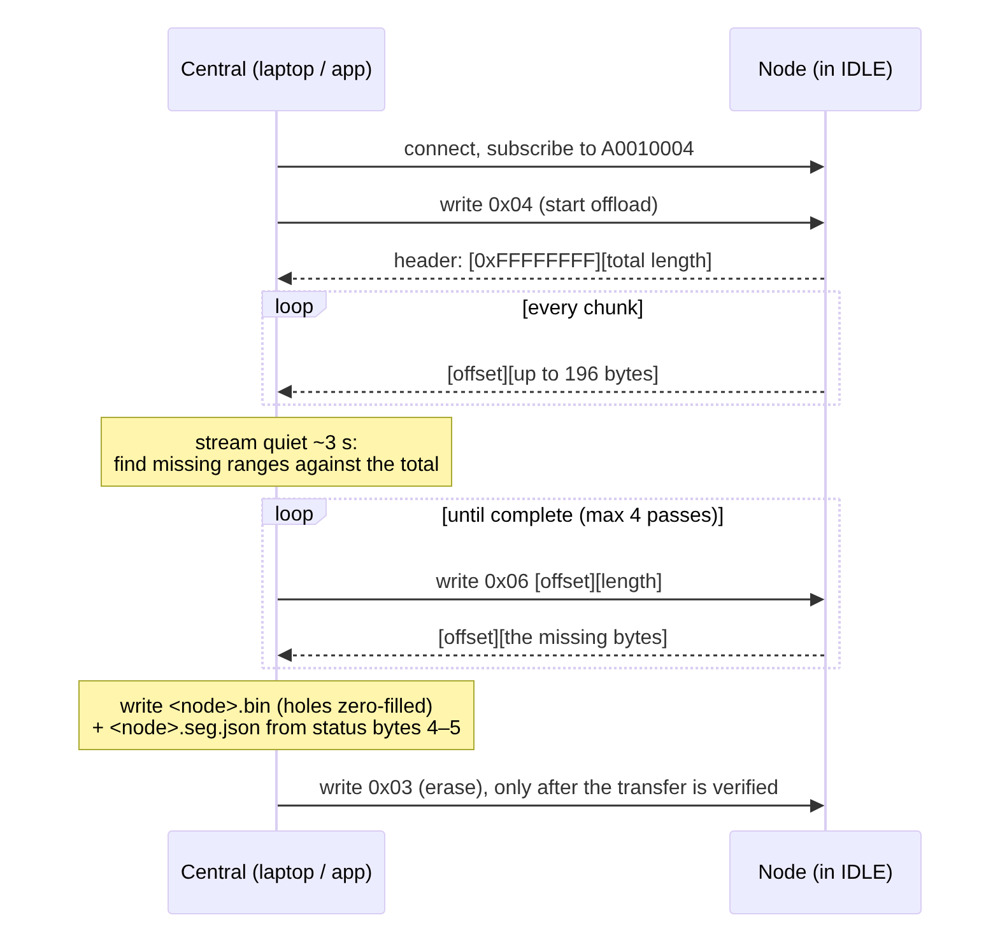
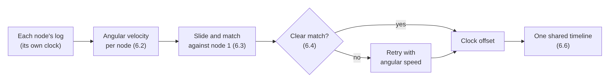
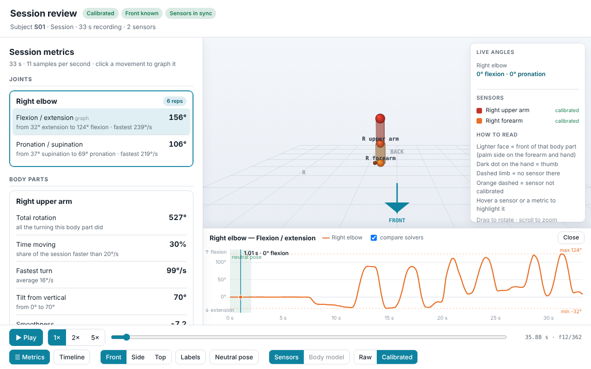
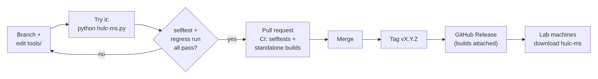

# Technical reference: how the system works, and why

This document describes how the HULC Motion Shirt works inside: the system
and its data formats, the nodes' firmware, the design decisions, the math
behind each number, the evidence for the choice of pose solver, and how to
change the software safely.

1. [The system and the pipeline](#1-the-system-and-the-pipeline)
2. [The capture folder (data format)](#2-the-capture-folder-data-format)
3. [The montage and what it lets you compute](#3-the-montage-and-what-it-lets-you-compute)
4. [The nodes and their firmware](#4-the-nodes-and-their-firmware)
5. [Design decisions: identity, time, calibration, and the recording protocol](#5-design-decisions-identity-time-calibration-and-the-recording-protocol)
6. [Clock alignment](#6-clock-alignment)
7. [Metrics](#7-metrics)
8. [Choosing the pose solver](#8-choosing-the-pose-solver)
9. [Changing the software safely](#9-changing-the-software-safely)

**Key terms**

| **Term** | **Meaning** |
|---|---|
| Quaternion | Four numbers $(w, x, y, z)$ that describe an orientation (which way a node points) without the gaps or jumps of three angles. $q$ and $-q$ describe the same orientation |
| World frame | The shared reference that every node reports in: "up" from gravity and "north" from the magnetometer |
| Angular velocity / speed | How fast something is turning and about which axis (velocity), or only how fast, ignoring the axis (speed) |
| Cross-correlation | Sliding one signal along another and scoring how well they match at each shift; the best shift is the delay between them |
| Lag / offset | How far apart two clocks are (ms). Drift is how fast that offset changes, in parts per million (ppm) |
| DOF | Degree of freedom: one direction in which a joint can move (e.g. elbow flexion) |
| Euler sequence | A recipe for splitting a 3D rotation into three angles about named axes in a fixed order. The ISB (International Society of Biomechanics) recommends one per joint |
| ROM | Range of motion: the span between the smallest and largest angle reached |
| RMS | Root-mean-square: a typical size of an error or signal, which weights large values more |
| Neutral pose / freeze | The still pose held for about 5 s at the start of each block (arms down, palms to the thighs), which defines zero |
| IK | Inverse kinematics: finding the body-model pose that best matches the sensors |
| Node | One sensor board: a BNO086 orientation sensor, a Bluetooth microcontroller, flash memory and a battery |
| Mounting offset | The fixed angle between a node and the bone it is strapped to. It is measured in the freeze and removed by calibration |
| BLE central / peripheral | In Bluetooth Low Energy, the peripheral (a node) advertises and waits; the central (the laptop, later a phone) connects to it and sends commands |
| GATT service / characteristic | How a BLE device lays out its data: a service is a group of characteristics, and each characteristic is one value that the central can read, write, or subscribe to (a "notification" each time it changes) |
| I²C / QSPI | Wired connections between chips on the node's board: I²C links the microcontroller to the BNO086, and QSPI links it to the flash memory chip that holds the log |
| Fourier transform / FFT | Splits a signal into the frequencies it contains. The FFT (fast Fourier transform) is the standard fast way to compute it |

---

## 1. The system and the pipeline

### 1.1 The system: today and the target



<!-- diagram: system-target -->
<details><summary>Mermaid source</summary>

```text
flowchart LR
    N["Nodes<br/>record to flash"]
    subgraph ACQ["Acquisition"]
        L["Laptop: hulc-ms nodes<br/>(today, interim)"]
        M["Mobile app<br/>enroll, offload, store every block<br/>(target, not built)"]
    end
    C[("Capture folders<br/>the hand-over")]
    subgraph AN["Analysis (on a computer)"]
        A["hulc-ms analyze<br/>block check + metrics"]
        R["Review page<br/>HULC-MS app"]
    end
    N -- BLE --> L --> C
    N -. BLE .-> M -. "export after the<br/>collection period" .-> C
    C --> A --> R
    classDef todo stroke-dasharray: 5 5
    class M todo
```

</details>

Solid lines exist today; dashed lines are the target.

The **capture folder** (chapter 2) is where acquisition hands over to
analysis. The two sides do not depend on each other: the mobile app can
replace `hulc-ms nodes` by writing the same folders, and the analysis, the
HULC-MS app and the regression library then work without change. A whole
export (many blocks, many subjects) is a tree of capture folders.
`hulc-ms validate --recursive` checks it, and dropping its top folder on the
HULC-MS app analyzes every block.

| Layer | Status | Code | Talks to the next layer through |
|---|---|---|---|
| Firmware | built | `firmware/firmware.ino` | BLE GATT ([§4.3](#43-ble-protocol--talking-to-a-node)) |
| Acquisition | interim: laptop | `tools/multinode_test.py` (`hulc-ms nodes`) | capture folders |
| Acquisition | **to do: mobile app** | — | capture folders, exported to the computer |
| Analysis | built | `tools/analyze_session.py` (`hulc-ms analyze`) and the stage modules | the output files (§2.5) |
| Review | built | `tools/skeleton_viewer.py` (review page), `tools/app.py` (HULC-MS app) | — |

---

### 1.2 The pipeline

Each node records the orientation of the segment it is strapped to. A
clinical **joint angle** is the relative orientation of two adjacent
segments, so what can be computed depends on where the nodes are placed: the
**montage** (chapter 3). The pipeline makes this dependency explicit and does
not report a number that the placement cannot support.

`hulc-ms analyze` (`tools/analyze_session.py`) runs steps 3–8 in order, and
the app runs it for each dropped block. Each step is a separate module that
reads files and writes files, so it can be run, tested or replaced on its own
(to run them by hand, see §9.7).

| Step | Stage | Module | What it does |
|---|---|---|---|
| 1–2 | Capture and offload | `firmware.ino`, `multinode_test.py` (`hulc-ms nodes`) | The nodes log on their own; the laptop offloads each node's `.bin` into the capture folder |
| 3 | Reconcile | `reconcile_nodes.py` | Decodes the `.bin` logs and aligns them onto one timeline from the motion itself → `aligned.csv`, plus `aligned.quality.json` (sync confidence, data gaps, clock restarts). Math: [chapter 6](#6-clock-alignment) |
| 4 | Capability | `motion_capabilities.py` | Reads the capture folder and the montage, and works out which joints and metrics are valid and which are blocked, and why (chapter 3) |
| 5 | Calibrate | `calibrate_segments.py` | Finds the sync movement, the freeze after it and the session end; solves each node's **sensor-to-segment mounting offset**; estimates the subject's facing → `calibration.json` (§5.3) |
| 6 | Metrics | `metrics.py` | Joint angles over the analysis window → range of motion, angular velocity, repetitions and plausibility flags, plus the segment and derived metrics → `metrics.json` ([chapter 7](#7-metrics)) |
| 7 | Visualize | `skeleton_viewer.py` | The review page, one self-contained HTML file → `session.html` |
| 8 | Block check | `analyze_session.py` | Reads every step's output and gives OK, NOTE or UNUSABLE for each check (§5.4.5) → `block_check.json` |
| optional | OpenSense | `opensense_ik.py` | The same session solved on a published OpenSim body model, through the same metrics and review page ([chapter 8](#8-choosing-the-pose-solver)) |

---

## 2. The capture folder (data format)

The **capture folder** is where acquisition hands over to analysis. Whatever
gets the logs off the nodes (today the laptop with `hulc-ms nodes offload`,
later the mobile app) writes one folder per block in this format, and
everything after it (`hulc-ms analyze`, the HULC-MS app, the regression
library) reads only this. As long as the format is kept, the analysis needs
no change when the acquisition side changes.

To check a folder, or a whole export of many blocks, before analyzing it:

```bash
hulc-ms validate --capture-dir ./capture/block1
hulc-ms validate --capture-dir ./phone_export --recursive
```

### 2.1 One folder per block

A **block** is one segment of the data collection: mount the nodes, collect,
then offload and erase. It is one mounting and one log per node. Its folder
holds, for every node:

| File | Required | Content |
|---|---|---|
| `<name>.bin` | yes | The node's log: its 20-byte records, back to back (§2.2) |
| `<name>.seg.json` | yes | The header naming the node and its segment (§2.3) |
| `montage.json` | no | Which node is on which segment, plus the subject and session IDs (§2.4) |

- `<name>` can be anything (`HULC-IMU-485C`, `export_1`, …), but each `.bin`
  and its `.seg.json` must share it. The node is identified by `node_id` in
  the `.seg.json`, not by the file name.
- There is one file pair per node, and at most one node per segment.
- Nothing else in the folder is read. Keep the folder whole: without the
  `.seg.json` files, a log does not say what it measured.

**Many blocks** (the export of a collection period): any folder tree whose
leaf folders are block folders. `hulc-ms validate --recursive` checks every
folder that holds `.bin` logs, and dropping the top folder on the HULC-MS app
makes one session per block folder. A suggested layout is
`<export>/<subject>/<date>_<block>/…`.

### 2.2 The log: `.bin`

The `.bin` file holds exactly the bytes that the node stores after its 4 KB
flash header (the log data region, as offload delivers it), with no header,
framing or padding added.

Each record is 20 bytes, little-endian:

| Bytes | Type | Field |
|---|---|---|
| 0–3 | `uint32` | `t_ms`: the node's own `millis()` clock |
| 4–7 | `float32` | quaternion w (real) |
| 8–11 | `float32` | quaternion x |
| 12–15 | `float32` | quaternion y |
| 16–19 | `float32` | quaternion z |

- The quaternion is the BNO086 Rotation Vector: the sensor's orientation in a
  world frame of gravity and magnetic north, which is the same frame for
  every node.
- **Each node has its own clock.** Each node counts from its own power-up.
  The analysis aligns the clocks from the motion itself (the sync movement),
  so no time sync or wall-clock time is needed in the file.
- **Rate:** about 10 records per second while moving, about 1 per second
  while still, and none in IDLE.
- **What the loader tolerates** (and `validate` reports): records with
  `t_ms = 0xFFFFFFFF` (erased flash) or a zero or non-finite quaternion are
  dropped, so a transfer hole can be **zero-filled** (keep the offsets; never
  close the gap). Also tolerated: trailing bytes that are not a whole record,
  a constant framing shift, and a clock restart (a reboot mid-block, in which
  case only the longest part is analyzed).

### 2.3 The header: `.seg.json`

```json
{
  "node_id": "HULC-IMU-485C",
  "segment": "torso",
  "code": 0
}
```

| Field | Required | Meaning |
|---|---|---|
| `node_id` | yes | The node's advertised name, `HULC-IMU-` + the last 4 hex digits of its BLE MAC address; stable for each board |
| `segment` | yes | One of the segment names below |
| `code` | no | The segment code the node stores (read from the status characteristic, bytes 4–5: [§4.3](#43-ble-protocol--talking-to-a-node)) |

| Code | Segment | Code | Segment |
|---|---|---|---|
| 0 | `torso` | 4 | `forearm_r` |
| 1 | `upper_arm_l` | 5 | `hand_l` |
| 2 | `upper_arm_r` | 6 | `hand_r` |
| 3 | `forearm_l` | 0xFF | unassigned (not allowed in a capture) |

The table is `motion_capabilities.SEGMENT_CODES`, which the firmware shares.
New segments are only ever added at the end.

### 2.4 The montage: `montage.json` (optional)

If a `montage.json` is present, it is used as it is (`--montage` overrides
it; without either, the analysis builds one from the `.seg.json` files).
Write one when there is more to record than the headers carry, such as the
subject ID, the session ID or the strap positions. The full format is in
§3.2; the minimum is:

```json
{
  "schema_version": "1.0",
  "subject": {"id": "S01"},
  "session": {"id": "2026-10-21_block1"},
  "calibration": {"neutral_pose": "N-pose", "captured": true, "protocol": "sync-first"},
  "nodes": [
    {"node_id": "HULC-IMU-485C", "column": "n0", "segment": "torso"},
    {"node_id": "HULC-IMU-B059", "column": "n1", "segment": "upper_arm_r"}
  ]
}
```

### 2.5 What the analysis writes

`hulc-ms analyze --capture-dir … --outdir OUT` writes the following files
(the app writes the same into `~/HULC_sessions/<session>/out/`):

| File | Content |
|---|---|
| `block_check.json` | The verdict (OK / UNUSABLE) and one line per check |
| `session.html` | The review page, self-contained |
| `metrics.json` | Per-joint, per-DOF angles: range of motion, speed, repetitions and plausibility; segment and derived metrics ([chapter 7](#7-metrics)) |
| `calibration.json` | The freeze window, mounting offsets, facing and session end |
| `aligned.csv` | All nodes on one timeline: `t_common_ms`, then `n<i>_qw, n<i>_qx, n<i>_qy, n<i>_qz` per node (column order from the montage) |
| `aligned.quality.json` | Per node: clock offset, sync confidence, data gaps and clock restarts |
| `montage.json` | Only when the montage was built from the headers |
| `opensense/<model>/` | One folder per body-model solve, when OpenSim is installed |

---

## 3. The montage and what it lets you compute

The **montage** is the record of where each node is placed for a session.
The **capability resolver** (`motion_capabilities.py`) maps a montage to the
joints and metrics that can be computed from it. Reconcile puts the nodes on
one timeline, the montage says which body part each aligned stream belongs
to, and the resolver says what that placement makes it possible to compute.
Every metric is built on this.

### 3.1 Why a montage is required

A node measures the **orientation of the segment** it is strapped to, not a
joint. A joint angle is the **relative orientation of the nodes on two
adjacent segments**:

| Joint | Proximal segment | Distal segment |
|---|---|---|
| shoulder | `torso` | `upper_arm` |
| elbow | `upper_arm` | `forearm` |
| wrist | `forearm` | `hand` |



<!-- diagram: joints -->
<details><summary>Mermaid source</summary>

```text
flowchart LR
    T(["torso"]) ---|shoulder| UA(["upper_arm"]) ---|elbow| FA(["forearm"]) ---|wrist| H(["hand"])
```

</details>

Each rounded box is a node on a segment, and each labelled link is a joint.
A joint can be computed only when the nodes at both of its ends are worn. The
same chain exists on the left and right sides (`_l` / `_r`); the torso is
shared.

- **A joint needs both of its nodes.** Without the torso node, the analysis
  can still report how the upper arm moved in space, but it cannot separate
  shoulder motion from trunk motion. Shoulder ROM is then not computable
  (rather than approximate), and the resolver reports it as blocked and names
  the missing node.
- **The set of computable metrics depends on the placement.** Bilateral
  symmetry needs both sides, inter-joint coordination needs at least two
  joints on a limb, and trunk compensation needs the torso node.
- **An orientation is not an anatomical angle until it is calibrated**
  (§5.3).

### 3.2 Schema

`python tools/motion_capabilities.py --example` prints a montage to fill in
(`tools/montage.example.json` is a filled-in one).

```json
{
  "schema_version": "1.0",
  "subject":  { "id": "S01", "notes": "" },
  "session":  { "id": "2026-09-04-A", "aligned_csv": "aligned.csv" },
  "calibration": {
    "neutral_pose": "N-pose",
    "captured": true,
    "protocol": "sync-first",
    "functional": []
  },
  "nodes": [
    { "node_id": "HULC-IMU-D067", "column": "n0", "segment": "torso",       "landmark": "sternum",       "calibrated": true },
    { "node_id": "HULC-IMU-A1B2", "column": "n1", "segment": "upper_arm_r", "landmark": "right humerus", "calibrated": true },
    { "node_id": "HULC-IMU-C3D4", "column": "n2", "segment": "forearm_r",   "landmark": "right forearm", "calibrated": false }
  ]
}
```

| Field | Meaning |
|---|---|
| `subject.id` | The participant ID. |
| `session.aligned_csv` | The reconcile output that this montage describes. |
| `calibration.neutral_pose` | The still pose that defines zero (e.g. `N-pose`). |
| `calibration.captured` | Whether that pose was recorded in this session. |
| `calibration.protocol` | *Optional.* `sync-first` (the default: sync movement, then the freeze) or `hold-first` (recordings made before October 2026). `--protocol` overrides it. |
| `calibration.t_window_ms` | *Optional, normally absent.* A known neutral window `[t0, t1]`, used only if the data there is still. Calibration finds the freeze itself, and `--window` overrides both. `[1000, 4000]`, the placeholder that `enroll` used to write, is ignored. |
| `calibration.functional` | Optional functional-calibration movements that were captured (e.g. a known elbow flexion to fix a joint axis). |
| `nodes[].node_id` | The board's advertised ID (`HULC-IMU-XXXX`). |
| `nodes[].column` | **The link to the reconcile output:** the per-node prefix in `aligned.csv` (`n0`, `n1`, …). |
| `nodes[].segment` | One of the segments: `torso`, `upper_arm_l/r`, `forearm_l/r`, `hand_l/r`. One node per segment. This field decides what the node represents. |
| `nodes[].landmark` | *Optional.* A description of where the node sits. It is descriptive only, and is checked against `segment` (§3.3). |
| `nodes[].calibrated` | Whether this node has a valid anatomical calibration in this session. |

**Errors that stop the analysis:** an unknown `segment`; two nodes on the
same `segment` or the same `column`; a missing `segment` or `column`.

### 3.3 Which montage is used

`analyze_session` uses, in order: `--montage` if it is given; otherwise the
capture folder's `montage.json`; otherwise one built from the nodes'
`.seg.json` headers (§5.2). If the montage disagrees with a node's header,
the analysis warns, so that a swapped node is noticed. A node's `landmark` is
descriptive only; a landmark that names a different segment from `segment`
is flagged as a likely mislabel.

### 3.4 Joints, DOFs and Euler sequences

A joint can turn in three directions at once, so its rotation cannot be read
as a single angle. To report the movements clinicians name, the analysis
splits each joint's rotation into three smaller turns, taken one after the
other about the joint's axes (X forward, Y up along the limb, Z to the
subject's right). The order of those three turns is the joint's **Euler
sequence**.

For example, the elbow uses `ZXY`:

1. a turn about Z (the side-to-side axis) is flexion/extension;
2. then a turn about X (the forward axis) is the carrying angle, which is not
   reported;
3. then a turn about Y (along the forearm) is pronation/supination.

The shoulder uses `YXY`: a turn about Y picks the direction the arm is raised
in (plane of elevation), a turn about X is how far it is raised (elevation),
and a second turn about Y is the twist of the upper arm (axial rotation).

The order matters, because the same rotation split in a different order gives
different angles. The sequences are taken from the International Society of
Biomechanics recommendations for the upper limb (Wu et al., 2005), which are
also used by most biomechanics software. The angle math is in `metrics.py`
([§7.2](#72-the-shared-chain-quaternion--joint-angle)).

| Joint | DOFs | Euler sequence | Note |
|---|---|---|---|
| shoulder | plane of elevation, elevation, axial rotation | `YXY` | Ball joint with a large range of motion. Two of the angles are undefined with the arm at the side or overhead (§7.2). Trunk movement contaminates it without a calibrated torso node. |
| elbow | flexion/extension, pronation/supination | `ZXY` | Pronation/supination is sensitive to the roll of the forearm node. |
| wrist | flexion/extension, radial/ulnar deviation | `ZXY` | |

#### 3.4.1 Rotations in brief

Chapters 6 and 7 use a few operations on quaternions. Only their meaning is
needed to follow the text:

- **What a quaternion holds.** A rotation by an angle $\theta$ about an axis
  $\hat{\mathbf u}$ (a unit vector) is stored as
  $q = \bigl(\cos\tfrac{\theta}{2},\ \hat{\mathbf u}\sin\tfrac{\theta}{2}\bigr)$,
  that is, $w = \cos\tfrac{\theta}{2}$ and $(x, y, z) = \hat{\mathbf u}\sin\tfrac{\theta}{2}$.
  A node's orientation is the rotation that takes the world frame to the
  node.
- **Dot product: the angle between two orientations.**
  $q_1 \cdot q_2 = w_1w_2 + x_1x_2 + y_1y_2 + z_1z_2$ is the cosine of half the
  angle between them, so the angle is $2\arccos\lvert q_1 \cdot q_2\rvert$
  (used in §6.2).
- **Multiplication ($\otimes$): doing one rotation after another.**
  $q_1 \otimes q_2$ is a single rotation equal to the two combined. Like
  turning a book about two different axes, the order matters.
- **Inverse ($q^{*}$): undoing a rotation.** $q^{*} = (w, -x, -y, -z)$ turns by
  the same angle the other way.
- **Relative rotation.** $q_A^{*} \otimes q_B$ is $B$'s orientation as seen
  from $A$: what is left of $B$'s rotation once $A$'s is undone. This is how
  the forearm is taken relative to the upper arm (§7.2).

### 3.5 Capability tiers

| Tier | Needs | Examples |
|---|---|---|
| **segment** | 1 node | elevation, angular speed, smoothness, posture dwell |
| **joint** | 2 adjacent nodes | angle series, ROM, joint velocity, repetition count |
| **derived** | a set of joints or segments | left/right activity asymmetry (segment pair), left/right ROM symmetry (joint pair), inter-joint coordination, trunk compensation |

**Bilateral activity asymmetry** is computed for any left/right segment pair
(one node on each side, with no joint or torso node needed) and answers
"which arm is used more". Its metrics are session totals, so they do not need
the two sides to be time-aligned. This matters because two arms moving
independently are exactly the case that reconcile aligns with low
confidence.

Every metric also declares its **quality inputs**, which a user interface
should show next to the value: `dropout` (gaps in the aligned stream),
`sensor_cal` (the BNO086's own calibration status) and `sync_confidence`
(from reconcile).

```bash
python tools/motion_capabilities.py montage.json          # readable capability report
python tools/motion_capabilities.py montage.json --json   # machine-readable
python tools/motion_capabilities.py --selftest            # the model and resolver, no montage
```

**Not done on purpose:** position or endpoint trajectories. The sensors
measure orientation only, and integrating acceleration twice drifts. Hand
position would need per-person segment lengths and would be a modelled
estimate.

---

## 4. The nodes and their firmware

This section describes: the firmware's build switches, how a node behaves,
the Bluetooth protocol that a central uses, the flash log, and the decisions
behind time alignment, the wake source and power. Bench checks for a node
are in §9.8. The firmware itself (`firmware/firmware.ino`: its header
comment, numbered SECTIONs and `handleControl()`) is the source of truth, and
the reference central is `tools/multinode_test.py`, which runs behind
`hulc-ms nodes`.

Note: this chapter assumes some familiarity with microcontrollers and
Bluetooth (the terms are in the Key terms table). §4.1–4.2 describe how a
node behaves and are enough to follow the rest of the document; §4.3–4.7
are for someone writing a central (such as the mobile app) or changing the
firmware.

Each node is a Seeed XIAO nRF52840 (a Bluetooth microcontroller) with a
SparkFun BNO086 connected over I²C at 100 kHz (the I²C on this board is
unstable at 400 kHz). The BNO086's fused, magnetometer-referenced Rotation
Vector gives every node a quaternion in the same world frame (gravity and
magnetic north). The log goes to the XIAO's onboard 2 MB QSPI flash
(P25Q16H), which the firmware drives directly through `nrfx_qspi`, so the
bootloader on the microcontroller's internal flash is never at risk. Each
node advertises a unique name, `HULC-IMU-XXXX` (the last four hex digits of
its Bluetooth address), so no per-board firmware is needed.

### 4.1 Firmware build switches

The compile-time switches worth knowing are near the top of `firmware.ino`.
The second column is the numbered SECTION of `firmware.ino` where each one is
defined.

| Switch | In `firmware.ino` | Default | What it does |
|---|---|---|---|
| `IDLE_WAKE_SOURCE` | SECTION 3 | `IDLE_WAKE_DETECTOR` | Which BNO086 sensor wakes the node from IDLE (§4.6) |
| `ACTIVE_FUSION_SOURCE` | SECTION 3b | `ACTIVE_FUSION_RV` | The Rotation Vector, or the 6-axis Game Rotation Vector (§4.7) |
| `DEFAULT_ACTIVE_HZ` | SECTION 4 | 10 | The ACTIVE log rate |
| `NOT_MOTION_TO_STATIC_MS` / `NOT_MOTION_TO_IDLE_MS` | SECTION 5 | 10 s / 60 s | The state timeouts (§4.2) |
| `ON_TABLE_DEBOUNCE_ACTIVE_MS` / `ON_TABLE_FAST_PATH_MS` | SECTION 5 | 3 s / 5 s | The shorter timeouts when the node lies flat (§4.2) |
| `DEBUG_SERIAL` | SECTION 9 | 1 | Serial logging (turn it off for a deployed build, §4.7) |

`firmware/state_machine_test/state_machine_test.ino` is a reduced test
program (the state machine only, with no BLE or flash) that was used to
investigate the IDLE reset in §4.6. It is not part of the product.

### 4.2 How a node behaves

The node runs an adaptive-power state machine and records on its own, with
no central connected:

- **`ACTIVE_RECORDING`** (moving): logs the quaternion at about 10 Hz
  (exactly `activeHz`, on scheduled slots).
- **`STATIC_POSTURE`** (after 10 s still): logs at about 1 Hz.
- **`IDLE`** (after 60 s still): logs nothing, sleeps between sensor
  interrupts, and advertises. **Offload works only in IDLE**, so the laptop
  is disconnected while the node records and connects afterwards.
- **Lying flat is faster.** When the BNO086's stability classifier reports
  `ON_TABLE` (the node lying flat and still, as on a table or charger), the
  firmware uses shorter timeouts: 3 s in ACTIVE moves it to STATIC
  (`ON_TABLE_DEBOUNCE_ACTIVE_MS`), and 5 more seconds moves it to IDLE
  (`ON_TABLE_FAST_PATH_MS`). A node taken off and laid down therefore
  reaches IDLE in about 8 s instead of 70 s.
- **Flash watermark:** once the flash is 80% full, the node halves its ACTIVE
  rate (10 → 5 → 2 Hz). At 10 Hz this happens after about 2.3 h of ACTIVE
  recording, and logging stops at about 2.6 h.



<!-- diagram: node-states -->
<details><summary>Mermaid source</summary>

```text
stateDiagram-v2
    direction LR
    [*] --> IDLE: power on
    IDLE --> ACTIVE_RECORDING: motion (wake source, §4.6)
    ACTIVE_RECORDING --> STATIC_POSTURE: 10 s without motion,<br/>or 3 s lying flat
    STATIC_POSTURE --> ACTIVE_RECORDING: motion
    STATIC_POSTURE --> IDLE: 60 s without motion,<br/>or 5 more s lying flat
    ACTIVE_RECORDING --> IDLE: flash full
    note right of ACTIVE_RECORDING: logs ~10 Hz
    note right of STATIC_POSTURE: logs ~1 Hz
    note left of IDLE
        logs nothing, advertises,
        offload / erase allowed
    end note
```

</details>


How these timings shape the recording protocol is described in
[§5.4.2](#542-timings-and-the-settings-behind-them).

### 4.3 BLE protocol — talking to a node

This section gives what a central (the laptop today, a phone app later)
needs to find a node, enroll it, and get its log off as a capture folder
([chapter 2](#2-the-capture-folder-data-format)). The reference functions in
`tools/multinode_test.py` are named for each step.

#### 4.3.1 Finding a node, and the GATT layout

A node advertises as **`HULC-IMU-XXXX`** (the `node_id` of the capture
format) **only in IDLE**, once per second, and stops while a central is
connected. Reference: `scan()`, `connect_with_retry()`.

The node's GATT service and its characteristics use 128-bit UUIDs of the
form `A001000N-B0CE-4A4A-8F0B-0011223344FF`, where `N` is 0 for the service
and 1–5 for the characteristics:

| N | Name | Access | Size | Use |
|---|---|---|---|---|
| 1 | Quaternion stream | NOTIFY | 20 B | Debugging only (a live record, when streaming is on) |
| 2 | Control | WRITE | ≤ 9 B | Commands (§4.3.2) |
| 3 | Status | READ | 6 B | State, log size, segment |
| 4 | Log offload | NOTIFY | ≤ 200 B | The log, framed (§4.3.3) |
| 5 | Time Info | READ | 16 B | Clock-offset measurement (optional) |

**Status (N = 3), 6 bytes:**

| Byte | Field |
|---|---|
| 0 | State: 0 IDLE, 1 STATIC_POSTURE, 2 ACTIVE_RECORDING |
| 1 | Flags: bit 0 streaming, bit 1 time-synced |
| 2–3 | Log size in KB (`uint16` LE) |
| 4 | Segment config tag: `0x01` when byte 5 is a valid assignment |
| 5 | Segment code (the table in [§2.3](#23-the-header-segjson); `0xFF` unassigned) |

Reference: `read_status()`, `_read_segment()`.

**Time Info (N = 5), 16 bytes, little-endian:**

| Bytes | Field |
|---|---|
| 0–3 | `node_millis_now`: the node's `millis()` clock at the moment of reading |
| 4–11 | `sync_epoch_ms`: the Unix time in ms that the central sent with the last time-sync command (`uint64`, 0 if never synced) |
| 12–15 | `sync_millis`: the node's `millis()` at the moment it received that command |

A central converts the node's clock to Unix time as:

```math
\text{node time now} = \texttt{sync\_epoch\_ms} + \bigl(\texttt{node\_millis\_now} - \texttt{sync\_millis}\bigr)
```

That is, the time the central gave the node, plus how long the node's own
clock has run since then. Doing this for two nodes and taking the difference
gives their clock offset. The analysis does not need it, because it aligns
the clocks from the motion (§4.5); it is used for link checks. Reference:
`read_syncinfo()`, `report_offsets()`.

#### 4.3.2 Commands (Control, N = 2)

The command byte comes first, followed by its payload, e.g.
`[0x06, off0, off1, off2, off3, len0, len1, len2, len3]`.

| Command | Payload | Does | When |
|---|---|---|---|
| `0x00` / `0x01` | — | Stop / start the debug quaternion stream | Any time |
| `0x02` | `uint32` LE Unix seconds | Time sync (seconds, legacy) | Any time |
| `0x05` | `uint64` LE Unix ms | Time sync (ms) | Any time |
| `0x07` | `uint8` segment code 0–6 | Store this node's segment in its flash header (kept through power cycles and erases) | Enroll |
| `0x04` | — | Start the offload over N = 4 | **IDLE only** (ignored otherwise) |
| `0x06` | `uint32` LE offset, `uint32` LE length | Resend that byte range of the log | **IDLE only** |
| `0x03` | — | Erase the log (whole chip, verified blank; about 30 s) | After a verified offload |

**Enrolling a node** (once per board): power on one node at a time, connect,
write `[0x07, code]` for its segment, and read status bytes 4–5 back to
confirm it. Every later offload can then write the `.seg.json` from the node
itself. Reference: `enroll()`, `set_segment()`, `read_segments()`.

#### 4.3.3 Getting the log off (offload)



<!-- diagram: offload -->
<details><summary>Mermaid source</summary>

```text
sequenceDiagram
    participant C as Central (laptop / app)
    participant N as Node (in IDLE)
    C->>N: connect, subscribe to A0010004
    C->>N: write 0x04 (start offload)
    N-->>C: header: [0xFFFFFFFF][total length]
    loop every chunk
        N-->>C: [offset][up to 196 bytes]
    end
    Note over C: stream quiet ~3 s:<br/>find missing ranges against the total
    loop until complete (max 4 passes)
        C->>N: write 0x06 [offset][length]
        N-->>C: [offset][the missing bytes]
    end
    Note over C: write <node>.bin (holes zero-filled)<br/>+ <node>.seg.json from status bytes 4–5
    C->>N: write 0x03 (erase), only after the transfer is verified
```

</details>

1. Connect to a node in IDLE (status byte 0 = 0) and subscribe to the log
   offload characteristic (N = 4). The node requests a 15–30 ms connection
   interval (§4.5).
2. Write `0x04`. The node first sends a **header**,
   `[0xFFFFFFFF][total length]` (two `uint32` LE), then **data
   notifications**, `[offset][up to 196 bytes]`, where the offset is the
   payload's position in the log. Place each payload at its offset.
3. Notifications are not acknowledged, so some are dropped. When the stream
   goes quiet (about 3 s), compare what arrived with the total, and request
   each missing range with `0x06`. Repeat until the log is complete (the
   laptop tries up to 4 passes, `OFFLOAD_MAX_ATTEMPTS`). Reference:
   `measure_offload()`, `_offload_pass()`, `_missing_ranges()`.
4. Write the bytes unchanged as the node's `.bin`; any range still missing
   stays **zero-filled** at its offset (never close the gap). Write the
   `.seg.json` from status bytes 4–5.
5. Erase with `0x03` only after the transfer is verified as complete, and
   preferably after `hulc-ms validate`. The node keeps its log until then, so
   a failed transfer can be repeated.

Two firmware details make recovery reliable. The node applies
**backpressure**: when the Bluetooth transmit buffer is full, the same
notification is retried rather than skipped (without this, the node itself
dropped about 45% of them). And recovery uses **small range requests**
rather than a full re-offload, which would repeat the same burst and tend to
drop the same data again.

Reading the laptop's output: `pass 1 (full): 3528/5300 bytes, 5 hole(s)`,
then `pass 2: re-requesting 5 range(s)...`, then `COMPLETE — saved N bytes`.
`[!] INCOMPLETE after 4 attempts` saves the file zero-filled and lists the
missing offsets; run `offload` again to fill them.

#### 4.3.4 Things a central must not do

- Offload or erase while the node is recording (offload is refused outside
  IDLE).
- Erase before the offload is verified.
- Renumber the segment codes; they are stored on deployed nodes.

### 4.4 The flash log

```
 0x000000 ┌──────────────────────────── 4 KB header sector ─────────────────────────────┐
          │ bytes 0–3 magic 0xC0DE0001 · 4–7 write pointer · 8 segment tag · 9 segment code │
 0x001000 ├──────────────────────────────────────────────────────────────────────────────┤
          │ record 0: t_ms (uint32) · qw qx qy qz (4 × float32)          = 20 bytes        │
          │ record 1 …                                                                     │
          │ … append-only; past 80 % the ACTIVE rate is halved (watermark)                 │
          │ … logging stops 200 KB before the end                                          │
 0x200000 └──────────────────────────────────────────────────────────────────────────────┘
```

- A 4 KB header sector is followed by 20-byte records, written append-only.
  Offload sends everything after the header (record layout:
  [§2.2](#22-the-log-bin)).
- The header (with the write pointer) is saved every `FSYNC_EVERY` (10)
  samples, so a power cut loses at most about 1 s of samples at 10 Hz.
- **Erase between blocks.** The write pointer is kept across reboots, so a
  node that restarts without being erased adds the next recording to the end
  of the log, and since `millis()` restarts at 0, the log then holds a
  backward jump in time. The analysis keeps the longest monotonic part and
  warns (`clock restart` / `non-monotonic`).
- `eraseLog()` erases the whole chip in 64 KB blocks and **checks that the
  data region reads back blank before it resets the write pointer**, so a
  failed erase leaves the log intact rather than reporting `log=0KB`.

### 4.5 Multi-node time alignment

Each sample carries the node's own `millis()`, and the clocks are aligned
afterwards from the motion: the nodes' motion during the sync movement at
the start of each block is cross-correlated (`tools/reconcile_nodes.py`;
the math is in [chapter 6](#6-clock-alignment)). Because the nodes never
stream live, Bluetooth latency does not affect the result. The target is
**25–50 ms**, a fraction of a sample at 10 Hz, and the synthetic self-test
recovers a known offset to about 15–18 ms. The method needs shared motion,
which is why the sync movement must move every node. The Bluetooth time sync
(`0x05` and Time Info) is kept for link checks only.

**Offload speed depends on the central.** The firmware requests a 15–30 ms
connection interval (`setConnectionInterval(12, 24)`); 15 ms is the shortest
that iOS accepts. A Windows desktop `bleak` central imposed about 850 ms per
read, so a full flash would take hours. In an early test with the nRF Connect
app, an iPhone moved a 48 KB log in 2.46 s (about 20 KB/s), which
corresponds to a full 2 MB flash in about 1.7 min.

**Not built: a coordinated trigger.** A shared "any node moves, every node
records" trigger with a pre-roll buffer was considered, so that a node with
little motion (e.g. the torso) does not stay in IDLE. It was not built: the
STATIC timeout and the protocol's rule of never staying still for a minute
cover this, and the trigger would cost battery and flash.

### 4.6 IDLE wake source and the ~6.5 s IDLE reset

#### 4.6.1 The switch

`firmware.ino`, Section 3:

```c
#define IDLE_WAKE_SOURCE   IDLE_WAKE_DETECTOR   // DETECTOR | CLASSIFIER | SIGMOTION
```

| | `IDLE_WAKE_DETECTOR` (default) | `IDLE_WAKE_CLASSIFIER` | `IDLE_WAKE_SIGMOTION` |
|---|---|---|---|
| Sensor | Stability Detector `0x1C` | Stability Classifier `0x13` | Significant Motion `0x12` |
| Sensing | Accelerometer only (on change) | Accelerometer + gyroscope (runs the fusion engine) | Accelerometer only (one-shot) |
| Idle reset | About every 6.7 s (harmless) | Not triggered, because the fusion engine keeps the sensor active | Not triggered |
| Idle current | About 8.8 mA | Higher (gyroscope running) | About 7.4 mA (lowest) |
| Sensitivity to slow motion | Good | Good | Poor: misses slow, held-limb motion |

The **detector** is the default because it is the only low-power source that
reliably wakes on slow, deliberate movement. SIGMOTION suits off-body
standby only. Keep the `i2cBusRecover()` safeguard in `setup()` with every
source.

The sensor's own sleep mode (devSleep) was tried and dropped: the
detector's wake events were then rarely delivered, so the node did not wake.
The sensor therefore stays awake in IDLE; going lower needs a hardware wake
(§4.7.2).

To compare the sources, build each value and test on the bench with the
serial monitor open, using slow motions as well as shakes. `handleIdle()`
logs each sensor restart as `IDLE: BNO reset — <ms> since last reset`.

#### 4.6.2 The ~6.5 s IDLE reset

In IDLE with the detector, the BNO086 restarts itself about every 6.5 s.
Tests with `state_machine_test`, changing one thing at a time, ruled out the
sensor's sleep mode, the report rate and a slow host. The reset happened
with every accelerometer-only sensor and never with the Rotation Vector.
The likely explanation is that accelerometer-only sensors leave the sensor's
processor in a low-activity state that restarts itself, while anything that
runs the fusion engine keeps it active.

It does not affect the data: IDLE logs nothing, and the firmware sets the
wake sensor up again automatically. The one real risk is a reset during an
I²C transfer, which could hold the SDA line low until the node is
power-cycled. This has never been observed, and `i2cBusRecover()` guards
against it.

#### 4.6.3 Not done: tuning SIGMOTION

SIGMOTION's threshold is an FRS record (`SIG_MOTION_DETECT_CONFIG`,
`0xC274`), which the SparkFun library cannot write. Tuning it would need the
record layout from the SH-2 Reference Manual, a way to write FRS records
(e.g. CEVA's `sh2_setFrs()`) and bench tests against slow held-limb motion,
and it may still miss slow movement.

### 4.7 Power

**Measured:** about 8.8 mA in IDLE (detector) and about 20–21 mA while
recording (full fusion), down from about 12 mA and 22 mA before the
optimization work. Battery life on the current firmware has not been
measured.

#### 4.7.1 Landed

None of these change the data format or the state logic; each is commented
where it is made in `firmware.ino`.

| Change | Effect |
|---|---|
| DC/DC regulator (`NRF_POWER->DCDCEN = 1`) | More efficient than the LDO in every state |
| Advertising only in IDLE, about every 1 s (`ADV_INTERVAL_UNITS`) | No radio use while recording |
| BNO086 report rate matched to the log rate (100 ms instead of 65 ms) | No fused samples computed only to be discarded |
| STATIC sets the Rotation Vector to about 1 Hz (`BNO_CFG_STATIC`) | About 4× fewer microcontroller wakes in STATIC; only the fusion report is changed on a state switch, to avoid SparkFun library issue #2 |
| Detector reported on change (60 s keepalive) | About 0.2 mA |
| QSPI flash deep power-down in IDLE (`qspiSleep()`/`qspiWake()`) | Small; disabling the QSPI peripheral as well made idle worse (about 9 → 11 mA, nRF52840 Errata 122) |
| Game Rotation Vector switch (`ACTIVE_FUSION_SOURCE`) | No meaningful saving; choose it only for data quality (no magnetometer, but slow yaw drift). Not compile-checked against the installed library |
| STATIC logs every report (about 1 Hz, previously 0.2 Hz) | For data quality: in simulation (`tools/evaluation/timing_bench.py`), shoulder axial rotation error fell from 6.3° to 1.9° RMS and elevation from 5.1° to 2.5°, for about 14% more of a torso node's log |
| ACTIVE logs at exactly `activeHz` (`ACTIVE_SAMPLE_SLACK_DIV`) | The old gate logged at 6.9–8.3 Hz; this logs about 20–44% more ACTIVE records. Not yet measured on hardware |

#### 4.7.2 Backlog — worth exploring

Listed roughly by benefit:

- **Lower the BNO086 rate when the watermark halves `activeHz`.** Today this
  saves flash but not power, because the sensor still reports at 10 Hz.
- **Sleep between radio polls while connected** (`__WFE()` in the
  `BLE.poll()` loop of `waitForIMUData()`), and relax the connection interval
  outside offload.
- **Production build without USB serial.** `DEBUG_SERIAL 1` keeps USB running,
  and some `Serial` calls in `setup()` and the QSPI helpers are not behind
  the macro.
- **Fewer header saves** (`FSYNC_EVERY` above 10): fewer erases and less wear,
  at the cost of slightly more data at risk on power loss.
- **LEDs:** cut the LED jumpers on the boards; the blue "connected" LED could
  blink instead of staying on.
- **Below about 8.8 mA with slow-motion wake** needs a separate low-power
  motion sensor that wakes the microcontroller, which then powers the BNO086.

---

## 5. Design decisions: identity, time, calibration, and the recording protocol

This chapter records the reasoning behind steps 3–5 of the pipeline, so that
a later change does not undo it without knowing why it was made.

### 5.1 Starting facts

- The nodes log the **full Rotation Vector** (BNO086 report `0x05`), which is
  referenced to the magnetometer, so every node's orientation is already in
  a **shared world frame**. A Game Rotation Vector would give each node its
  own arbitrary heading instead.
- Each sample is timestamped with the node's free-running **`millis()`**,
  which starts at zero when the battery is plugged in. There is no real-time
  clock.

### 5.2 Node identity: the segment is stored on the node

"Which node is where" (configuration) is kept separate from "how the sensor
sits on the bone" (calibration), because they last for different lengths of
time. The segment is a **1-byte code in the log header** (with a tag that
marks it as valid), set over BLE with `0x07` at enroll, kept through power
cycles and erases, and reported in the status characteristic (§4.3). The
codes are `motion_capabilities.SEGMENT_CODES`, the single source for the
firmware and the analysis. Every offloaded log therefore says what it
measured, and offload builds the block's montage from the nodes (§3.3).

### 5.3 Calibration and the time offset

Two things are measured at the start of every block. They are independent and
easy to confuse:

| | Aligns | Changes when | Measured by |
|---|---|---|---|
| **Time offset** | The nodes' clocks | Every block: the clocks drift apart (a few seconds a day) and restart at zero when a battery runs flat | The sync movement ([chapter 6](#6-clock-alignment)) |
| **Mounting calibration** | Each sensor to its segment | Only when a node is re-mounted | The freeze |

**Why calibration is needed.** A sensor reports its own orientation in the
world frame correctly, but it sits on the segment at an unknown angle, its
**mounting offset**. During the freeze the subject holds a pose whose joint
angles are known (arms down, palms facing the thighs), so whatever each
sensor reads then is its mounting offset. Removing it from every later
reading gives the bone's orientation, and every joint angle reads zero in the
freeze pose. A node therefore does not need to line up with the anatomy, only
to stay in place: a fixed tilt is part of the offset. The most sensitive
direction is roll around the limb, which affects pronation/supination and
axial rotation.

**The subject's facing.** The freeze sets each segment's zero, but the
segment's axes still follow the compass. To name the movements (flexion,
abduction and so on), calibration also needs the direction the subject
faces. It comes from the torso node, otherwise from the elbow's hinge axis
(which needs at least 30° of elbow flexion in the block), otherwise from
`--facing-deg`. Without it, angles are relative only (§7.1).


`calibrate_segments.py` saves the mounting offsets and the facing in
`calibration.json`. A calibration can be reused in a later block once
`calibrate_segments.py verify` has checked a still pose against it; the same
check catches a strap that slipped. How the freeze and the end of the session
are found is in §5.4.

---

### 5.4 The recording protocol: what each step gives, and the settings behind it

This section explains why each step of the recording routine is there and
which pipeline or firmware setting each number comes from.

#### 5.4.1 What each step gives the pipeline

| Step | What the pipeline gets from it | Without it |
|---|---|---|
| **1 Strap on** | Nothing; this part is not analyzed. | — |
| **2 Sync movement** | One strong motion shared by every node, so that their clocks can be aligned (`reconcile_nodes.py`); the landmark that calibration uses to find the freeze; and motion that wakes every node and settles its magnetic heading. | Clocks off by milliseconds to tens of seconds, and the freeze cannot be told apart from stillness during setup |
| **3 Freeze** | The mounting offsets and the zero of every angle (`calibrate_segments.py`), plus the facing (torso node). Coming after the movement, it includes any strap shift from the twisting. | Every angle is measured against a wrong zero |
| **4 Task** | The movement of interest. With no torso node, elbow bends also give the facing. | — |
| **5 Nodes taken off** | Where the analysis ends (§5.4.4). | — |

#### 5.4.2 Timings and the settings behind them

| Step | Duration | Why (the setting) |
|---|---|---|
| Sync movement | At least 4 s, ideally about 10 s: 3–5 cycles of about 1–1.5 s | The clocks are aligned by matching the nodes' world angular-velocity vectors, and one clear shared burst gives a distinct peak (`sync_peak_ratio` ≥ 1.25, `VECTOR_PEAK_RATIO_MIN`). Calibration recognizes the movement as every node moving (≥ 0.4 rad/s) and turning together (coherence of their rotation vectors ≥ 0.8) for at least 3 s (`SYNC_MIN_RAD_S`, `SYNC_MIN_COHERENCE`, `SYNC_MIN_MS`). In real recordings, trunk twists moved the torso at only 0.4–0.8 rad/s but with a coherence of 0.84–0.96, while strapping a node on gives 0.2–0.7, so it never counts. Faster than about 2 cycles per second aliases at 10 Hz. |
| Freeze | At least 3 s, ideally about 5 s, at most 8 s; starting within 20 s of the movement | The first still stretch after the sync movement lasting at least 3 s whose quietest 2 s average at most 0.04 rad/s, about 2°/s (`SYNC_TO_HOLD_MAX_MS`, `NEUTRAL_MIN_HOLD_MS`, `NEUTRAL_QUIET_RAD_S`). Pauses in motion only slow to about 0.06–0.09 rad/s. After 10 s still, a node drops to 1 Hz (`NOT_MOTION_TO_STATIC_MS`). The palms facing the thighs define the forearm's zero, as `metrics.py` and the OpenSense models assume. |
| Rests in the task | 5–8 s | At least 5 s separates sets in the repetition count (`REP_PAUSE_S`); at most 8 s keeps the nodes at 10 Hz. |
| Still in the task | Less than 60 s | After 60 s without motion, a node goes to IDLE and stops logging until it is moved (`NOT_MOTION_TO_IDLE_MS`). |
| Elbow bends (no torso node) | At least 30° of flexion somewhere in the block | The facing then comes from the elbow's hinge (`HINGE_MIN_FLEX_DEG`). |
| Nodes taken off | Lying flat for at least 10 s | IDLE through the ON_TABLE timeouts (3 s, then 5 s, §4.2); offload needs IDLE. |

#### 5.4.3 Why the torso node goes on the front of the chest

The facing is found on the assumption that the torso node's face points out
of the chest [`TORSO_FORWARD_IN_SENSOR` in `calibrate_segments.py`]. A node on
the side of the trunk is flagged as low-confidence and the facing is lost. If
the torso position is ever standardized elsewhere, that constant has to
change with it.

#### 5.4.4 Where the analysis ends

No closing pose is needed. The end of the log is read node by node
[`calibrate_segments.find_session_end`]: a node laid down rests still, in a
pose that no body holds (tilted more than 60° from the freeze,
[`OFF_BODY_TILT_DEG`]), until the log ends. The **first** node found lying
off the body marks the start of taking the nodes off, and the analysis ends
at the last whole-body pause within 10 s before that point
[`HANDLING_MAX_MS`], otherwise 5 s before it [`HANDLING_MARGIN_MS`]. If the
log ends in motion or with the nodes still worn, the analysis runs to the end
and the block check reports it. The review page's Timeline can correct
either detection, which runs the analysis again with `--window t0,t1` or
`--end t`.

#### 5.4.5 The block check: what each line reads

`hulc-ms analyze` (and the app) ends with `BLOCK CHECK: OK` or `UNUSABLE` and
one line per check, also saved as `block_check.json` [`block_check()` in
`analyze_session.py`]:

| Check | Computed from | UNUSABLE / NOTE when |
|---|---|---|
| Sync | `aligned.quality.json` | UNUSABLE: a node is not aligned, or the vector peak ratio is below 1.25 (`PEAK_RATIO_MIN`) |
| Clock | `clock_restarts` | NOTE: a node restarted mid-block |
| Logging rate | Each log's median rate | NOTE: below 8 Hz (`MIN_ACTIVE_HZ`) |
| Freeze | Calibration `neutral.found_by` | UNUSABLE: no clean freeze after the sync movement; NOTE: a node's pose spread above 3° (`NOISY_POSE_DEG`) |
| Facing | Calibration `heading` | NOTE: facing unknown, so angles are relative only |
| Session end | Calibration `end` | NOTE: the nodes were not seen coming off |
| Trunk | Metrics: torso median tilt from the freeze | UNUSABLE: above 30° (`TRUNK_MAX_MEDIAN_DEG`), meaning the torso was calibrated in the wrong pose or its strap moved |
| Angles | Metrics plausibility | UNUSABLE: a joint outside physiological limits for more than 25% of the session (`OUTSIDE_LIMITS_UNUSABLE_FRAC`); NOTE: implausible angles |
| Model fit | OpenSense `fit_lost` | NOTE: the model lost the sensors for some seconds |

Only Sync, Freeze, Trunk and Angles can make a block UNUSABLE, because each
of them makes every angle in the block wrong; the other checks leave the
numbers usable with a caveat.

---

## 6. Clock alignment

Each node keeps its own clock, so their timestamps do not agree. This chapter
explains how `tools/reconcile_nodes.py` works out the difference between the
clocks from the recorded motion, and puts every node on one shared timeline.
Why this is done from the motion rather than over Bluetooth is in
[§4.5](#45-multi-node-time-alignment).



<!-- diagram: clock-alignment -->
<details><summary>Mermaid source</summary>

```text
flowchart LR
    L["Each node's log<br/>(its own clock)"] --> V["Angular velocity<br/>per node (6.2)"]
    V --> X["Slide and match<br/>against node 1 (6.3)"]
    X --> P{"Clear match?<br/>(6.4)"}
    P -- yes --> O["Clock offset"]
    P -- no --> S["Retry with<br/>angular speed"] --> O
    O --> M["One shared timeline<br/>(6.6)"]
```

</details>

The formulas in this chapter are standard techniques, not new ones; their
sources are in §6.9.

### 6.1 The problem

Every node stamps its samples with its own millisecond counter (`millis()`),
which starts at zero when its battery is plugged in and runs on the node's
own crystal. Two nodes therefore disagree in two ways:

1. **Offset.** They started at different times, so the same moment has a
   different timestamp on each node.
2. **Drift.** Their crystals run at slightly different rates (tens of ppm),
   so the offset slowly changes over time.

Reconciling finds, for each node $B$, how to convert its timestamps onto the
clock of the reference node $A$ (the first node):

```math
t_{\text{on }A} = t_B + \text{offset} + \text{drift}\cdot\bigl(t_B - t_{B,0}\bigr) \quad (1)
```

where $t_B$ is a timestamp on node $B$ and $t_{B,0}$ is node $B$'s first
timestamp. Over a block of a few minutes the drift term is only a few
milliseconds, so in practice only the offset is estimated (§6.5).

### 6.2 The motion signal: angular speed (mounting-invariant)

To compare two nodes' motion, a signal is needed that looks the same on both
even though each node is strapped on at a different, unknown angle. Raw
orientations fail this test. **How fast a segment is turning** passes it: a
rigid body turns at one rate, wherever on it a sensor sits and however it is
tilted.

Each node logs unit quaternions $q_i$ (§3.4.1). The rotation between two
consecutive orientations $q_i$ and $q_{i+1}$ has the angle

```math
\theta_i = 2\,\arccos\!\bigl(\lvert\, q_i \cdot q_{i+1}\,\rvert\bigr) \quad (2)
```

Here $q_i \cdot q_{i+1}$ is the quaternion dot product, and the absolute value
picks the shorter way round (since $q$ and $-q$ are the same orientation).
Dividing by the time between the samples gives the angular speed:

```math
\omega_i = \frac{\theta_i}{\Delta t_i}, \qquad \Delta t_i = \frac{t_{i+1}-t_i}{1000} \quad (3)
```

Angular velocity is a property of the whole rigid body, so its size
$\lvert\omega\rvert$ is the same whichever way each sensor is mounted. Two
sensors that move together therefore produce matching angular-speed signals,
even though their raw quaternions differ [`angular_speed()`].

#### 6.2.1 The default signal: angular-velocity vectors

Speed throws away the axis of rotation. Because every node reports in the
**same** world frame (gravity and magnetic north), the axis can be kept as
well. The rotation that happened between two samples is

```math
\Delta q_i = q_{i+1} \otimes q_i^{*}, \qquad
\boldsymbol\omega_i = \hat{\mathbf u}(\Delta q_i)\,\frac{\theta_i}{\Delta t_i} \quad (3')
```

Read from left to right (§3.4.1): $q_i^{*}$ undoes the orientation at sample
$i$, and $q_{i+1}$ then applies the orientation at the next sample, so
$\Delta q_i$ is only the turn made in between. Its axis
$\hat{\mathbf u}(\Delta q_i)$ is a unit vector along the direction the
segment turned about, and $\theta_i / \Delta t_i$ is the speed from Eqs. (2)
and (3). Multiplying them gives the angular velocity $\boldsymbol\omega_i$: a
vector that points along the axis and whose length is the speed
[`world_angular_velocity()`]. Two nodes that move together show the same
vector, direction included, which makes the match much sharper than with
speed alone. A short trunk twist, for example, can no longer be matched to an
unrelated arm swing of a similar speed.

This is the default (`--sync vector`). The speed signal is the fallback
(`--sync speed`), used when the vector match is not clear (§6.4). On
synthetic torso + upper-arm sessions (`timing_bench.py`), the vector signal
matched the accuracy of perfectly synchronized clocks, where speed failed.

### 6.3 Finding the offset: slide and match

Both nodes' signals are first resampled onto a regular 100 Hz grid
[`resample_uniform()`]. Node $B$'s signal is then slid along node $A$'s, one
step (10 ms) at a time. At each shift $k$, the two signals are multiplied
sample by sample and added up:

```math
C[k] = \sum_n a[n]\; b[n-k] \quad (4)
```

where $a[n]$ is node $A$'s signal at grid step $n$, $b[n-k]$ is node $B$'s
signal shifted by $k$ steps, and each signal has its mean removed first.
When both signals rise and fall at the same moments, their products are
mostly positive and the sum is large; when they do not line up, positive and
negative products cancel. This sum, the **cross-correlation**, is largest at the shift where
the two signals line up. That shift, converted to milliseconds, is the lag
$L$ between the two signals. For the vector signal, the products of the three
components are added together [`best_lag_seconds()`,
`lag_and_confidence()`].

Each signal was measured from its own node's first sample, so the lag still
has to be turned into a clock offset:

```math
\text{offset} = (A_0 - B_0) + L \quad[\text{ms}] \quad (5)
```

where $A_0$ and $B_0$ are the first timestamps of nodes $A$ and $B$. The
first term puts back the difference in start times; the second is what the
shared motion measured [`estimate_offset_drift()`].

**The sub-sample lag.** The scores exist only at whole grid steps, 10 ms
apart, so the best shift $\hat k$ is known only to the nearest 10 ms. The
true lag usually falls between two steps (say 23.4 ms); a lag measured more
finely than one grid step is a *sub-sample* lag. Near its top, any smooth
peak is shaped like a parabola, so a parabola is fitted through the best
score $y_0 = C[\hat k]$ and its two neighbours $y_{-1} = C[\hat k - 1]$ and
$y_{+1} = C[\hat k + 1]$. Its top lies $\delta$ steps from $\hat k$:

```math
\delta = \frac{1}{2}\,\frac{y_{-1}-y_{+1}}{y_{-1}-2y_0+y_{+1}}, \qquad
L = \frac{\hat k + \delta}{f_s} \quad (6)
```

where $f_s$ is the grid rate (100 Hz). If the two neighbours are equal,
$\delta = 0$ and the peak is exactly at $\hat k$; if the right neighbour is
higher, $\delta$ is positive and the peak moves towards it, up to half a
step. This refines the lag from about 10 ms to about 1 ms. It is used
wherever a lag is found: the vector match, the speed match, and each window
of the drift fit [`lag_and_confidence()`, `vector_lag_and_confidence()`].

### 6.4 Confidence: did the nodes share motion?

The highest score always gives *some* lag, even for two nodes that moved
independently, so each offset also gets a confidence. It is computed after
node $B$'s signal is shifted by the lag found in §6.3.

- **Vector signal (default).** The value is $c$, the match between node $A$'s
  and node $B$'s angular-velocity vectors at that lag:

  ```math
  c = \frac{\sum_n \boldsymbol\omega_A[n]\cdot\boldsymbol\omega_B[n]}
           {\sqrt{\sum_n \lvert\boldsymbol\omega_A[n]\rvert^2\;\sum_n \lvert\boldsymbol\omega_B[n]\rvert^2}} \quad (7)
  ```

  The top is the cross-correlation score at the lag: the dot product is
  large when both nodes turn about the same axis at the same moment. The
  bottom divides out how much each node moved, so $c$ runs from −1 to 1.
  Nodes on different segments (say torso and arm) mostly move on
  their own, so $c$ stays low even when one shared sync movement pins the lag
  down exactly. What matters is whether the best score **stands out**:

  ```math
  \rho = \frac{C[\hat k]}{\max_{\lvert k - \hat k\rvert > 0.5\,\text{s}} C[k]} \quad (8)
  ```

  The peak ratio $\rho$ is the best score divided by the highest score at
  any shift more than 0.5 s away from it. A value of 1 means another shift
  matches just as well, so the lag is ambiguous. The match is accepted when
  $\rho \ge 1.25$ and $c \ge 0.10$
  [`VECTOR_PEAK_RATIO_MIN`, `VECTOR_PEAK_EXCLUDE_S`,
  `VECTOR_CONFIDENCE_MIN`].
- **Speed signal (fallback).** The value is $r$, the Pearson correlation
  between node $A$'s and node $B$'s angular speed over the time both cover:

  ```math
  r = \frac{\sum_n \bigl(a[n]-\bar a\bigr)\bigl(b[n]-\bar b\bigr)}
           {\sqrt{\sum_n \bigl(a[n]-\bar a\bigr)^2\;\sum_n \bigl(b[n]-\bar b\bigr)^2}} \quad (9)
  ```

  Here $a[n]$ is node $A$'s angular speed, $b[n]$ is node $B$'s angular speed
  already shifted by the lag, and $\bar a$, $\bar b$ are their means. It has
  the same shape as Eq. (7), with speeds in place of vectors. It is 1 when the two speeds rise and fall together and near 0 when the nodes
  share no motion. It ignores each signal's size, so a node that moves more
  than the other still scores high if they moved together. The match is
  accepted when $r$ is at least 0.40 [`CONFIDENCE_MIN`,
  `_pearson_at_lag()`].

If the vector match fails and the speed match passes, the speed offset is
used. If neither passes, the offset is marked unreliable: reconcile prints a
warning and the block check reports the block UNUSABLE. The method used and
its confidence are saved in `aligned.quality.json` (`sync_method`,
`sync_peak_ratio`, `sync_confidence`).

This is the method's main limitation: it needs shared motion. Two nodes on
limbs that move independently have nothing to match, which is why every
block starts with a sync movement that moves every node.

### 6.5 Drift

Over a block of a few minutes, two crystals drift apart by only a few
milliseconds, which is less than the measurement noise. Drift estimation
therefore exists in the code (`estimate_drift=True` in
`estimate_offset_drift()`) but the pipeline does not turn it on.

When it is on, the lag is measured in 8 windows spread over the recording and
a straight line is fitted through lag against time; its slope is the drift
[`_windowed_lags()`, `_lsq_slope()`]. The drift is used only if the slope is
clearly different from zero (more than 3 times its standard error) and moves
the offset by more than 15 ms across the recording [`DRIFT_RESOLVE_MS`].
Windows in which the two nodes do not share motion are skipped; without this
check, a real recording once gave a false drift of 15.9 s.

### 6.6 Applying the offsets

Each node's timestamps are converted onto the reference clock with Eq. (1)
[`to_A_clock()`]. A regular time grid is then laid over the time that every
node covers, and each node's orientation at each grid time is blended from
its two nearest samples (normalized linear interpolation, accurate enough for
human movement at 10 Hz) [`nlerp()`]. The result is `aligned.csv`, with one
`t_common_ms` column and each node's quaternion [`align_and_emit()`].

### 6.7 Validation

`reconcile_nodes.py --selftest` builds two synthetic nodes from the same
random motion, with a known offset and drift, different mounting angles,
sensor noise and timing jitter, and checks that:

- the offset is recovered within the 25–50 ms target, and
- a node given *independent* motion comes back with low confidence and
  is flagged.

Current result: the offset is recovered to about 15–18 ms; confidence is
about 0.93 with shared motion and 0.07 with independent motion. This shows
that the method works on synthetic data; it has not been checked against
real hardware timing (§6.10).

### 6.8 Known limitations

- **Shared motion is required** (§6.4); the sync movement provides it.
- **The clock model is a straight line** (Eq. 1), which holds over minutes. A
  full-day recording would need the offset tracked over time (§6.11).
- **Gaps in the logs** weaken the match and increase the error.
- **Clock restarts.** A node that restarts mid-log (a flat battery) starts its
  counter again at 0, so one log holds two unrelated clocks. The loader splits
  the log at any backward jump of more than 1 s [`CLOCK_RESET_MS`], keeps the
  longest piece, warns, and records `clock_restarts` in the quality file.
  Offloading after every block avoids this.

### 6.9 Basis of the method

Each step uses a standard technique:

| Step | Technique | Source |
|---|---|---|
| Rotation angle between two orientations (Eq. 2) | Standard quaternion identity | Any quaternion text |
| Finding the lag (Eq. 4) | Cross-correlation time-delay estimation | Knapp & Carter, *"The Generalized Correlation Method for Estimation of Time Delay,"* IEEE Trans. ASSP, 1976 |
| Sub-sample lag (Eq. 6) | Parabolic peak interpolation | Common signal-processing practice (e.g. spectral peaks) |
| Clock model (Eq. 1) | Offset plus linear drift | As used by network time protocols (NTP, PTP) |
| Confidence (Eqs. 7 and 9) | Normalized correlation; Pearson correlation | Standard statistics |

Eq. (5) only puts back the different start times. The approach of aligning
unsynchronized sensors through a shared movement is common for cameras,
motion capture and multiple IMUs.

### 6.10 Upgrades for a rigorous / publishable result

Note: §6.10 and §6.11 are for someone extending the method. They name
techniques (GCC-PHAT, RANSAC, Kalman filter) that are not used today and are
not explained here.

1. **Measure the real error.** Wire a shared electrical sync pulse to an
   input pin on every node, timestamp it with `millis()`, and report the
   actual alignment error in milliseconds.
2. **GCC-PHAT.** Whiten the cross-spectrum before the inverse FFT, for a
   sharper and more robust peak with noise or gaps.
3. **Robust fitting.** Use RANSAC or weighted least squares for the offset
   and drift, so that dropouts cannot pull the estimate off.

### 6.11 Long-session drift tracking: $\text{offset}(t)$ as a fitted curve

The single straight line of §6.5 holds for minutes at a stable temperature,
but not for a full day of wear, when temperature changes the crystals'
rates. The offset then becomes a curve over time. Every moment of shared
motion (the sync movement, or everyday movements such as standing up) gives
one measurement of that curve through Eq. (5), with its confidence (§6.4).
These measurements would be combined, by a line fitted through the recent
ones or by a Kalman filter, and the offset at any time interpolated between
them. The building blocks exist [`lag_and_confidence()`,
`_windowed_lags()`]; what is new is keeping the offset as a running estimate
over the whole log.

---

## 7. Metrics

This chapter explains every number the analysis reports in `metrics.json`: what it
means, how it is computed, its units, whether it needs the calibration, and
the field it is stored in. The computation is in `metrics.py`; this part is a
readable guide to it.

- **Which** metrics appear for a recording depends on where the nodes were
  placed: only what the montage supports is reported. The rules are in
  `motion_capabilities.py`, described in [§3.5](#35-capability-tiers).
- **How** each one is computed is explained here, and in the docstring of the
  named function in `metrics.py`.

### 7.1 Rules that apply to every number

A few rules apply to every number, so that a doubtful value is never
presented as a solid one.

- **Missing is reported as missing, never guessed.** A joint needs a node on
  both of its segments. If one is missing, the joint is listed in
  `blocked_joints` with the missing node named, instead of a guessed angle.
- **Uncalibrated means "relative only".** A joint or segment whose nodes were
  not calibrated still gets numbers, but they are marked `clinical: false`.
  Its zero is then "the pose during the freeze", not the anatomical zero. The
  same applies when the subject's facing could not be worked out
  (`anatomical_axes: false` at the top of the file): without it the angle
  names (flexion, abduction…) need not match the actual movement. On the
  review page these rows are dimmed in the raw view. Calibration is what
  turns a sensor's orientation into an *anatomical* angle
  ([§5.3](#53-calibration-and-the-time-offset)).
- **Angles are unwrapped before measuring a range.** An angle is reported
  between −180° and +180°, so a real sweep through 180° would otherwise look
  like a jump of nearly 360°: 170°, 179°, −178° is really 170°, 179°, 182°.
  Unwrapping goes through the series and, wherever one sample differs from
  the previous one by more than 180°, adds or subtracts 360° from it and every
  later sample (`np.unwrap`). The range then reflects the real movement. The
  whole series is then shifted by whole turns so that its median lies within
  ±180°:

  ```math
  \theta'[n] = \theta[n] - 360^\circ \cdot \operatorname{round}\!\Bigl(\frac{\operatorname{median}(\theta)}{360^\circ}\Bigr)
  ```

  where $\theta[n]$ is the unwrapped angle at sample $n$. This only removes
  whole turns, so it never moves the zero. A movement with undefined
  stretches (§7.2) is unwrapped only within each defined stretch, each one
  shifted on its own, because the angle inside an undefined stretch is
  arbitrary and unwrapping through it would add false turns
  [`unwrap_runs_deg`].
- **Implausible values are flagged.** Every movement gets a plausibility check
  (§7.3): a range of more than a full turn, sample-to-sample jumps larger than
  `JUMP_MAX_DEG`, or (when the anatomical axes are known) more than 2% of
  samples outside physiological limits. A failing joint gets a
  `plausibility_warning` naming the likely causes (the calibration pose, the
  facing, a slipped sensor) instead of a silent number.
- **Only the protocol is analyzed.** By default the data is cut to the
  *analysis window*: from the freeze to where the nodes come off, both found in
  stage 5 [`trim_to_analysis`]. Strapping on, the sync movement, and taking the
  nodes off never count towards range of motion, repetitions or activity.
  Nothing is cut unless the calibration's freeze comes from this same
  recording (a calibration reused from another recording cuts nothing). If
  the nodes are not seen coming off, the end of the log stays in and the run
  says so. `--keep-pre-neutral` analyzes the whole recording.

The trust indicators from clock alignment (`sync_confidence`, gaps) are **not**
recalculated here. They travel with these numbers and should be shown
alongside them (`gates_note` in the output says so).

---

### 7.2 The shared chain: quaternion → joint angle

A joint angle describes how one segment is turned relative to its
neighbour, in the body's own directions (forward, up, right), split into the
movements clinicians name. Every joint metric gets there in the same steps
[`compute_joint_metrics`; `metrics.py` module docstring]. The elbow is shown
as the example:


<!-- diagram: joint-chain -->
<details><summary>Mermaid source</summary>

```text
flowchart LR
    P["Upper-arm node<br/>orientation"] --> PC["Remove its<br/>mounting offset"]
    D["Forearm node<br/>orientation"] --> DC["Remove its<br/>mounting offset"]
    PC --> R["Forearm relative<br/>to upper arm"]
    DC --> R
    R --> A["Express in body axes<br/>using the facing"]
    A --> E["Split in the elbow's<br/>Euler sequence (ZXY)"]
    E --> O["Flexion / extension<br/>Pronation / supination"]
```

</details>

1. **Remove each sensor's mounting offset**, which gives each bone's
   orientation in the world:

   ```math
   q_{\text{seg}}(t) = q_{WS}(t) \otimes q_{SB}
   ```

   $q_{WS}(t)$ is the sensor's orientation in the world at time $t$, as the
   node logged it, and $q_{SB}$ is the fixed turn from the sensor to the bone
   (the mounting offset in `calibration.json`, §5.3). Without calibration
   $q_{SB}$ is "no turn" and the joint is marked `clinical: false`.
2. **Take the outer segment relative to the inner one** (§3.4.1):

   ```math
   q_{\text{rel}}(t) = q_{\text{prox}}^{*}(t) \otimes q_{\text{dist}}(t)
   ```

   For the elbow, $q_{\text{prox}}$ is the upper arm and $q_{\text{dist}}$ the
   forearm, both from step 1. Undoing the upper arm's orientation leaves only
   how the forearm is turned relative to it, which removes the motion they
   share. This is what makes a joint angle relative.
3. **Express that rotation in the body's axes** (X forward, Y up along a
   hanging limb, Z to the subject's right):

   ```math
   q_{\text{anat}}(t) = q_{WA}^{*} \otimes q_{\text{rel}}(t) \otimes q_{WA}
   ```

   $q_{WA}$ is the turn from the world's axes (north, up) to the body's axes
   at the freeze, built from gravity and the subject's facing (the
   `anatomical_frame` block of `calibration.json`). Placing $q_{\text{rel}}$
   between $q_{WA}^{*}$ and $q_{WA}$ keeps the same rotation but describes it
   about the body's axes instead of the world's. Without this step, a pure
   elbow bend would land in whichever angle the compass direction happened to
   put it. If the facing is not known, the joint is `clinical: false`.
4. **Split the rotation into three angles** in the joint's Euler sequence
   (§3.4):

   ```math
   (\alpha, \beta, \gamma) = \operatorname{euler}\bigl(q_{\text{anat}}(t),\ \text{sequence}\bigr)
   ```

   $\alpha$, $\beta$ and $\gamma$ are the first, second and third turns of the
   sequence. Each movement takes one of them: for the elbow (`ZXY`), $\alpha$
   is flexion/extension and $\gamma$ is pronation/supination. The sequences
   and which angle each movement takes come from `motion_capabilities.JOINTS`,
   the single body model.

Because calibration makes the relative rotation zero in the freeze, a
calibrated angle is measured from the freeze pose.

Some details:

- **The wrist uses the hand's own neutral frame.** In the freeze the palms
  face the thighs, which is the hand turned 90° about the forearm
  [`NEUTRAL_FOREARM_DEG`] from the palms-forward position that the wrist's
  `ZXY` sequence assumes. Splitting the wrist in the body's axes would then
  read flexion as deviation. For the wrist, step 3 therefore uses
  $q_{WA} \otimes q_N$ in place of $q_{WA}$, where $q_N$ is a 90° turn about
  Y (−90° on the left) [`joint_frame_quat`]. The rotation is then described
  in the hand's own axes, so wrist flexion reads as flexion. The elbow and
  shoulder are unaffected.
- **Left and right read the same way.** Both sides share one set of body
  axes, with Z pointing to the subject's right. A left elbow bend is then the
  mirror image of a right one: flexion (about Z) has the same sign, but
  turns about X and Y have the opposite sign. Before the split, a left
  joint's rotation is reflected through the body's midline:

  ```math
  (w,\ x,\ y,\ z) \;\rightarrow\; (w,\ -x,\ -y,\ z)
  ```

  Flipping the X and Y parts reverses the turns about those axes and keeps
  the turn about Z, so a left joint then splits exactly like a right one
  [`mirror_left`]. Every movement has the same sign on both sides:

  | Joint | DOF | Positive = |
  |---|---|---|
  | elbow | `flex_ext` | flexion |
  | elbow | `pro_sup` | pronation |
  | wrist | `flex_ext` | flexion |
  | wrist | `rad_uln` | ulnar deviation |
  | shoulder | `plane_elev` | 0° abduction plane, +90° forward flexion, −90° extension |
  | shoulder | `elevation` | raised (always ≥ 0) |
  | shoulder | `axial_rot` | internal rotation |

- **How the three angles are read, and where they fail.** The split works
  on $R$, the 3 × 3 rotation matrix of $q_{\text{anat}}$, whose columns are
  the distal segment's X, Y and Z axes described in the proximal segment's
  axes. For `ZXY` [`_euler_ZXY`] (rows and columns numbered from 1):

  ```math
  \beta = \arcsin R_{32}, \qquad
  \alpha = \operatorname{atan2}\bigl(-R_{12},\ R_{22}\bigr), \qquad
  \gamma = \operatorname{atan2}\bigl(-R_{31},\ R_{33}\bigr)
  ```

  $\beta$ is the middle turn (about X), and $\alpha$ and $\gamma$ the first
  and third. The two `atan2` pairs both shrink with $\cos\beta$, so when the
  middle angle nears ±90° the first and third axes line up, both pairs
  approach 0/0, and $\alpha$ and $\gamma$ can no longer be told apart
  ("gimbal lock"). For `YXY` the same happens when the middle angle nears 0°
  or 180°, which for the shoulder is the arm at the side or overhead
  [`_euler_YXY`]. Within 10° of such a pose [`SINGULARITY_GUARD_DEG`], the
  affected angles are marked undefined (`NaN`) for those samples, so a joint
  resting there never reports a false 180° swing. Affected movements carry
  `defined_frac` (the share of samples that were defined) and a
  `singularity_note`.

What the chain produces for one joint, as the review page graphs it (right
elbow flexion over six bends, the freeze shaded at the start):



---

### 7.3 Joint-tier metrics

These are reported for each joint the montage supports, in `joints[]`. Each
joint has `key`, `name`, `clinical`, `decomposition` (the Euler sequence),
`dofs[]` (one entry per movement) and `reps`.

| Metric | What it tells you | Units | Needs calibration? |
|---|---|---|---|
| **Angle** (per DOF) | The joint angle over time, for each movement; the other metrics are built from it | ° | For an anatomical zero; the shape is valid without |
| **Range of motion** | The smallest, largest and middle angle reached, and the span between them | ° | For a clinical range of motion |
| **Angular velocity** | How fast the joint moved | °/s | No |
| **Repetitions** | How many back-and-forth movements, grouped into sets | count | No |
| **Plausibility** | Whether the numbers look physically possible | — | The limits check needs the facing |

How each is computed, with its field in `metrics.json` and its function in
`metrics.py`. Here $\theta[n]$ is the angle of one movement at sample $n$
and $t[n]$ its time:

- **Angle** (`dofs[]`): the split of §7.2, unwrapped as in §7.1.
- **Range of motion** (`dofs[].rom`: `min_deg`, `max_deg`, `range_deg`,
  `median_deg`) [`_rom`]:

  ```math
  \text{range} = \max_n \theta[n] - \min_n \theta[n]
  ```

  over the defined samples. The median is the middle value, which shows
  where the joint spent most of its time. `null` if the movement is
  undefined for the whole session.
- **Angular velocity** (`dofs[].velocity`: `peak_deg_s`, `mean_abs_deg_s`,
  `rms_deg_s`) [`velocity_stats`]. The velocity at each sample is the change
  in angle across its two neighbours divided by the time between them:

  ```math
  v[n] = \frac{\theta[n+1] - \theta[n-1]}{t[n+1] - t[n-1]}
  ```

  It is summarized three ways: the peak, $\max \lvert v\rvert$; the mean
  speed, the average of $\lvert v\rvert$; and the RMS,
  $\sqrt{\operatorname{mean}(v^2)}$, which weights fast movements more than
  the mean does. The velocity is computed only within defined stretches, so
  a gap across an undefined stretch never creates a false peak.
- **Repetitions** (`reps`: `count`, `primary_dof`, `bouts[]`)
  [`find_rep_bouts`]. First, the smallest swing that counts is set from the
  session itself:

  ```math
  \text{threshold} = \max\bigl(15^\circ,\ 0.25\,(P_{98} - P_{2})\bigr)
  ```

  where $P_{98}$ and $P_{2}$ are the angles that 98% and 2% of the samples lie
  below, so the range ignores the most extreme 2% at each end
  [`REP_MIN_AMPLITUDE_DEG`, `rep_threshold`]. The angle is then traced for its
  turning points: a peak or trough counts only once the angle has come back
  from it by at least the threshold, so wiggles smaller than the threshold
  never count. One repetition is two legs between turning points, out and
  back. For example, curls from 10° to 120° and back set a threshold of about
  28° (a quarter of 110°) and give one repetition each, while a 5° tremor at the top gives none. Each
  swing is measured from its own turning points, so a set of small curls
  still counts next to a big movement elsewhere in the session.

  Repetitions are grouped into sets (*bouts*). A pause at a turning point
  longer than 5 s [`REP_PAUSE_S`], or one leg slower than 8 s
  [`REP_MAX_LEG_S`], ends a bout, so curls, then rotations, then curls show as
  three sets. Each bout has its start and end time, its count, and its mean
  amplitude (the average size of its legs); `count` is the total.
- **Plausibility** (`dofs[].plausibility`) [`check_plausibility`]. A
  movement fails if any of these holds:
  - its range is more than 360°, which no joint can turn;
  - $\lvert\theta[n] - \theta[n-1]\rvert > 120^\circ$ between two samples
    (`jumps`) [`JUMP_MAX_DEG`];
  - with the facing known, more than 2% of samples lie outside the
    movement's physiological limits $[\theta_{lo}, \theta_{hi}]$
    (`outside_limits_frac`, the number of samples outside divided by the
    total) [`PLAUSIBLE_OUTSIDE_FRAC`; the limits are `plausible_deg` in
    `motion_capabilities`].

  A failing movement adds a `plausibility_warning` to its joint.

A `clinical:false` joint also carries a `warning` that spells out that its
angles are relative only.

**The main movement.** Repetitions, left/right symmetry and coordination use
each joint's declared main movement [`Joint.primary`]: elevation for the
shoulder, flexion/extension for the elbow and wrist. If none is declared, or it
is undefined all session, the movement with the largest swing is used.

**Shoulder movements** use the `YXY` names rather than flexion and
abduction:

| Key | Name | Meaning |
|---|---|---|
| `plane_elev` | Plane of elevation | *Which direction* the arm is raised in: 0° = to the side (abduction), +90° = forward (flexion), −90° = backward (extension). Undefined with the arm at the side or overhead |
| `elevation` | Elevation | *How far* the arm is raised, in whichever direction: raising it 60° forward or 60° to the side both read 60°. The main movement |
| `axial_rot` | Axial rotation (internal / external) | Twist about the upper arm's long axis, internal rotation positive. Undefined only overhead |

They are read from the three `YXY` angles $(\alpha, \beta, \gamma)$ of §7.2
as [`_shoulder_clinical`]:

```math
\text{plane of elevation} = \alpha + 180^\circ, \qquad
\text{elevation} = \beta, \qquad
\text{axial rotation} = \alpha + \gamma
```

- **Plane of elevation.** The same rotation can be written two ways:
  $(\alpha, \beta, \gamma)$ or $(\alpha + 180^\circ, -\beta, \gamma + 180^\circ)$.
  In the first form, $\beta$ is always between 0° and 180°, but its first
  angle is 180° away from the usual clinical reading. The second form's
  first angle gives that reading (0° at abduction, +90° at forward flexion),
  but its elevation is negative. The analysis therefore takes the
  plane from the second form ($\alpha + 180^\circ$) and the elevation from the
  first ($\beta$, always positive).
- **Elevation** is the middle angle $\beta$ directly.
- **Axial rotation** is the sum of the two outer angles. The third angle on
  its own changes with the plane: 20° of internal rotation reads +20° with the
  arm out to the side but −70° with it forward. The sum reads +20° in both.
  It also stays defined with the arm at the side, where the two outer axes
  line up and only their sum can be measured, so only the plane of elevation
  is masked there.

---

### 7.4 Segment-tier metrics

These describe each body segment on its own, one entry per node, in
`segments[]` (`segment`, `node_id`, `calibrated`, …). Speed and travel use the
**raw** orientation, which does not depend on how the node is mounted, so they
are valid with or without calibration. Elevation and posture dwell use the
**calibrated** orientation.

| Metric | What it tells you | Units | Needs calibration? |
|---|---|---|---|
| **Angular speed** | How fast the segment turned | °/s | No |
| **Angular travel** | How much the segment moved in total, and for what share of the time | °, fraction | No |
| **Elevation** | How far the segment tilts from vertical | ° | For an anatomical meaning |
| **Smoothness (SPARC)** | How smooth or jerky the movement was | unitless (≤ 0) | No |
| **Posture dwell** | The share of time spent at each elevation | fraction per band | Yes: reported only when calibrated |

How each is computed. Here $q_n$ is the segment's orientation at sample $n$
and $\Delta t_n$ the time to the next sample:

- **Angular speed** (`angular_speed`: `mean_deg_s`, `peak_deg_s`)
  [`segment_angular_speed`]: the angle turned between consecutive samples,
  divided by the time between them, as in Eqs. (2) and (3) of §6.2:

  ```math
  \theta_n = 2\arccos\lvert q_n \cdot q_{n+1}\rvert, \qquad \omega_n = \frac{\theta_n}{\Delta t_n}
  ```

  It measures how much the bone turned, not where it points, so it does not
  depend on how the node is mounted. The mean and peak of $\omega_n$ are
  reported, and the series also feeds SPARC.
- **Angular travel** (`travel`: `travel_deg`, `active_time_frac`)
  [`segment_travel_deg`]:

  ```math
  \text{travel} = \sum_n \theta_n, \qquad
  \text{active time fraction} = \frac{\sum_{n:\ \omega_n > 20^\circ/\text{s}} \Delta t_n}{\sum_n \Delta t_n}
  ```

  Travel adds up every turn, in any direction: an arm that swings 30° forward
  and 30° back has travelled 60°. The active time fraction is the time spent
  turning faster than 20°/s [`ACTIVE_SPEED_DEG_S`] divided by the total time.
  Both are session totals, so they are valid even when two limbs are not
  time-aligned.
- **Elevation** (`elevation`: min, max, range, median and mean in degrees)
  [`segment_elevation_series`]:

  ```math
  e_n = \arccos R_{33}(q_n)
  ```

  $R(q_n)$ is the rotation matrix of the calibrated segment orientation. The
  calibrated segment's Z axis is the one that pointed straight up at the
  freeze (along the hanging limb), and $R_{33}$ is the vertical component of
  that axis now, which is the cosine of its angle from vertical. A hanging
  arm reads 0°, an arm raised to horizontal 90°, and an arm overhead 180°.
  Without calibration it is the board's own tilt, which is real but not tied
  to the bone.
- **Smoothness** (`smoothness_sparc`) [`sparc`], the spectral arc length
  (Balasubramanian et al. 2015). The speed $\omega_n$ over the session is
  split into the frequencies it contains (Fourier transform), giving a
  magnitude $\lvert V(f)\rvert$ at each frequency $f$. Then:

  ```math
  \hat V(f) = \frac{\lvert V(f)\rvert}{\lvert V(0)\rvert}, \qquad
  \text{SPARC} = -\sum_k \sqrt{\Bigl(\frac{f_{k+1}-f_k}{f_c}\Bigr)^2 + \bigl(\hat V(f_{k+1}) - \hat V(f_k)\bigr)^2}
  ```

  $\hat V$ is the spectrum scaled so that it starts at 1, and the sum is the
  length of its curve, with the frequency axis scaled to run from 0 to 1. The
  cutoff $f_c$ is the last frequency, up to 10 Hz, where $\hat V$ is still at
  least 0.05 [`SPARC_FC_MAX_HZ`, `SPARC_AMP_THRESH`]. A smooth movement has
  its spectrum concentrated at low frequencies, so the curve drops quickly
  and is short; a jerky movement has many bumps at higher frequencies, so the
  curve is longer and the value more negative. About −1.5 is smooth, and −5
  or below is jerky. `null` when there is almost no movement.
- **Posture dwell** (`posture_dwell`: `edges_deg`, `fraction`)
  [`posture_dwell`]: for each 30° elevation band $b$ from 0° to 180°
  [`POSTURE_BIN_EDGES_DEG`],

  ```math
  \text{fraction}_b = \frac{\sum_{n:\ e_n \in b} \Delta t_n}{\sum_n \Delta t_n}
  ```

  Each sample counts for the time it covers rather than as one sample, so
  uneven sampling is weighted correctly.

---

### 7.5 Derived-tier metrics

These compare joints or segments with each other: left with right, one joint
with another, or the trunk with the arm. They appear in `derived[]` **only when
the montage supports them** [`compute_derived`]. Each entry has `target`,
`name`, `requires[]` and a `metrics{}` block, and most carry a `clinical` flag
and/or a `note`.

| Metric | What it tells you | `target` |
|---|---|---|
| **Left/right range-of-motion symmetry** | Whether both sides of a joint reach a similar range | `symmetry_<joint>` |
| **Bilateral activity asymmetry** | Which arm (or segment) was used more | `activity_asymmetry_<segment>` |
| **Inter-joint coordination** | Whether two joints move together, and which one leads | `coordination_<a>_<b>` |
| **Trunk compensation** | How much the trunk moved during the task (e.g. leaning instead of lifting the arm) | `compensation_<...>` |

How each is computed:

- **Symmetry** (`symmetry_index`, `rom_ratio`, `left_rom_deg`,
  `right_rom_deg`, `dof`), from each side's range of motion $L$ and $R$ on
  the joint's main movement [`_symmetry_index`]:

  ```math
  \text{symmetry index} = 100\,\frac{\lvert L-R\rvert}{\tfrac12\bigl(\lvert L\rvert+\lvert R\rvert\bigr)}, \qquad
  \text{ROM ratio} = \frac{\min(L, R)}{\max(L, R)}
  ```

  The index is the difference between the sides as a percentage of their
  average: 0 for identical sides, up to 200 for completely different ones.
  For example, a left elbow range of 100° and a right of 80° give
  $100 \times 20 / 90 = 22$ and a ratio of 0.8. `clinical` when both sides
  are calibrated.
- **Activity asymmetry** (`asymmetry_index`, `use_ratio`,
  `active_time_ratio`, `left_travel_deg`, `right_travel_deg`), from each
  side's angular travel $L$ and $R$ (§7.4):

  ```math
  \text{asymmetry index} = 100\,\frac{R-L}{R+L}, \qquad
  \text{use ratio} = \frac{R}{L}
  ```

  The index runs from −100 (only the left side moved) to +100 (only the
  right), with 0 for equal use. For example, 3000° of travel on the right and
  1000° on the left give +50 and a use ratio of 3. `active_time_ratio` is the
  right side's active time fraction divided by the left's. These are session
  totals, so they are valid even when the clock alignment is weak (the
  `note` says so), which makes this the most useful measure for sparse
  montages.
- **Coordination** (`pair`, `peak_r`, `lag_s`), from the two joints' main
  movements $a[n]$ and $b[n]$ [`cross_correlation`]. Each is first centred on
  its mean and scaled to a size of 1, giving $\hat a$ and $\hat b$; then, as
  in §6.3:

  ```math
  r(k) = \sum_n \hat a[n]\;\hat b[n+k]
  ```

  `peak_r` is the value of $r(k)$ furthest from zero, between −1 and 1: near
  1 when the joints move together, near −1 when one bends while the other
  straightens, near 0 when they are unrelated. `lag_s` is its shift $k$ in
  seconds; a positive lag means the second joint follows the first.
- **Trunk compensation** (`trunk_travel_deg`, `trunk_elevation_range_deg`):
  the torso segment's angular travel (§7.4) and its elevation range,
  $\max e_n - \min e_n$. A trunk that leans to help lift the arm shows up as
  a larger travel and range. `clinical` when the torso is calibrated;
  otherwise the `note` marks the movement as relative.

---

### 7.6 Constants (the tuning knobs)

All are defined at the top of `metrics.py`:

| Constant | Value | What it controls |
|---|---|---|
| `SINGULARITY_GUARD_DEG` | 10° | How close to a gimbal-lock pose an angle is marked undefined |
| `ACTIVE_SPEED_DEG_S` | 20°/s | Speed above which a segment counts as "active" (active time, activity comparison) |
| `REP_MIN_AMPLITUDE_DEG` | 15° | The smallest swing that can count as a repetition (the threshold is the larger of this and 25% of the range) |
| `REP_PAUSE_S` | 5 s | A pause at an extreme longer than this ends a set of repetitions |
| `REP_MAX_LEG_S` | 8 s | A single swing slower than this ends a set |
| `NEUTRAL_FOREARM_DEG` | 90° | How far the hand is turned from palms-forward in the freeze (wrist frame) |
| `JUMP_MAX_DEG` | 120° | A sample-to-sample jump larger than this is flagged as implausible |
| `PLAUSIBLE_OUTSIDE_FRAC` | 0.02 | Share of samples outside physiological limits that fails the plausibility check |
| `POSTURE_BIN_EDGES_DEG` | 0/30/60/90/120/150/180° | Elevation bands for posture dwell |
| `SPARC_FC_MAX_HZ` | 10 Hz | Highest frequency SPARC looks at |
| `SPARC_AMP_THRESH` | 0.05 | Spectrum level that sets SPARC's cutoff |
| `_GIMBAL_SIN` | 1e-6 | Below this \|sin(middle angle)\|, the Euler split falls back to the well-defined sum |

---

### 7.7 Output shape (`metrics.json`)

```jsonc
{
  "schema_version": "1.0",
  "subject": { ... }, "session": { ... },
  "calibration_used": true, "anatomical_axes": true,
  "sample_rate_hz": 50.0, "n_samples": 4000, "duration_s": 79.98,
  "analysis_window_ms": [t0, t1],            // freeze → nodes coming off
  "trimmed_before_neutral_s": 12.4 | null,   // setup dropped before the hold
  "trimmed_after_end_s": 8.1,                // tail dropped (taking the nodes off)
  "end_detected": true, "end_method": "pause_before_takeoff",
  "joints": [ { "key","name","clinical","decomposition",
                "dofs": [ { "key","name","plane",
                            "rom": {min_deg,max_deg,range_deg,median_deg} | null,
                            "velocity": {peak_deg_s,mean_abs_deg_s,rms_deg_s} | null,
                            "plausibility": {ok,issues,jumps,...},
                            "defined_frac"?, "singularity_note"? } ],
                "reps": {count,primary_dof,
                         bouts: [ {t_start_ms,t_end_ms,reps,mean_amplitude_deg} ]},
                "warning"?, "plausibility_warning"? } ],
  "blocked_joints": [ { "key","name","missing": [ ... ] } ],
  "segments": [ { "segment","node_id","calibrated",
                  "angular_speed": {mean_deg_s,peak_deg_s},
                  "travel": {travel_deg,active_time_frac},
                  "elevation": {min_deg,max_deg,range_deg,median_deg,mean_deg},
                  "smoothness_sparc": <float|null>,
                  "posture_dwell"?: {edges_deg,fraction} } ],
  "derived": [ { "target","name","requires": [...],
                 "metrics": { ... }, "clinical"?, "note"? } ],
  "gates_note": "clinical=false ⇒ relative-only ..."
}
```

---

### 7.8 Where the code is, and how to check it

- **The computation:** `tools/metrics.py`, in the function named in each row
  above.
- **Which metrics a montage unlocks:** `tools/motion_capabilities.py`,
  described in [§3.5](#35-capability-tiers).
- **The body model** (segments, joints, movements, Euler sequences):
  `motion_capabilities.JOINTS`.
- **Checking it without hardware:**

  ```
  python tools/metrics.py selftest
  ```

  This round-trips every Euler sequence; recovers a known flexion sweep (and a
  forearm twist) at several facings; checks the calibration and
  anatomical-axis rules, angle wrapping, the wrist's signs, the analysis-window
  cut (including its guard against a reused calibration), the plausibility
  flags and the repetition sets; and tests the SPARC and cross-correlation
  building blocks and the whole derived tier.

---

## 8. Choosing the pose solver

Once each node is calibrated, the joint angles still have to be worked out
from the segment orientations. The part of the analysis that does this is the
**pose solver**. Both solvers compared here take the same input, each
segment's calibrated orientation (a quaternion) at every timestamp, and
produce joint angles:

- **The default chain** (`calibrate_segments.py` → `metrics.py`) treats each
  joint separately. For the elbow, it takes the forearm's orientation
  relative to the upper arm's and splits that rotation into angles such as
  flexion and pronation (chapter 7). It is simple, fast and needs no other
  software.
- **OpenSim OpenSense** (`opensense_ik.py`) works on a published
  musculoskeletal body model as a whole. It attaches a virtual sensor to each
  matching segment of the model (IMUPlacer, from the neutral pose), then, at
  every timestamp, searches for the pose whose virtual sensors best match the
  measured orientations (inverse kinematics). The joint angles are read off
  that pose. Two models were tried: the **Thoracoscapular Shoulder Model**
  (TSM; Seth et al. 2019), a right-arm model built for the upper limb, and
  **Rajagopal 2016**, a full-body model built for walking.

Neither solver changes the orientations themselves. If a sensor's reading is
wrong (a slipped strap, magnetic disturbance, a poor freeze), both start from
the same wrong input.

OpenSense was evaluated for three reasons:

- **Physiologically possible poses.** A musculoskeletal model links the
  segments through anatomical joints with limited ranges of motion, so the
  fitted pose is expected to stay physiologically possible, whereas the
  default chain computes each joint on its own.
- **A possible gain in accuracy.** The model fits all the nodes at once, so
  an error in one sensor can be spread across the body instead of passing
  straight into one joint angle. Whether this improves accuracy can only be
  settled against a lab motion-capture system; the tests below show only
  whether the solvers agree, and how each recovers simulated ground truth.
- **An established, citable method.** OpenSense (Al Borno et al. 2022) and
  the TSM (Seth et al. 2019) are peer-reviewed and used by other groups, so
  the computation can be cited and reproduced. This does not replace
  validating the sensors themselves.

The comparison was run on 2026-09-25 with OpenSim 4.6.

Note: this chapter is for someone changing or validating the pose solver.
It assumes some biomechanics background (body models, inverse kinematics,
RMS error against a known truth). The rest of the document does not depend
on it, and §8.1 gives the conclusion in a few lines.

### 8.1 Verdict

**For a method that can be cited, use OpenSense with the Thoracoscapular
Shoulder Model** for right-arm sessions
(`--opensense-model ThoracoscapularShoulderModel.osim`):

- It is as accurate as the default chain in every condition tested (within
  about 1°), with or without a torso node.
- Its own joint coordinates agree with the angles the analysis reports.
- It fits the real recording best (median residual 4.4°, the typical angle
  between a sensor and the fitted skeleton) and solves in about 10 s.

Keep the **default chain** as the path with no extra dependencies and as a
cross-check, and look at it next to the model. Inverse kinematics can lose
track of the sensors after a fast movement and hold a wrong pose for several
seconds (§8.3.1); such stretches are detected, shaded on the review page and
left out of that model's numbers. Use **Rajagopal** only where the TSM has no
body part (the left arm and the wrists), and report its own joint
coordinates only when there is a torso node (§8.2.1, finding 3).

### 8.2 Synthetic ground truth (`tools/evaluation/compare_paths.py`)

This test makes up a movement whose angles are known exactly, creates the
sensor readings it would produce, and checks how close each method gets. A
40 s session shaped like the recording protocol (a neutral hold, a shoulder
swing, curls, pronation/supination, a full swing with rotation, rest, with
the trunk swaying throughout) is played on the Rajagopal model. Virtual
nodes are strapped on at random angles, with the subject facing 37° away
from the world's +Y direction. The TSM solves on a different model from the
one that made the movement, as with a real arm. Both methods get the same
sensor streams and calibration, and every angle goes through the same
definitions in `metrics.py`.

- **clean:** 60 Hz, about 1° RMS of slowly varying sensor error
- **realistic:** 8.3 Hz (the firmware's rate at the time; it now logs about
  10 Hz), about 3° RMS of slowly varying error per strap, and a 50 ms clock
  offset on the outer nodes

Errors are RMS in degrees (lower is better). Each solver column sits next to
the default chain from its own run.

**Full right arm (torso + upper arm + forearm; + hand for Rajagopal):**

| DOF | clean: default | clean: Rajagopal | clean: default | clean: TSM | realistic: default | realistic: Rajagopal | realistic: default | realistic: TSM |
|---|---|---|---|---|---|---|---|---|
| shoulder elevation | 2.7 | 2.1 | 2.7 | **2.0** | 6.0 | 5.6 | 6.2 | **5.6** |
| shoulder axial rot. | 0.8 | 0.8 | 0.8 | 0.8 | 4.7 | 4.7 | 4.6 | 4.6 |
| elbow flexion | 0.4 | 0.3 | 0.4 | 0.3 | 2.4 | 2.4 | 2.3 | 2.3 |
| elbow pro/sup | 1.5 | 1.0 | 1.5 | 1.5 | 2.1 | 3.1 | 2.0 | 2.0 |
| wrist flex / dev | 0.6 / 0.5 | 1.0 / 0.4 | — | — | 2.1 / 5.1 | 2.3 / 5.3 | — | — |

**Torso + upper arm (the 2-node shoulder montage):**

| DOF | clean: default | clean: Rajagopal | clean: TSM | realistic: default | realistic: Rajagopal | realistic: TSM |
|---|---|---|---|---|---|---|
| plane of elevation | — | — | — | 10.7 | 10.8 | **9.8** |
| elevation | 0.9 | 0.9 | 1.0 | 5.8 | 5.8 | 6.0 |
| axial rotation | 0.5 | 0.5 | 0.5 | 4.6 | 4.6 | 5.2 |

(The plane of elevation is undefined with the arm near the side; in the clean
run the arm stayed there too often for it to be scored.)

**Upper arm + forearm (no torso):**

| elbow DOF | clean: default | clean: Rajagopal | clean: TSM | realistic: default | realistic: Rajagopal | realistic: TSM |
|---|---|---|---|---|---|---|
| flexion | 1.2 | 1.1 | 1.1 | 4.2 | 4.7 | 4.3 |
| pro/sup | 8.3 | 8.1 | 8.2 | 9.4 | 9.2 | 9.2 |

The shared pronation/supination error of about 8° in this table comes from
the test, not the methods: the true angles were split in the trunk's frame,
but the elbow's hinge is 13° off that frame. Scored against the Rajagopal
model's own coordinates, the default chain's error is 1.9° (clean) and 4.5°
(realistic).

#### 8.2.1 Findings

1. **Both methods give the same angles.** OpenSense and the default chain
   differ by 0.1–1.3° RMS frame by frame without a torso node, and by about 1°
   or less otherwise. Errors roughly double from clean to realistic, which
   comes from the input (sampling rate, strap wobble, clock offset), not the
   method.
2. **The model's joints help the shoulder slightly:** elevation is 0.4–0.7°
   better with either model when the elbow is included.
3. **The models' own coordinates differ, which decides which model can be
   cited.** OpenSense users usually report the model's own joint coordinates.
   Their RMS difference from the angles the analysis reports:

   | | full arm + torso | no torso (synthetic) | real recording (no torso) |
   |---|---|---|---|
   | TSM `pro_sup` | 0.2° | 0.6–0.7° | 1.7° |
   | TSM `elbow_flexion` | 0.3° | 3.8° | 4.3° |
   | Rajagopal `pro_sup_r` | 1.9° | 6.3–6.4° | 6.2° |
   | Rajagopal `elbow_flex_r` | 0.3° | 0.7–1.3° | 5.2° |

   Without a torso node, the facing comes from the elbow's hinge, which is
   13° from the Rajagopal model's trunk axis, so Rajagopal's
   pronation/supination coordinate absorbs the difference. The TSM's
   `elbow_flexion` differs by about 4% of the range because its elbow axis
   is slightly oblique.
4. **The TSM needed three changes** (listed in `opensense_ik.py`): its
   default pose set to the freeze pose; range limits switched on for the
   elbow and forearm (one solve wandered to −368° without them); and the
   shoulder angles left without limits, because a limited solve got stuck
   with the arm overhead.
5. **Facing recovery** from the torso node: within 0.8–3.7° (clean) and
   1.4–4.1° (realistic).

### 8.3 Real capture (upper arm + forearm, 2026-09-25)

With real data there are no true angles, so this compares the methods with
each other and checks how well each fits.

| | default | Rajagopal | TSM |
|---|---|---|---|
| elbow flexion ROM | −21…145° | −18…145° | −12…145° |
| pro/sup ROM | −80…100° | −83…92° | −82…99° |
| vs default, frame by frame | — | 5.4° flex, 2.3° pro/sup | **1.8° flex, 1.4° pro/sup** |
| fit residual, median / p95 | — | 5.6° / 20° | **4.4° / 16°** |
| run time | < 1 s | ~35 s | ~10 s |

The residual is large where the sensors disagree with any rigid skeleton,
here during fast movements, where the sampling rate and the timing between
the nodes dominate.

#### 8.3.1 Solver stability: the model can lose the sensors

On a re-run of the same recording, the TSM fit settled in a wrong pose for
12 s during the wide shoulder swing: the elbow stuck at its 168° limit while
the sensors showed an almost straight arm. Inverse kinematics starts each
frame from the previous pose, so a fast movement sampled at about 8 Hz can
carry the fit past the right solution. `opensense_ik.py` therefore marks
frames where any sensor is more than 30° [`FIT_LOST_DEG`] from the fitted
skeleton as **fit lost**: they are left out of that model's metrics and
listed in `pose_solver.fit_lost`, `opensense_fit.csv` records the fit for
every frame, and the review page shades those stretches. Report the fit-lost
time with any model-based number.

#### 8.3.2 Torso + upper arm: the model adds no constraint (2026-10-01)

With torso + upper arm, the TSM has exactly as many free coordinates as the
two nodes measure (thorax 3 + shoulder 3), so its fit matches the nodes
exactly (median residual 0.0°) and gives the same angles as the default
chain. A model only adds information where the nodes measure more than it
needs, as with a forearm node, where the elbow hinge constrains the chain.
With this montage, report the default chain and use the model as a
cross-check. Rajagopal, whose shoulder has range limits, could not follow the
large raises and lost the fit for 9.9 s.

### 8.4 Methods text (draft)

> Segment orientations were measured with inertial nodes (BNO086, 9-axis
> fusion) strapped to the thorax, upper arm and forearm. Sensor-to-segment
> alignment was obtained from a static neutral pose (arms at the sides,
> palms facing the thighs), detected automatically as the first deliberate
> still hold of each recording. Joint kinematics were estimated with OpenSim 4.6
> OpenSense [Delp 2007; Seth 2018; Al Borno 2022]: IMUPlacer registered the
> nodes to the Thoracoscapular Shoulder Model [Seth 2019; Seth 2016] in the
> neutral pose, and IMU inverse kinematics solved the pose at every sample.
> The model's default pose was set to the neutral pose. Sternoclavicular and
> scapulothoracic coordinates were held at the model's resting posture, as
> the scapula was not instrumented. Ranges were widened to elbow flexion
> −15–160° and pro/supination ±100°. Shoulder, elbow and forearm angles were
> computed from the solved segment orientations using the Euler sequences in
> §3.4.

References (check volume and pages before use):

- Delp SL et al. 2007, *IEEE Trans Biomed Eng* 54(11)
- Seth A et al. 2018, *PLoS Comput Biol* 14(7)
- Al Borno M et al. 2022, *J NeuroEng Rehabil* 19:22
- Seth A, Dong M, Matias R, Delp SL 2019, *Front Neurorobot* 13:90
- Seth A et al. 2016, *PLoS ONE* 11(1)

Limits to state with it: the scapula is held fixed, so the shoulder motion
is the upper arm relative to the thorax; OpenSense's published validation is
for walking, so this device's accuracy still needs its own check against
optical motion capture or a goniometer; and the TSM covers the right arm
only.

### 8.5 Recommendations

1. **Record torso + upper arm** for shoulder work with two nodes (about 6°
   RMS realistic, 1° clean, with every method), and upper arm + forearm for
   elbow and forearm sessions.
2. **Report** the joint angles computed from the TSM-solved pose. The TSM's
   own coordinates agree for pronation/supination; use the computed flexion.
3. **The input matters more than the method:** the realistic condition
   roughly doubles every error. Raise the log rate from 10 Hz towards
   30–60 Hz, keep the full rate through the freeze, and tighten the straps.
4. **Check every model fit against the direct sensor view** (the review page's
   solver switch) and report the fit-lost time (§8.3.1).
5. **Both arms:** the TSM could be mirrored for the left arm (a modification
   that must be reported), or Rajagopal used for the left, with the caveat in
   §8.2.1, finding 3.

### 8.6 Reproduce

```bash
pip install opensim
git clone --depth 1 --filter=blob:none --sparse https://github.com/opensim-org/opensim-core
(cd opensim-core && git sparse-checkout set --no-cone OpenSim/Tests/shared/ThoracoscapularShoulderModel.osim)
git clone --depth 1 --filter=blob:none --sparse https://github.com/opensim-org/opensim-models
(cd opensim-models && git sparse-checkout set Models/Rajagopal_OpenSense)
RAJ=opensim-models/Models/Rajagopal_OpenSense/Rajagopal2015_opensense.osim
TSM=opensim-core/OpenSim/Tests/shared/ThoracoscapularShoulderModel.osim
python tools/evaluation/compare_paths.py --model $RAJ                    # Rajagopal
python tools/evaluation/compare_paths.py --model $TSM --truth-model $RAJ # Thoracoscapular
```

### 8.7 Earlier study: what a partial montage can recover (2026-09-25)

This study came before the solver comparison above and asked a different
question. Its main result, finding 4, supports the rule in
[§3.1](#31-why-a-montage-is-required) that a joint needs a node on both of its
segments.

It used synthetic data with known true angles to see what OpenSense
can recover when only some of the nodes are worn
[`tools/evaluation/opensense_feasibility.py`]. Setup: the Rajagopal OpenSense
model (legs, lumbar spine and pelvis position locked); a 20 s session at
60 Hz with every arm movement at once (shoulder flexion to 140°, abduction
to 70°, elbow 5–125°, pronation/supination 7–83°, wrist ±45°) and trunk sway
of 8–18°; virtual nodes at random angles with 1° of noise, the subject facing
37° from magnetic north; calibration from the neutral hold through IMUPlacer.

Results, RMS / max in degrees ("—" = not measurable with that montage; UA =
upper arm, FA = forearm):

| Montage (nodes) | Trunk | Shoulder flex / add / rot | Elbow | Pro/sup | Wrist flex / dev |
|---|---|---|---|---|---|
| **A** torso + UA + FA + hand (R) | 0.7 / 0.8 / 0.6 | 4.2 / 2.9 / 5.0 (max 19) | 0.8 | 3.2 | 1.4 / 2.1 |
| **G** all 7 nodes (bilateral) | same as A | R same as A; L 2.5 / 3.0 | 0.8 (L 0.9) | 3.2 (L 2.7) | 1.4 / 2.1 (L 1.2 / 1.9) |
| **B** torso + UA | 0.7 / 0.8 / 0.6 | 4.1 / 2.7 / 5.2 | — | — | — |
| **C** torso + FA (no UA) | ok | **41 / 22 / 28** | **36** | **19** | — |
| **D** UA + FA, no torso, facing known | — (assumed upright) | 16 / 10 / 17 | 1.0 | 1.1 | — |
| **D2** UA + FA, no torso, facing unknown | — | 18 / 35 / 32 | 5.9 | **25** | — |
| **E** FA + hand, shoulder & elbow locked | — | — | wrong (63) | wrong (32) | **28 / 23** |
| **E2** FA + hand, upper chain left free | — | meaningless | meaningless | meaningless | 0.8 / 0.8 |
| **F** both UAs, no torso (facing known) | — | R 16 / 10 / 17, L 12 / 11 | — | — | — |

Findings:

1. **The full set of nodes works well:** elbow and wrist about 1–2° RMS,
   pronation/supination about 3°, trunk under 1°. The shoulder spikes (up to
   19°) occur near gimbal lock in the model's own shoulder definition, which
   differs from the `YXY` angles the analysis reports.
2. **Facing has to be applied to the data.** IMUPlacer's heading settings
   only affect sensor placement, so all orientations must be rotated about
   vertical by the torso node's heading before fitting (as
   `calibrate_segments.compute_heading` provides); otherwise the trunk
   rotation is off by about 40°.
3. **The model's range limits must be widened for rehabilitation.** As
   shipped, shoulder flexion is limited to ±90°, and a 140° reach then fails
   silently while the fit distorts the trunk and elbow by up to 25°.
4. **A partial montage cannot recover what is not measured.** A joint angle
   is valid only when both of its segments carry a node, which is the rule
   `motion_capabilities.JOINTS` follows. Without the middle segment (C) the
   pose is plausible-looking but wrong; without a torso node (D, F) the
   shoulder angles become "arm relative to vertical" and absorb trunk sway;
   with an unknown facing (D2) errors spread to every joint; and with only
   the outer segments (E/E2), the wrist is right only if the chain above it
   is left free, while the coordinates above it are meaningless and must be
   masked.

---

## 9. Changing the software safely

Changes are made in the repository and reach the lab machines as a new
standalone build. The standalone `hulc-ms` app is a frozen copy of this code:
editing files inside it does nothing useful.

### 9.1 Rules that keep it easy to change

- **Files between stages.** Every stage's input and output is a file in a
  documented format, never shared memory, so each is testable and replaceable.
- **One way to start a tool.** A tool that runs another goes through
  `hulc_paths.tool_cmd()`, which works from the repository and inside the
  standalone build alike.
- **The capture folder is the only input.** New acquisition writes capture
  folders; the analysis never talks to hardware.
- **Every change is checked twice:** `hulc-ms selftest` (synthetic data, in
  CI) and `hulc-ms regress run` (real recordings, before and after).

The modules around the pipeline steps (§1.2), in `tools/` unless noted:

| Module | Role |
|---|---|
| `app.py` | The HULC-MS app: a local web page around `analyze_session.py` |
| `validate_capture.py` | `hulc-ms validate`: checks a capture folder against chapter 2 |
| `regress.py` | `hulc-ms regress`: the regression library of real recordings (chapter 9) |
| `hulc_paths.py` | Where the tools write, and how one tool starts another (`tool_cmd`) |
| `hulc-ms.py` (repository root) | The `hulc-ms` command, and the standalone build's entry point |
| `tools/evaluation/` | Synthetic-truth studies behind the design (`timing_bench`, `compare_paths`, `opensense_feasibility`) |

### 9.2 Each change

One-time setup: Python 3.11–3.13, then from the repository folder
`pip install -r requirements.txt` (+ `requirements-opensense.txt` for OpenSim).



<!-- diagram: release -->
<details><summary>Mermaid source</summary>

```text
flowchart LR
    B["Branch +<br/>edit tools/"] --> T["Try it:<br/>python hulc-ms.py"]
    T --> C{"selftest +<br/>regress run<br/>all pass?"}
    C -- no --> B
    C -- yes --> PR["Pull request<br/>CI: selftests +<br/>standalone builds"]
    PR --> M["Merge"] --> TAG["Tag vX.Y.Z"] --> REL["GitHub Release<br/>(builds attached)"] --> LAB["Lab machines<br/>download hulc-ms"]
```

</details>

1. **Branch**, then edit `tools/`:

   | To change | Edit |
   |---|---|
   | sync / freeze / session-end detection, facing (thresholds are named constants at the top) | `calibrate_segments.py` |
   | joint angles, ROM, reps, plausibility | `metrics.py`; joint definitions and limits in `motion_capabilities.py` |
   | the block check | `analyze_session.py` |
   | the review page | `skeleton_viewer.py` |
   | the HULC-MS app | `app.py` |
   | reading capture folders | `motion_capabilities.py` (`capture_logs`), `reconcile_nodes.py` (`load_log`) |

2. **Try it** without building anything: `python hulc-ms.py` (the app) or
   `python hulc-ms.py analyze --capture-dir … --outdir …`.
3. **Check nothing broke:**
   ```bash
   python hulc-ms.py selftest                                    # synthetic checks, every tool
   python hulc-ms.py regress run --data <regression data>/      # real recordings: all must pass
   ```
4. **Push the branch and open a pull request.** CI (`.github/workflows/selftest.yml`)
   runs the selftests; `app.yml` builds the standalone app for Windows, macOS
   and Linux (downloadable from the run's Artifacts) so it can be tried before
   merging.
5. **Merge, then tag a version** (`v0.2.0`, …): the builds are attached to a
   GitHub release, and the lab machines download the new `hulc-ms` there.
   (Building locally: `packaging/build_app.py`, with `requirements-build.txt`.)

**When a diagram changes,** edit its Mermaid source in the collapsed "Mermaid
source" section just below its image (in this file or the README), then redraw the images with
`node docs/img/make_diagrams.cjs` and commit them. The diagrams are images
because GitHub's own Mermaid rendering cuts off longer labels.

**When the app or the review page changes,** refresh the screenshots in
`docs/img/`: `node docs/img/make_screenshots.cjs <capture folder>` (needs
Node with Playwright). Any capture folder works; a regression-library case
is a good choice. Check the images for anything identifying before
committing them.

### 9.3 The regression library

Synthetic selftests check the math; they cannot tell whether a change still
handles **real** recordings. `hulc-ms regress` runs the whole pipeline on a
library of real captures and checks each against what a person confirmed once:
where the freeze is, where the session ends, the block-check verdict, the
facing, and plausible ranges.

```bash
# before and after any change to the analysis; every case must still pass:
hulc-ms regress run --data /path/to/regress_data

# grow the library (or "Keep as test case…" in the app): expectations are
# pre-filled from today's analysis; check them against what happened,
# edit, and commit tools/regress_cases/<name>.json
hulc-ms regress add 2026-10-07_torso_upper-arm --capture-dir ./capture/block1 --description "..."
```

The case files are in git (`tools/regress_cases/`); the recordings are
**not**: keep them outside the repository (`<data>/<case name>/*.bin`) and point
`--data` or `$HULC_REGRESS_DATA` at it. Cases without recordings are skipped,
which is also why the library cannot run in CI. When a recording breaks the
analysis, add it as a case first, then fix the code until every case passes.

### 9.4 Changing what the analysis reads or writes

The capture folder (chapter 2) is the contract with the acquisition side. Keep
changes to it backward compatible (the analysis must still read older
folders), update chapter 2 and `validate_capture.py` with the code, and never
renumber segment codes: they are stored on the nodes.

### 9.5 Dependencies

Edit the pin in `requirements.txt` (or `requirements-opensense.txt` /
`requirements-build.txt`) and re-run the selftests and the regression library
on Python 3.11 and 3.13.

---

### 9.6 Integrating the mobile app

What it has to do to replace `hulc-ms nodes` (protocol:
[§4.3](#43-ble-protocol--talking-to-a-node); format: chapter 2):

1. Enroll each board once (`0x07` segment code), or read the stored segment.
2. After each block: offload every node (framed notifications,
   range re-requests until complete), and store each block as a capture folder:
   `<node>.bin` (the bytes as received) + `<node>.seg.json`; a `montage.json`
   with the subject id if the app knows it.
3. Erase a node only after its transfer is verified.
4. Export the stored folders to the computer as a tree; check it with
   `hulc-ms validate --recursive`, then analyze (HULC-MS app or
   `hulc-ms analyze`).

### 9.7 Running the stages by hand, and fixing an analysis

**Running the stages by hand.** `hulc-ms analyze` runs these in order (logs
in montage column order):

```bash
python tools/reconcile_nodes.py <n0>.bin <n1>.bin --out aligned.csv
python tools/motion_capabilities.py montage.json
python tools/calibrate_segments.py calibrate aligned.csv montage.json --out calibration.json
python tools/metrics.py compute aligned.csv montage.json --calibration calibration.json --out metrics.json
python tools/skeleton_viewer.py render aligned.csv montage.json --calibration calibration.json --metrics metrics.json --out session.html
```

**Checking and fixing the montage.** `hulc-ms analyze` first prints which
montage it used and which log belongs to which segment
(`n0 upper_arm_r <- HULC-IMU-485C.bin`, …). The montage comes from the
folder's `montage.json`, else from the nodes' `.seg.json` files. If a node
stored the wrong segment, `--montage FILE` gives the right montage instead,
and the run warns where it disagrees with a node. A `montage.json` edited by
hand must stay UTF-8: the tools accept a UTF-8 BOM (Notepad, PowerShell `>`),
but an empty or UTF-16 file stops the analysis with `json … Expecting value`.

**Special cases within a block.**

- A node came off mid-block without an offload: analyze the part after it
  separately, with that part's own freeze (`hulc-ms analyze … --window t0,t1`).
- A battery ran flat mid-block: the node's clock starts again from zero when
  it is recharged. The analysis keeps the larger part and warns; the rest is
  not analyzed.
- Nodes swapped between segments without enrolling them again: the block's
  montage is built from what the nodes store, so it is wrong; fix it
  afterwards with `--montage`.

The files the analysis writes are listed in §2.5.

### 9.8 Bench checks

**Link check** (`hulc-ms nodes check`). The offset is only known to within
the time one Bluetooth read takes, so treat it as an upper bound. A large or
negative drift below that is a measurement artifact (`NOT RESOLVABLE`), not
the clocks; real crystal drift is far smaller. `--count 1` (one node only)
measures a single link's delay on its own, separating it from the scheduling
of several connections.

**Offload speed on any central.** The node prints `[OFFLOAD] Done` on its USB
serial with the speed (KB/s) and the time per chunk, which is about the
Bluetooth connection interval the central chose. The offload output on the
laptop also shows each node's speed.

**Re-mount check (optional).** Every block has its own freeze, so this only
confirms that a previous calibration still holds after a node was taken off
and put back. Record a short still hold, offload it into `./redon`, then:

```bash
python tools/reconcile_nodes.py ./redon/<n0>.bin ./redon/<n1>.bin --out redon.csv
python tools/calibrate_segments.py verify redon.csv montage.json --calibration calibration.json
```

**Without hardware.** `hulc-ms selftest` checks every tool on synthetic data.
For the Bluetooth side alone: `python tools/reconcile_nodes.py --selftest`
(the clock-alignment math) and `python tools/multinode_test.py selftest` (the
enroll logic).
