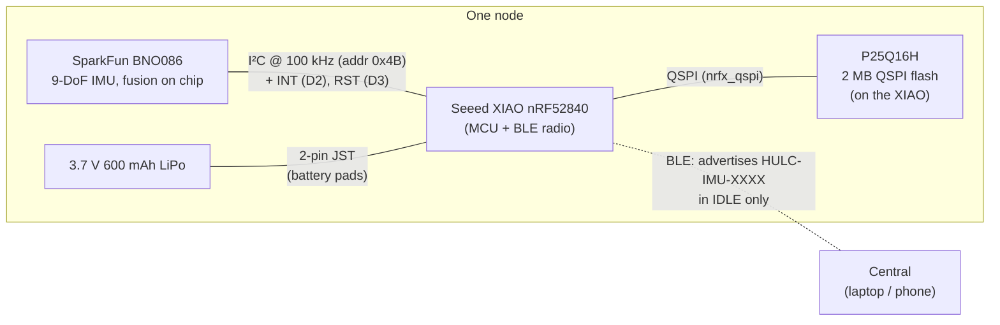
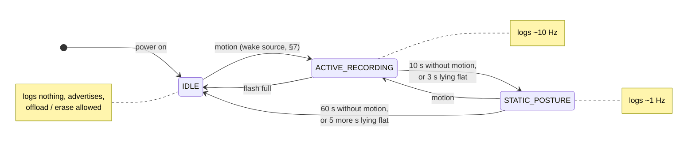
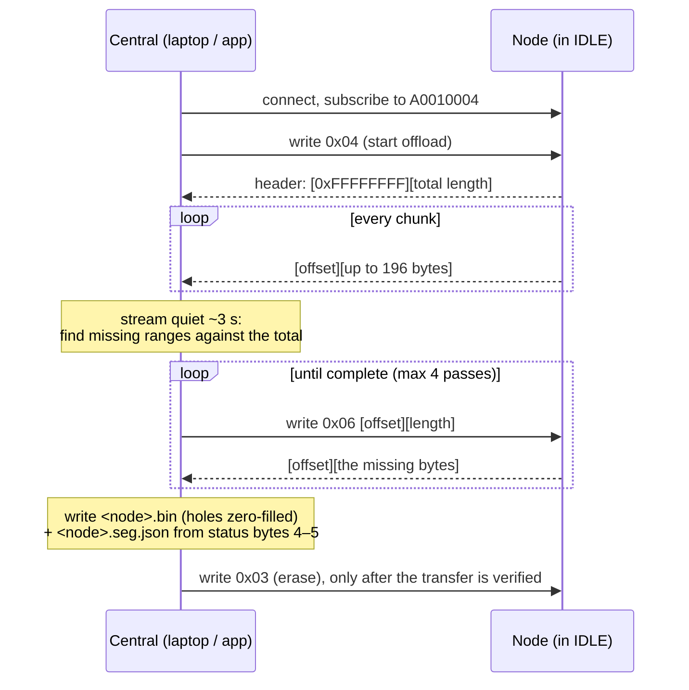

# Wearable — the nodes, their firmware, and talking to them

The hardware half of the project: what a node is made of, how to build and
flash it, how it behaves, the BLE protocol a central (the laptop today, the
mobile app later) uses to get data off it, and the power, wake-source and
time-alignment decisions behind the firmware. The firmware is the source of
truth: `firmware/firmware.ino` (its header comment, its numbered SECTIONs and
`handleControl()`); the working reference central is `tools/multinode_test.py`
(Python, `bleak`), behind `hulc-ms nodes`.

1. [Hardware](#1-hardware)
2. [Building and flashing](#2-building-and-flashing)
3. [How a node behaves](#3-how-a-node-behaves)
4. [BLE protocol — talking to a node](#4-ble-protocol--talking-to-a-node)
5. [The flash log](#5-the-flash-log)
6. [Multi-node time alignment](#6-multi-node-time-alignment)
7. [IDLE wake source and the ~6.5 s IDLE reset](#7-idle-wake-source-and-the-65-s-idle-reset)
8. [Power](#8-power)
9. [Bench testing](#9-bench-testing)

---

## 1. Hardware

Each node is a:

- **Seeed XIAO nRF52840** (BLE MCU; also charges the battery from its USB-C port)
- **SparkFun BNO086** 9-DoF IMU over I²C (100 kHz: this board's I²C is
  unstable at 400 kHz) — its fused, magnetometer-referenced Rotation Vector
  gives every node a quaternion in a **shared world frame** (gravity +
  magnetic north)
- **External 2 MB QSPI flash** (P25Q16H) for an append-only log — driven
  directly via `nrfx_qspi`, so the bootloader on internal flash is never at risk
- **3.7 V 600 mAh LiPo** battery
- a **3-D printed case** (tray + lid): `hardware/HULC_MS_Wearable_Case.stl`



A "motion shirt" is several such nodes, one per body segment (e.g. torso,
upper arm, forearm). Each advertises a unique BLE name `HULC-IMU-XXXX` (last 4
hex of its MAC), so boards never collide and need no per-board reflash.

**On every deployed node, cut the LED jumpers.** The BNO086 breakout's red LED
and the XIAO's power LED are wired to the 3.3 V rail, not GPIOs, so firmware
can't turn them off; cutting each board's `LED` solder jumper (reversible)
saves ~1–3 mA each, 24/7.

### 1.1 What a node looks like


**The board stack.** The XIAO sits directly on top of the SparkFun BNO086
(Qwiic) breakout. Four short hook-up wires carry the I²C bus (SDA, SCL) and
the IMU's interrupt and reset lines (INT → D2, RST → D3, as set in
`firmware.ino` Section 2); a red/black pair runs from the breakout's 3V3/GND
pads to the XIAO. The white 2-pin JST connector on the XIAO's battery pads
takes the battery lead. When you build a new node, check each wire against
the pin labels printed on both boards; wire colours are not standardized
between nodes.


**The case and battery.** The 3.7 V 600 mAh LiPo lies flat in the back
compartment of the printed tray, its lead running round the side to the JST
plug. The front well holds the board stack. The cut-out in the side wall lines
up with the XIAO's USB-C port, which is how a node is charged and flashed
without opening the case. The blue tape is the label written at enroll (the
node's `HULC-IMU-XXXX` suffix), so a node can be identified without
connecting to it.


**Assembled.** The board stack drops into the front well with the USB-C port
in the side cut-out, and the battery plugs into the JST connector; the lid
then closes over both. The node's orientation in the case is fixed by the
cut-out, which is what makes "same node, same way round" repeatable when it
is strapped on ([`RECORDING.md`, Where on each segment](RECORDING.md#where-on-each-segment)).

### 1.2 The case


`hardware/HULC_MS_Wearable_Case.stl` holds both printed parts, laid out flat
for printing: the **tray** (battery compartment, board well, USB-C cut-out)
and the **lid**. About 48 mm wide; the tray is ~17 mm tall (model units,
assumed mm).
**`TODO(handoff)`:** printer, material and settings (layer height, infill,
supports), and how the lid is held shut (friction fit, glue or tape).

## 2. Building and flashing

Arduino IDE (or `arduino-cli`) with the **Seeed nRF52 mbed-enabled** board
package. Libraries: **ArduinoBLE** and the **SparkFun BNO08x Arduino Library**
(`nrfx_qspi` ships with the core — nothing to install). Select the XIAO
nRF52840 board and flash `firmware/firmware.ino`. Every board gets the same
build; each derives its own name from its MAC.

Compile-time switches worth knowing (all near the top of `firmware.ino`):

| Switch | Section | Default | What it does |
|---|---|---|---|
| `IDLE_WAKE_SOURCE` | 3 | `IDLE_WAKE_DETECTOR` | which BNO sensor wakes IDLE (§7) |
| `ACTIVE_FUSION_SOURCE` | 3b | `ACTIVE_FUSION_RV` | Rotation Vector, or the 6-axis Game Rotation Vector (§8) |
| `DEFAULT_ACTIVE_HZ` | 4 | 10 | ACTIVE log rate |
| `NOT_MOTION_TO_STATIC_MS` / `NOT_MOTION_TO_IDLE_MS` | 5 | 10 s / 60 s | state timeouts (§3) |
| `DEBUG_SERIAL` | 9 | 1 | serial logging (turn off for a deployed build, §8) |

`firmware/state_machine_test/state_machine_test.ino` is a stripped-down
harness (state machine only, no BLE or flash) used for the IDLE-reset
investigation in §7; it is not part of the product.

## 3. How a node behaves

An adaptive-power state machine that records autonomously, with no central
connected:

- **`ACTIVE_RECORDING`** — moving: logs the quaternion at ~10 Hz (exactly
  `activeHz`, on scheduled slots).
- **`STATIC_POSTURE`** — after 10 s still: logs ~1 Hz.
- **`IDLE`** — after 60 s still, or ~8 s lying flat (ON_TABLE: 3 s → STATIC,
  then 5 s → IDLE): logs nothing, sleeps between IMU interrupts, advertises.
  **Offload works only in IDLE**, so the laptop is disconnected while
  recording and connects afterwards.
- **Flash watermark** — past 80% full the node halves its ACTIVE rate
  (10 → 5 → 2 Hz). At 10 Hz that is after ~2.3 h of ACTIVE recording; it stops
  at ~2.6 h. Battery runs out first: plan blocks by battery, never past ~90 min.



How these timings shape the recording protocol is in
[`RECORDING.md` §2](RECORDING.md#2-timings-and-the-settings-behind-them).

## 4. BLE protocol — talking to a node

What a central needs to enroll a node, get its log off, and write it as a
capture folder ([`ANALYSIS.md` §3](ANALYSIS.md#3-the-capture-folder-data-format)).
Reference functions in `tools/multinode_test.py` are named per step.

### 4.1 Finding a node

- Each node advertises as **`HULC-IMU-XXXX`**, the last 4 hex digits of its BLE
  MAC: unique and stable per board. This is the `node_id` of the capture format.
- It advertises **only in IDLE** (once per second), and stops while a central is
  connected. Recording happens with no central connected.
- Reference: `scan()`, `connect_with_retry()`.

### 4.2 GATT

Service `A0010000-B0CE-4A4A-8F0B-0011223344FF`; the characteristics share its
suffix:

| UUID | Name | Access | Size | Use |
|---|---|---|---|---|
| `A0010001-…` | Quaternion stream | NOTIFY | 20 B | debug only (a live record, when streaming is on) |
| `A0010002-…` | Control | WRITE | ≤ 9 B | commands, below |
| `A0010003-…` | Status | READ | 6 B | state, log size, segment |
| `A0010004-…` | Log offload | NOTIFY | ≤ 200 B | the log, framed (below) |
| `A0010005-…` | Time Info | READ | 16 B | clock-offset measurement (optional) |

**Status (A0010003), 6 bytes**

| Byte | Field |
|---|---|
| 0 | state: 0 IDLE, 1 STATIC_POSTURE, 2 ACTIVE_RECORDING |
| 1 | flags: bit 0 streaming, bit 1 time-synced |
| 2–3 | log size in KB (`uint16` LE) |
| 4 | segment config tag: `0x01` when byte 5 is a valid assignment |
| 5 | segment code (0 torso … 6 hand_r, `0xFF` unassigned; the table in [`ANALYSIS.md` §3.3](ANALYSIS.md#33-the-header-segjson)) |

Reference: `read_status()`, `_read_segment()`.

**Time Info (A0010005), 16 bytes, little-endian**

| Bytes | Field |
|---|---|
| 0–3 | node `millis()` now |
| 4–11 | sync epoch in ms (`uint64`, 0 if never synced) |
| 12–15 | node `millis()` at the last sync |

A central computes a node's epoch now as
`sync_epoch_ms + (node_millis_now − sync_millis)`, and two nodes' difference
is their clock offset. Not needed for the analysis (it aligns the clocks from
the motion, §6); useful to check a link. Reference: `read_syncinfo()`,
`report_offsets()`.

**Control (A0010002)**

| Command | Payload | Does | When |
|---|---|---|---|
| `0x00` / `0x01` | — | stop / start the debug quaternion stream | any time |
| `0x02` | `uint32` LE Unix seconds | time sync (seconds, legacy) | any time |
| `0x05` | `uint64` LE Unix ms | time sync (ms) | any time |
| `0x03` | — | erase the log (whole chip, verified blank; ~30 s) | after a verified offload |
| `0x04` | — | start the offload over A0010004 | **IDLE only** (ignored otherwise) |
| `0x06` | `uint32` LE offset, `uint32` LE length | re-send that byte range of the log | **IDLE only** |
| `0x07` | `uint8` segment code 0–6 | store this node's segment in its flash header (survives power cycles and erases) | enroll |

The command byte comes first, e.g. `[0x06, off0, off1, off2, off3, len0, len1, len2, len3]`.

### 4.3 Getting the log off (offload)



1. Connect to a node in IDLE (status byte 0 = 0). Subscribe to A0010004.
   The node requests a 15–30 ms connection interval (§6).
2. Write `0x04`. The node first sends a **header notification**:
   `[0xFFFFFFFF (uint32 LE)][total length (uint32 LE)]` — the exact byte count
   of the log.
3. Then **data notifications**: `[offset (uint32 LE)][up to 196 bytes]`, the
   offset being where the payload sits in the log. Place each payload at its
   offset.
4. Notifications are unacknowledged and some get dropped. When the stream goes
   quiet (~3 s), compute the **missing ranges** against the total and request
   each with `0x06`; repeat until complete (the laptop tries up to 4 passes,
   `OFFLOAD_MAX_ATTEMPTS`). Reference: `measure_offload()`, `_offload_pass()`,
   `_missing_ranges()`.
5. Write the bytes as the node's `.bin`, unchanged; any range still missing
   stays **zero-filled** at its offset (never close the gap). Read the status
   bytes 4–5 and write the `.seg.json` header next to it (`node_id`,
   `segment`, `code`). Together these make the capture folder.
6. Only after the transfer is verified complete (bytes received = total), and
   preferably after the folder has been checked (`hulc-ms validate`), write
   `0x03` to erase. The node keeps the log until then, so a failed transfer can
   simply be repeated.

**Why the framing.** Before it, each 200-byte notification carried 10 records
back to back, and a dropped notification silently collapsed 10 records out of
the middle of the file — showing up downstream as ~1.2 s gaps with clean data
on both sides. With offsets, a drop leaves a locatable hole. Two more pieces
make recovery work: the firmware **backpressures** (when the BLE TX buffer is
full, `writeValue()` fails and the same notification is retried instead of
skipped — without this the sender alone dropped ~45%), and recovery uses
**small range re-requests** rather than a whole re-offload, which recreates the
same burst and tends to drop the same chunk again.

Reading the laptop's output: `pass 1 (full): 3528/5300 bytes, 5 hole(s)` (drops
located) → `pass 2: re-requesting 5 range(s)...` → `COMPLETE — saved N bytes`.
`[!] INCOMPLETE after 4 attempts` saves the file zero-filled and lists the
missing offsets; re-run `offload` to fill them (the log is still on the node).

### 4.4 Enrolling a node (once per board)

Power on one node at a time, connect, write `[0x07, code]` for its segment, and
read the status back to confirm (bytes 4–5). The assignment stays on the node,
so every later offload can write the `.seg.json` from the node itself.
Reference: `enroll()`, `set_segment()`, `read_segments()`. The operator steps
are in [`RECORDING.md` §4](RECORDING.md#4-setting-up-the-nodes).

### 4.5 Things a central must not do

- Offload or erase while the node is recording: offload is refused outside
  IDLE; an erase loses whatever was not yet offloaded.
- Erase before the offload is verified.
- Re-number segment codes: they are stored on deployed nodes.

## 5. The flash log

```
 0x000000 ┌──────────────────────────── 4 KB header sector ─────────────────────────────┐
          │ bytes 0–3 magic 0xC0DE0001 · 4–7 write pointer · 8 segment tag · 9 segment code │
 0x001000 ├──────────────────────────────────────────────────────────────────────────────┤
          │ record 0: t_ms (uint32) · qw qx qy qz (4 × float32)          = 20 bytes        │
          │ record 1 …                                                                     │
          │ … append-only; past 80 % the ACTIVE rate is halved (watermark)                 │
          │ … logging stops 200 KB before the end                                          │
 0x200000 └──────────────────────────────────────────────────────────────────────────────┘
```

- A 4 KB header sector followed by 20-byte records, append-only; offload
  sends everything after the header (record layout:
  [`ANALYSIS.md` §3.2](ANALYSIS.md#32-the-log-bin)).
- The header (with the write pointer) is re-saved every `FSYNC_EVERY` (10)
  samples — a 4 KB sector erase + write + readback, ~1 s at 10 Hz — so a power
  cut loses at most ~1 s of samples.
- **Erase between blocks.** The write pointer persists across reboots, so a
  node power-cycled without erasing *appends* the next recording, and since
  `millis()` restarts at 0 the log holds two sessions with a backward time
  jump. The analysis keeps the longest monotonic part and warns
  (`clock restart` / `non-monotonic`), but stale data accumulates. Use
  `hulc-ms nodes erase` before a block, or `offload --erase-after` (each node
  wiped only after its offload verifies `COMPLETE`).
- `eraseLog()` erases the whole chip in 64 KB blocks and **verifies the data
  region reads back blank before resetting the write pointer**, so a silently
  failed erase leaves the log intact at its real size rather than reporting
  `log=0KB`.

## 6. Multi-node time alignment

**Requirements:** every node records the movement and the samples can be
aligned afterwards; the logs can be moved off the nodes to free flash.
**Constraints (decided):** no wire between nodes (BLE only); analysis is
**offline** after collection; quaternions at ~10 Hz, so the alignment target
is **25–50 ms** (a fraction of a sample), not single-digit ms.

**The key reframe.** Because analysis is offline, BLE latency **does not touch
the data path** — nodes never stream live. Each sample carries the node's
`millis()`; the clocks are aligned afterwards. The production method is
**cross-correlating the nodes' motion** around the sync movement every block
starts with (`tools/reconcile_nodes.py`; the math, its confidence measure and
its limits are in [`METHODS.md` Part A](METHODS.md#part-a--clock-alignment)).
It is immune to BLE latency, and its synthetic selftest recovers a known
offset to ~15–18 ms. It needs **shared motion** — two limbs moving
independently share nothing to lock onto — which is why every block starts
with a sync movement that moves every node. The BLE time sync (`0x05`, A005)
remains for link checks.

**The BLE connection interval is the crux** for offload speed. Measured: the
bottleneck was the **central**, not the firmware — a Windows desktop `bleak`
central imposes slow intervals (~850 ms per read; a full flash would take
hours), while an **iPhone offloaded a 48 KB log in 2.46 s (~20 KB/s,
~10 ms/chunk)**, i.e. a full 2 MB flash in ~1.7 min. The firmware requests
**15–30 ms** (`setConnectionInterval(12, 24)`); 15 ms is the floor because
Apple requires Interval Min ≥ 15 ms or iOS falls back to its slow default.
**The product's central should be iOS, Android or Linux (BlueZ), not a Windows
desktop.**

**Coordinated trigger — decided against.** Each node runs its own motion
detector, so a low-motion segment (e.g. the torso) could stay IDLE and miss an
event. A shared "any node moves → everyone records" trigger with a pre-roll
buffer was proposed; after discussion with the PIs it was not built: the
node's own idle behaviour is sufficient for the project, and the trigger would
cost design flexibility, battery and flash. (The STATIC timeout and the
recording protocol's "never still for a minute" rule cover the torso case.)

Open questions here (iOS sync-read latency, offload pacing, whether 10 Hz is
enough) are in [`HANDOFF.md`](../HANDOFF.md#open-work).

## 7. IDLE wake source and the ~6.5 s IDLE reset

### 7.1 The switch

`firmware.ino`, Section 3:

```c
#define IDLE_WAKE_SOURCE   IDLE_WAKE_DETECTOR   // DETECTOR | CLASSIFIER | SIGMOTION
```

| | `IDLE_WAKE_DETECTOR` (default) | `IDLE_WAKE_CLASSIFIER` | `IDLE_WAKE_SIGMOTION` |
|---|---|---|---|
| Sensor | Stability Detector `0x1C` | Stability Classifier `0x13` | Significant Motion `0x12` |
| Sensing | accelerometer only (on-change) | accel + gyro (MotionEngine) | accelerometer only (one-shot) |
| Idle reset | ~6.7 s (inherent, benign) | **none** | **none** |
| Idle current | ~8.8 mA | higher (gyro running) | **~7.4 mA** (lowest) |
| Slow-motion sensitivity | good | good | **poor** — misses slow held-limb motion |

**Recommendation (current default):** the **detector** for on-body capture —
the only source that reliably wakes on slow, deliberate motion. **SIGMOTION**
only for off-body standby. The **classifier** if a reset-free idle ever matters
more than current. Keep the `i2cBusRecover()` insurance in `setup()` in every
case.

**devSleep was explored and dropped.** With the hub's own devSleep the
detector's wake event was coalesced or rarely delivered, so shaking failed to
wake IDLE → ACTIVE. Every wake source runs the hub awake; going lower needs a
hardware wake (§8.2).

**To A/B them:** build each value, exercise on the bench with Serial open
(test slow motions, not just shakes), and watch for the `DETECTOR: 0x1C val=` /
`CLASSIFIER: MOTION` / `SIGMOTION:` lines and the IDLE → ACTIVE transition.
`handleIdle()` logs each self-reset as
`IDLE: BNO reset — <ms> since last reset`; with the classifier or SIGMOTION
that line never prints, which *is* the result.

### 7.2 The ~6.5 s IDLE reset (known quirk, understood, harmless)

In IDLE with the detector, the BNO086 **reboots itself every ~6.5 s**. Found
with the `state_machine_test` harness, one change at a time:

| Tried | Result | Rules out |
|---|---|---|
| devSleep off (fully awake) | still ~6.5 s | sleep |
| report interval 50 ms → 5 s | still ~6.5 s (worse when slow) | report rate |
| constant polling vs sleeping | identical | a slow host |
| plain accelerometer instead of detector | still ~6.5 s | misuse of the detector |
| I²C at 400 kHz | reset every ~130 ms + corruption | (board unstable at 400 kHz; stay at 100 kHz) |
| **Rotation Vector instead** | **no reset**, 300+ reports | **the cause is non-fusion sensors** |

**Explanation:** accelerometer-only sensors (detector, raw accel) leave the hub
in a low-activity state that self-restarts; anything that runs the fusion
engine (classifier, Rotation Vector) keeps it active and does not. That is why
almost nobody else reports it — most projects stream a fused output
continuously. The datasheet's "host too slow" watchdog applies to the older
BNO080, not the 085/086.

**Why it doesn't matter:** IDLE logs nothing and the firmware re-arms
automatically; ACTIVE streams the Rotation Vector and never resets. It is the
price of the low-power wake sensor. **The one real risk:** a reset landing
mid-I²C transaction could hold SDA low and freeze the node until a power
cycle — never observed, insured against by `i2cBusRecover()`.

*A lesson from the investigation:* a probe reading the "reset cause" on every
restart reported "External Reset", but the probe itself was causing those
resets (the driver hard-resets the chip when its SHTP traffic gets confused).
It was removed — and it showed why the bus-recovery routine is worth keeping.

### 7.3 Not done: tuning SIGMOTION

SIGMOTION has a threshold (FRS record `SIG_MOTION_DETECT_CONFIG`, `0xC274`:
acceleration threshold + window), but the SparkFun library exposes no
FRS-write path. Making it work would need: the exact record layout from the
SH-2 Reference Manual, an FRS-write path (extend the library or use CEVA's
`sh2_setFrs()`), and a bench sweep against real slow held-limb motion vs false
wakes. Even then, an energy-over-a-window detector may still miss slow
stretches.

## 8. Power

**Measured now:** ~8.8 mA IDLE (detector), ~20–21 mA ACTIVE recording (full
fusion). Before the optimization work: ~12 mA / ~22 mA. Battery life on the
current firmware has **not** been bench-measured yet (open item).

### 8.1 Landed

None of these change the recorded data format or the state logic; each is
commented at its site in `firmware.ino`.

1. **DC/DC regulator** (`NRF_POWER->DCDCEN = 1`): more efficient than the LDO
   in every state.
2. **Cheap, IDLE-only advertising:** ~1 s interval (`ADV_INTERVAL_UNITS`), and
   no advertising while recording (offload is IDLE-only anyway).
3. **BNO report rate matched to the log rate** (Rotation Vector at 100 ms
   instead of 65 ms): no fused samples computed only to be discarded.
4. **Game Rotation Vector switch** (`ACTIVE_FUSION_SOURCE`, default RV):
   6-axis, no magnetometer, immune to magnetic interference but with slow yaw
   drift. **Measured: no meaningful power saving**, so decide on data quality
   alone — switch only if captures show magnetometer-driven heading
   corruption. The GRV path has not been compile-checked against the installed
   library.
5. **QSPI flash deep power-down in IDLE** (`qspiSleep()`/`qspiWake()`): a tiny
   saving, kept for completeness. *Tried and removed:* also disabling the
   nRF QSPI peripheral made idle **worse** (~9 → ~11 mA) because of nRF52840
   Errata 122 — only revisit with Nordic's register workaround.
6. **STATIC arms the Rotation Vector at ~1 Hz** instead of 10 Hz
   (`BnoRunningCfg`: `BNO_CFG_ACTIVE` / `BNO_CFG_STATIC`); the classifier
   still drives every transition. ~4× fewer nRF wakes in STATIC. Only the
   fusion report is re-issued on an ACTIVE ↔ STATIC switch, to stay off the
   SparkFun premature-reset path (library issue #2).
7. **IDLE wake source** selectable (§7).
8. **Detector reported on change** (60 s keepalive instead of a ~1 Hz
   heartbeat): ~0.2 mA.
9. **STATIC logs every RV report (~1 Hz, was 0.2 Hz)** — for data quality: the
   torso is mostly STATIC during arm work and every shoulder angle is measured
   against it. Simulated (`tools/evaluation/timing_bench.py`): shoulder axial
   rotation 6.3° → 1.9° RMS, elevation 5.1° → 2.5°. Cost ~+14% of a torso
   node's log. Write energy not yet bench-measured.
10. **ACTIVE logs at exactly `activeHz`** (scheduled slots with period/4 slack,
    `ACTIVE_SAMPLE_SLACK_DIV`): the old gate logged 6.9–8.3 Hz when report
    timing didn't line up. This logs up to ~20–44% more ACTIVE records than
    older firmware did; if storage was sized on the observed rate, lower
    `DEFAULT_ACTIVE_HZ`. Not yet bench-measured on hardware.

### 8.2 Backlog — worth exploring

Roughly by payoff; each needs bench time or a design decision.

- **Reconfigure the BNO rate on watermark throttle.** When flash fills,
  `writeQuaternionSample()` halves `activeHz` (10 → 5 → 2) but the BNO keeps
  emitting 10 Hz, so it saves flash but not power. Re-issue the fusion vector
  at the throttled rate through the same per-transition path as item 6 (mind
  the SparkFun issue #2 caution).
- **Sleep instead of spin while connected-idle.** In `waitForIMUData()` the
  BLE-connected branch busy-loops on `BLE.poll()` for up to 100 ms; a `__WFE()`
  between polls would let the core sleep. Relatedly, the fast connection
  interval is only needed during offload and could be relaxed otherwise.
- **Production build: drop USB/serial.** `DEBUG_SERIAL 1` keeps USB CDC (and
  HFCLK) alive, and the `Serial.print`/`Serial.begin` calls in the QSPI helpers
  and `setup()` are **not** behind the macro — gate those too.
- **fsync tuning.** `FSYNC_EVERY = 10` costs a sector erase + write + readback
  every ~1 s at 10 Hz; raising it trades a little data-at-risk on power loss
  for fewer power-hungry erases and less wear.
- **LEDs:** cut the jumpers (§1); in firmware, the blue "connected" LED is held
  on for the whole connection and could blink instead.
- **Below ~8.8 mA while keeping slow-motion wake needs hardware:** a separate
  low-power motion sensor whose interrupt wakes the nRF, which then powers the
  BNO. The remaining gap to SIGMOTION is the detector's self-reset, which no
  report-rate change affects.
- **QSPI peripheral disable** (item 5), only with the Errata 122 workaround —
  low priority, since idle is dominated by the BNO hub (~8 mA).

## 9. Bench testing

**Link check** (new rig or a flaky link): power the nodes, then

```bash
hulc-ms nodes check --count 2 --duration 30
```

It connects to every node, syncs each with `0x05`, then reads Time Info in a
round robin and reports the cross-node offset and drift. Every node should
read `synced=True` with a small, stable offset. `check --count 1` isolates a
single link's latency.

How to read it: the **read window** (round-trip of each A005 read) is the
measurement floor — the offset is only known to within it, so treat the
offset as an upper bound. A large or negative **drift** below that floor is a
measurement artifact (`NOT RESOLVABLE`), not physics: real nRF52840 crystal
drift is tens of ppm. This check validates connectivity and the sync path, not
ms-level alignment — the analysis does that from the motion (§6).

**Measuring offload speed on any central.** The firmware prints
`[OFFLOAD] Done` on its USB serial with throughput (KB/s) and **ms/chunk**;
one notification goes out per connection event, so ms/chunk ≈ the negotiated
connection interval. On an iPhone (nRF Connect for Mobile, which hides the
interval): enable notifications on A004, write `04` to A002, read the serial
monitor. On a Mac, `hulc-ms nodes offload --count 1` prints KB/s. Android's
nRF Connect shows the interval directly.

**Self-checks without hardware:** `python tools/reconcile_nodes.py --selftest`
(alignment math), `python tools/multinode_test.py selftest`, or
`hulc-ms selftest` for everything.

**Not yet validated:** a shared physical event (tap all nodes together) to
ground-truth the alignment on hardware, and the real ceiling on simultaneous
connections before scaling past two or three nodes.
